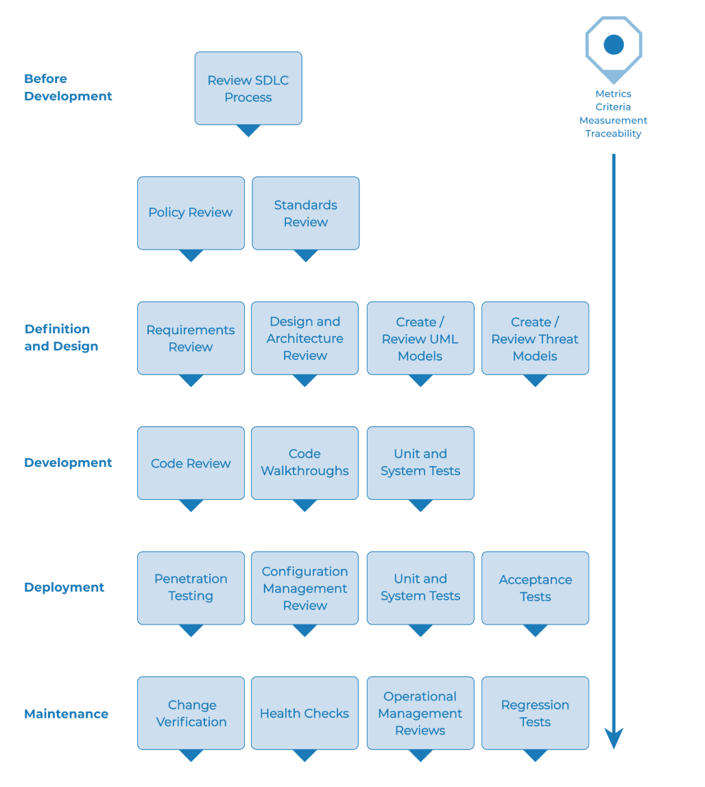

# El marco de pruebas de seguridad web

## Resumen

Esta sección describe un marco de pruebas típico que puede desarrollarse en una organización. Puede considerarse un marco de referencia compuesto por técnicas y tareas adecuadas para varias fases del ciclo de vida de desarrollo de software (SDLC). Las empresas y los equipos de proyecto pueden usar este modelo para desarrollar su propio marco de pruebas y definir el alcance de los servicios de pruebas que ofrecen los proveedores. Este marco no debe considerarse prescriptivo, sino un enfoque flexible que puede ampliarse y adaptarse al proceso y la cultura de desarrollo de una organización.

Esta sección busca ayudar a las organizaciones a crear un proceso estratégico de pruebas completo; no está dirigida a consultores o contratistas que suelen participar en áreas de pruebas más tácticas y específicas.

Es fundamental entender por qué crear un marco de pruebas de extremo a extremo es crucial para evaluar y mejorar la seguridad del software. En *Writing Secure Code*, Howard y LeBlanc señalan que emitir un boletín de seguridad le cuesta a Microsoft al menos $100,000, y que implementar los parches de seguridad les cuesta a sus clientes, en conjunto, mucho más que eso. También señalan que el sitio web [CyberCrime](https://www.justice.gov/criminal-ccips) del gobierno de EE. UU. detalla casos criminales recientes y las pérdidas para las organizaciones. Las pérdidas típicas superan los USD $100,000.

Con esta clase de costos, no es de extrañar que los proveedores de software pasen de realizar únicamente pruebas de seguridad de caja negra, que solo pueden llevarse a cabo en aplicaciones ya desarrolladas, a centrarse en las pruebas durante las primeras etapas del desarrollo de aplicaciones, como la definición, el diseño y el desarrollo.

Muchos profesionales de la seguridad todavía consideran que las pruebas de seguridad pertenecen al ámbito de las pruebas de penetración. Como se analizó en el capítulo anterior, aunque las pruebas de penetración cumplen una función, por lo general son ineficientes para encontrar errores y dependen demasiado de la habilidad del evaluador. Solo deberían considerarse una técnica de implementación o una forma de generar conciencia sobre los problemas en producción. Para mejorar la seguridad de las aplicaciones, es necesario mejorar la calidad de seguridad del software. Esto significa probar la seguridad durante las etapas de definición, diseño, desarrollo, despliegue y mantenimiento, en lugar de depender de la costosa estrategia de esperar hasta que el código esté completamente desarrollado.

Como se indicó en la introducción de este documento, existen muchas metodologías de desarrollo, como el Proceso Unificado de Rational, el desarrollo eXtreme y Agile, y las metodologías tradicionales en cascada. El propósito de esta guía no es sugerir una metodología de desarrollo en particular ni proporcionar orientación específica que se ajuste a una metodología determinada. En cambio, presentamos un modelo de desarrollo genérico, que el lector debe seguir de acuerdo con el proceso de su empresa.

Este marco de pruebas consta de actividades que deberían llevarse a cabo:

- Antes de que comience el desarrollo,
- Durante la definición y el diseño,
- Durante el desarrollo,
- Durante el despliegue, y
- Durante el mantenimiento y las operaciones.

## Fase 1 Antes de que comience el desarrollo

### Fase 1.1 Definir un SDLC

Antes de que comience el desarrollo de la aplicación, debe definirse un SDLC adecuado que incorpore la seguridad en cada etapa.

### Fase 1.2 Revisar las políticas y los estándares

Asegurarse de que existan las políticas, los estándares y la documentación adecuados. La documentación es sumamente importante, ya que proporciona a los equipos de desarrollo directrices y políticas que pueden seguir. Las personas solo pueden hacer lo correcto si saben qué es lo correcto.

Si la aplicación se desarrollará en Java, es esencial contar con un estándar de codificación segura para Java. Si la aplicación usará criptografía, es esencial contar con un estándar de criptografía. Ninguna política ni estándar puede abarcar todas las situaciones a las que se enfrentará el equipo de desarrollo. Al documentar los problemas comunes y previsibles, habrá menos decisiones que tomar durante el proceso de desarrollo.

### Fase 1.3 Desarrollar criterios de medición y métricas, y garantizar la trazabilidad

Antes de que comience el desarrollo, se debe planificar el programa de medición. Definir los criterios que deben medirse permite conocer los defectos tanto del proceso como del producto. Es esencial definir las métricas antes de que comience el desarrollo, ya que quizá sea necesario modificar el proceso para recopilar los datos.

## Fase 2 Durante la definición y el diseño

### Fase 2.1 Revisar los requisitos de seguridad

Los requisitos de seguridad definen cómo funciona una aplicación desde el punto de vista de la seguridad. Es esencial probar los requisitos de seguridad. En este caso, probar significa comprobar las suposiciones incluidas en los requisitos y determinar si hay lagunas en sus definiciones.

Por ejemplo, si un requisito de seguridad establece que los usuarios deben registrarse antes de acceder a la sección de documentos técnicos de un sitio web, ¿significa que el usuario debe estar registrado en el sistema o que debe autenticarse? Asegurarse de que los requisitos sean lo más inequívocos posible.

Al buscar lagunas en los requisitos, conviene considerar mecanismos de seguridad como:

- Gestión de usuarios
- Autenticación
- Autorización
- Confidencialidad de los datos
- Integridad
- Rendición de cuentas
- Gestión de sesiones
- Seguridad del transporte
- Segregación por niveles del sistema
- Cumplimiento de leyes y estándares (incluidos los de privacidad, gobierno e industria)

### Fase 2.2 Revisar el diseño y la arquitectura

Las aplicaciones deberían contar con documentación sobre su diseño y arquitectura. Esta documentación puede incluir modelos, documentos textuales y otros artefactos similares. Es esencial probar estos artefactos para garantizar que el diseño y la arquitectura implementen el nivel de seguridad adecuado, tal como se define en los requisitos.

Identificar fallas de seguridad durante la fase de diseño no solo es una de las formas más rentables de detectarlas, sino que también puede ser una de las oportunidades más eficaces para realizar cambios. Por ejemplo, si se determina que el diseño requiere tomar decisiones de autorización en varios lugares, podría ser conveniente considerar un componente de autorización centralizado. Si la aplicación valida datos en varios lugares, podría ser conveniente desarrollar un marco de validación centralizado (es decir, corregir la validación de entradas en un solo lugar, en vez de en cientos de lugares, es mucho menos costoso).

Si se descubren debilidades, deben comunicarse al arquitecto del sistema para que considere enfoques alternativos.

### Fase 2.3 Crear y revisar modelos UML

Una vez completados el diseño y la arquitectura, se deben crear modelos del Lenguaje Unificado de Modelado (UML) que describan cómo funciona la aplicación. En algunos casos, estos modelos ya estarán disponibles. Usar estos modelos para confirmar con los diseñadores de sistemas que se comprende exactamente cómo funciona la aplicación. Si se descubren debilidades, deben comunicarse al arquitecto del sistema para que considere enfoques alternativos.

### Fase 2.4 Crear y revisar modelos de amenazas

Con las revisiones del diseño y la arquitectura, y los modelos UML que explican exactamente cómo funciona el sistema, se debe realizar un ejercicio de modelado de amenazas. Desarrollar escenarios de amenazas realistas. Analizar el diseño y la arquitectura para garantizar que estas amenazas se hayan mitigado, que la empresa las haya aceptado o que se hayan asignado a un tercero, como una compañía de seguros. Si las amenazas identificadas no tienen estrategias de mitigación, se debe revisar el diseño y la arquitectura junto con el arquitecto del sistema para modificar el diseño.

## Fase 3 Durante el desarrollo

En teoría, el desarrollo consiste en implementar un diseño. Sin embargo, en el mundo real se toman muchas decisiones de diseño durante la programación. A menudo, se trata de decisiones menores que eran demasiado detalladas para incluirse en el diseño, o de cuestiones para las que no se proporcionó orientación en una política o un estándar. Si el diseño y la arquitectura no eran adecuados, el desarrollador deberá tomar muchas decisiones. Si las políticas y los estándares eran insuficientes, tendrá que tomar aún más decisiones.

### Fase 3.1 Recorrido por el código

El equipo de seguridad debería realizar un recorrido por el código junto con los desarrolladores y, en algunos casos, los arquitectos del sistema. Un recorrido por el código consiste en una revisión de alto nivel durante la cual los desarrolladores pueden explicar la lógica y el flujo del código implementado. Permite que el equipo de revisión de código obtenga una comprensión general del código y que los desarrolladores expliquen por qué ciertas partes se desarrollaron de determinada manera.

El propósito no es realizar una revisión de código, sino comprender, a alto nivel, el flujo, la disposición y la estructura del código que compone la aplicación.

### Fase 3.2 Revisiones de código

Con una buena comprensión de la estructura del código y de por qué ciertas partes se codificaron de determinada manera, el evaluador puede examinar el código real en busca de defectos de seguridad.

Las revisiones estáticas de código validan el código comparándolo con una serie de listas de verificación, entre ellas:

- Los requisitos de negocio relativos a la disponibilidad, la confidencialidad y la integridad;
- Las listas de verificación de la Guía OWASP o del Top 10 para detectar exposiciones técnicas (según el nivel de profundidad de la revisión);
- Las cuestiones específicas relacionadas con el lenguaje o el marco en uso, como la [hoja de referencia de configuración de PHP](https://cheatsheetseries.owasp.org/cheatsheets/PHP_Configuration_Cheat_Sheet.html) o las [directrices de codificación segura para .NET](https://learn.microsoft.com/en-us/dotnet/standard/security/secure-coding-guidelines); y
- Cualquier requisito específico de la industria, como Sarbanes-Oxley 404, COPPA, ISO/IEC 27002, APRA, HIPAA, las directrices de Visa Merchant u otros regímenes regulatorios.

En términos del rendimiento de los recursos invertidos (principalmente tiempo), las revisiones estáticas de código producen resultados de mucha más calidad que cualquier otro método de revisión de seguridad y dependen menos de la habilidad del revisor. Sin embargo, no son una solución mágica y deben considerarse cuidadosamente dentro de un régimen de pruebas integral.

Para obtener más detalles sobre las listas de verificación de OWASP, consulte la edición más reciente del [OWASP Top 10](https://owasp.org/www-project-top-ten/).

## Fase 4 Durante el despliegue

### Fase 4.1 Pruebas de penetración de aplicaciones

Tras probar los requisitos, analizar el diseño y revisar el código, podría suponerse que se han detectado todos los problemas. Ojalá sea así, pero probar la aplicación mediante pruebas de penetración después de su despliegue proporciona una comprobación adicional para garantizar que no se haya pasado nada por alto.

### Fase 4.2 Pruebas de gestión de la configuración

Las pruebas de penetración de la aplicación deberían incluir un examen de cómo se desplegó y protegió la infraestructura. Es importante revisar todos los aspectos de la configuración, por pequeños que sean, para garantizar que ninguno permanezca en una configuración predeterminada que pueda ser vulnerable a la explotación.

## Fase 5 Durante el mantenimiento y las operaciones

### Fase 5.1 Realizar revisiones de la gestión operativa

Debe existir un proceso que detalle cómo se gestionan los aspectos operativos tanto de la aplicación como de la infraestructura.

### Fase 5.2 Realizar comprobaciones periódicas del estado

Se deberían realizar comprobaciones mensuales o trimestrales del estado de la aplicación y la infraestructura para garantizar que no se hayan introducido nuevos riesgos de seguridad y que el nivel de seguridad siga intacto.

### Fase 5.3 Garantizar la verificación de los cambios

Después de aprobar y probar cada cambio en el entorno de QA y desplegarlo en el entorno de producción, es fundamental comprobar que el cambio no haya afectado el nivel de seguridad. Esto debería integrarse en el proceso de gestión de cambios.

## Flujo de trabajo típico de pruebas de SDLC

La siguiente figura muestra un flujo de trabajo típico de pruebas de SDLC.

\
 *Figura 3-1: Flujo de trabajo típico de pruebas de SDLC*