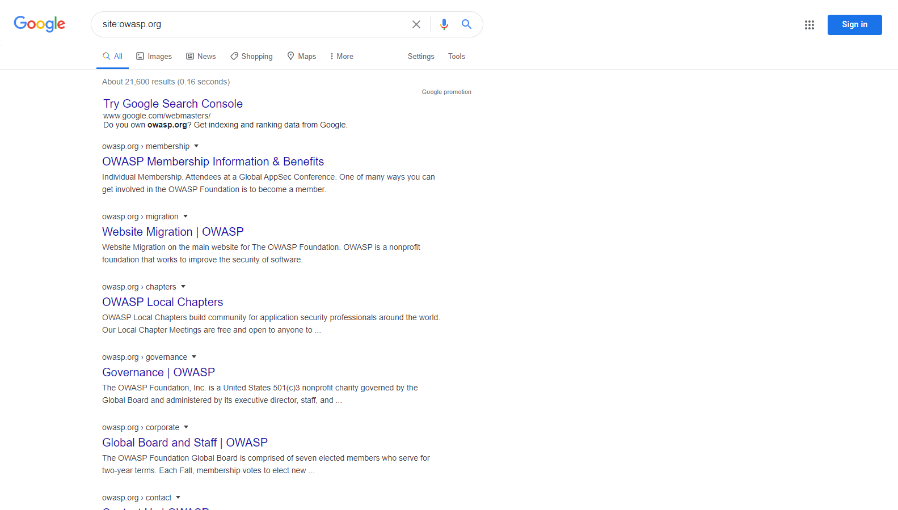

# Realizar reconocimiento de motores de búsqueda para detectar filtraciones de información

|ID          |
|------------|
|WSTG-INFO-01|

## Resumen

Para que los motores de búsqueda funcionen, los programas informáticos (o `robots`) obtienen regularmente datos de miles de millones de páginas de la web (proceso denominado [rastreo](https://en.wikipedia.org/wiki/Web_crawler)). Estos programas encuentran contenido y funcionalidades web siguiendo enlaces desde otras páginas o consultando mapas del sitio. Si un sitio utiliza un archivo especial llamado `robots.txt` para enumerar las páginas que no quiere que los motores de búsqueda rastreen, se ignorarán las páginas que figuren en él. Esta es una descripción general básica; Google ofrece una explicación más detallada de [cómo funciona un motor de búsqueda](https://support.google.com/webmasters/answer/70897?hl=en).

Los evaluadores pueden utilizar motores de búsqueda para realizar reconocimientos de sitios y aplicaciones web. Hay elementos directos e indirectos en el descubrimiento y reconocimiento mediante motores de búsqueda: los métodos directos se relacionan con la búsqueda en los índices y el contenido asociado de las cachés, mientras que los métodos indirectos se relacionan con la obtención de información sensible sobre diseño y configuración mediante búsquedas en foros, grupos de noticias y sitios de licitaciones.

Una vez que un robot de un motor de búsqueda termina de rastrear, comienza a indexar el contenido web según las etiquetas y los atributos asociados, como `<TITLE>`, para ofrecer resultados de búsqueda pertinentes. Si el archivo `robots.txt` no se actualiza durante la vida útil del sitio y no se han utilizado etiquetas meta HTML insertadas en línea para indicar a los robots que no indexen el contenido, es posible que los índices contengan contenido web que los propietarios no pretendían incluir. Los propietarios de sitios pueden utilizar el archivo `robots.txt` mencionado anteriormente, las etiquetas meta HTML, la autenticación y las herramientas que ofrecen los motores de búsqueda para eliminar dicho contenido.

## Objetivos de la prueba

- Identificar qué información sensible sobre el diseño y la configuración de la aplicación, el sistema o la organización está expuesta directamente (en el sitio de la organización) o indirectamente (a través de servicios de terceros).

## Cómo probar

Utilice un motor de búsqueda para buscar información potencialmente sensible. Esto puede incluir:

- diagramas y configuraciones de red;
- publicaciones y correos electrónicos archivados de administradores u otro personal clave;
- procedimientos de inicio de sesión y formatos de nombres de usuario;
- nombres de usuario, contraseñas y claves privadas;
- archivos de configuración de terceros o de servicios en la nube;
- contenido revelador de mensajes de error; y
- aplicaciones no públicas (versiones de desarrollo, prueba, pruebas de aceptación del usuario (UAT) y preproducción de sitios).

### Motores de búsqueda

No limite las pruebas a un solo proveedor de motores de búsqueda, ya que distintos motores pueden generar resultados diferentes. Los resultados pueden variar de varias maneras, según cuándo haya rastreado contenido el motor por última vez y el algoritmo que utilice para determinar qué páginas son pertinentes. Considere utilizar los siguientes motores de búsqueda (enumerados alfabéticamente):

- [Baidu](https://www.baidu.com/), el motor de búsqueda [más popular](https://en.wikipedia.org/wiki/Web_search_engine#Market_share) de China.
- [Bing](https://www.bing.com/), un motor de búsqueda propiedad de Microsoft y operado por esta empresa, y el segundo [más popular](https://en.wikipedia.org/wiki/Web_search_engine#Market_share) del mundo. Admite [palabras clave de búsqueda avanzada](https://help.bing.microsoft.com/#apex/18/en-US/10001/-1).
- [binsearch.info](https://binsearch.info/), un motor de búsqueda para grupos de noticias binarios de Usenet.
- [Common Crawl](https://commoncrawl.org/), «un repositorio abierto de datos de rastreo web al que cualquiera puede acceder y que puede analizar».
- [DuckDuckGo](https://duckduckgo.com/), un motor de búsqueda centrado en la privacidad que recopila resultados de muchas [fuentes](https://help.duckduckgo.com/results/sources/) diferentes. Admite [sintaxis de búsqueda](https://help.duckduckgo.com/duckduckgo-help-pages/results/syntax/).
- [Google](https://www.google.com/), que ofrece el motor de búsqueda [más popular](https://en.wikipedia.org/wiki/Web_search_engine#Market_share) del mundo y utiliza un sistema de clasificación para intentar ofrecer los resultados más pertinentes. Admite [operadores de búsqueda](https://support.google.com/websearch/answer/2466433).
- [Internet Archive Wayback Machine](https://archive.org/web/), «que crea una biblioteca digital de sitios de Internet y otros artefactos culturales en formato digital».
- [Censys](https://censys.com) es un motor de búsqueda centrado en la seguridad que indexa infraestructura conectada a Internet, incluidos servidores, certificados y servicios abiertos. Ofrece un nivel comunitario gratuito con créditos mensuales limitados y planes de pago para uso empresarial.
- [Shodan](https://www.shodan.io/), un servicio para buscar dispositivos y servicios conectados a Internet. Entre las opciones de uso hay un plan gratuito limitado y planes de suscripción de pago.

### Operadores de búsqueda

Un operador de búsqueda es una palabra clave o una sintaxis especial que amplía las capacidades de las consultas de búsqueda habituales y puede ayudar a obtener resultados más específicos. Por lo general, adopta la forma `operator:query`. Estos son algunos operadores de búsqueda que se admiten habitualmente:

- `site:` limita la búsqueda al dominio indicado.
- `inurl:` solo devuelve resultados que incluyen la palabra clave en la URL.
- `intitle:` solo devuelve resultados que contienen la palabra clave en el título de la página.
- `intext:` o `inbody:` solo busca la palabra clave en el cuerpo de las páginas.
- `filetype:` coincide únicamente con un tipo de archivo específico, es decir, `.png` o `.php`.

Por ejemplo, para encontrar el contenido web de owasp.org tal como lo indexa un motor de búsqueda habitual, se utiliza la siguiente sintaxis:

```text
site:owasp.org
```

\
*Figura 4.1.1-1: Ejemplo de resultado de búsqueda con el operador Site de Google*

#### Internet Archive Wayback Machine

[Internet Archive Wayback Machine](https://archive.org/web/) es la herramienta más completa para consultar capturas históricas de páginas web. Mantiene un extenso archivo de páginas web que se remonta a 1996.

Para ver versiones archivadas de un sitio, visite `https://web.archive.org/web/*/`
seguido de la URL objetivo:

```text
https://web.archive.org/web/*/owasp.org
```

Se mostrará una vista de calendario con todas las capturas disponibles del sitio a lo largo del tiempo.

#### Otros servicios de contenido en caché

Entre los servicios adicionales para consultar páginas web en caché o archivadas se incluyen:

- [archive.ph](https://archive.ph) (también conocido como archive.md): servicio de archivado a petición que crea capturas permanentes
- [CachedView](https://cachedview.com/): recopila páginas en caché de varias fuentes, incluidos datos históricos de Google Cache, Wayback Machine y otros

### Recopilación automatizada de URL de archivos históricos

Además de consultar la vista de calendario de Wayback Machine, los evaluadores suelen automatizar la recopilación de URL históricas. Estas URL suelen revelar endpoints olvidados, rutas antiguas de API, archivos de respaldo y parámetros que ya no están enlazados desde la aplicación activa.

- [gau](https://github.com/lc/gau): recopila URL conocidas de AlienVault OTX, Wayback Machine y Common Crawl.
- [waybackurls](https://github.com/tomnomnom/waybackurls): obtiene las URL de un dominio conocidas por Wayback Machine.
- [waymore](https://github.com/xnl-h4ck3r/waymore): amplía la cobertura a Wayback Machine, Common Crawl, AlienVault OTX, URLScan y VirusTotal, y también puede recuperar respuestas históricas.

Ejemplo de flujo de trabajo:

```bash
gau example.com --verbose --threads 8 | tee gau.txt
```

```text
WARN[0000] error reading config: Config file /Users/whoever/.gau.toml not found, using default config
INFO[0000] fetching example.com                          page=0 provider=wayback
INFO[0000] fetching example.com                          page=0 provider=urlscan
INFO[0000] fetching example.com                          page=0 provider=otx
https://code.example.com/team/content.git@
https://code.example.com/team/content.git
https://example.com/smoke-slug
https://example.com/pay
https://app.example.com
...
```

```bash
waybackurls example.com | tee wayback.txt
```

```text
https://example.com/
https://example.com/robots.txt
https://example.com/sitemap.xml
https://example.com/old-api/v1/users
https://backup.example.com/db.sql
...
```

```bash
waymore -i example.com -mode U -o waymore.txt
```

```text
waymore v0.10 by Xnl-h4ck3r
[+] Getting URLs from Wayback Machine, Common Crawl, AlienVault OTX, URLScan and VirusTotal
https://example.com/
https://example.com/careers
https://staging.example.com/login
https://example.com/backup.zip
...
```

[unfurl](https://github.com/tomnomnom/unfurl) es útil para extraer componentes (claves, rutas, dominios, etc.) de las listas extensas de URL que generan las herramientas anteriores.

```bash
# Expand and clean URLs (optional)
cat gau.txt wayback.txt waymore.txt | unfurl --unique keys | sort -u > urls.txt
```

```text
db.sql
login
old-api
robots.txt
sitemap.xml
...
```

La lista de URL resultante se puede filtrar por extensiones, parámetros o códigos de estado de interés y, posteriormente, utilizarse con herramientas de descubrimiento de contenido o análisis de vulnerabilidades. Valide siempre que los hosts y las rutas descubiertos sigan dentro del alcance autorizado.

### Google hacking o dorking

Las búsquedas con operadores pueden ser una técnica de descubrimiento muy eficaz cuando se combinan con la creatividad del evaluador. Los operadores pueden encadenarse para descubrir de manera eficaz tipos específicos de archivos e información sensibles. Esta técnica, denominada [Google hacking](https://en.wikipedia.org/wiki/Google_hacking) o dorking, también puede utilizarse con otros motores de búsqueda, siempre que admitan los operadores de búsqueda correspondientes.

Una base de datos de dorks, como [Google Hacking Database](https://www.exploit-db.com/google-hacking-database), es un recurso útil que puede ayudar a descubrir información específica.
Los generadores de consultas asistidos por IA, como [DorkGPT](https://www.dorkgpt.com), pueden convertir instrucciones en lenguaje natural a la sintaxis de dorks de Google, lo que reduce el trabajo manual necesario para crear operadores de búsqueda complejos.
Algunas categorías de dorks disponibles en esta base de datos incluyen:

- Puntos de entrada
- Archivos que contienen nombres de usuario
- Directorios sensibles
- Detección de servidores web
- Archivos vulnerables
- Servidores vulnerables
- Mensajes de error
- Archivos con información valiosa
- Archivos que contienen contraseñas
- Información sensible sobre compras en línea

## Herramientas de correlación OSINT

Además de los motores de búsqueda individuales, los evaluadores pueden utilizar marcos OSINT dedicados para correlacionar y visualizar las relaciones entre las entidades descubiertas:

[Maltego](https://maltego.com) es una plataforma de análisis de vínculos y OSINT estándar del sector que mapea las relaciones entre dominios, direcciones IP, direcciones de correo electrónico y organizaciones mediante transformaciones automatizadas de datos. Los evaluadores la utilizan para visualizar la superficie de ataque de una organización, partiendo de una entidad para descubrir infraestructura relacionada y puntos de datos asociados. Hay una Community Edition gratuita disponible para uso no comercial.

Entre las herramientas OSINT modernas adicionales que se utilizan habitualmente junto con el reconocimiento mediante motores de búsqueda se incluyen:

- [theHarvester](https://github.com/laramies/theHarvester): herramienta OSINT para recopilar correos electrónicos, subdominios y nombres.
- [Amass](https://github.com/owasp-amass/amass) (modo pasivo): mapeo detallado de la superficie de ataque y descubrimiento de activos.
- [subfinder](https://github.com/projectdiscovery/subfinder): herramienta rápida de enumeración pasiva de subdominios.

## Remediación

Considere cuidadosamente la sensibilidad de la información sobre diseño y configuración antes de publicarla en línea.

Revise periódicamente la sensibilidad de la información sobre diseño y configuración existente que esté publicada en línea.