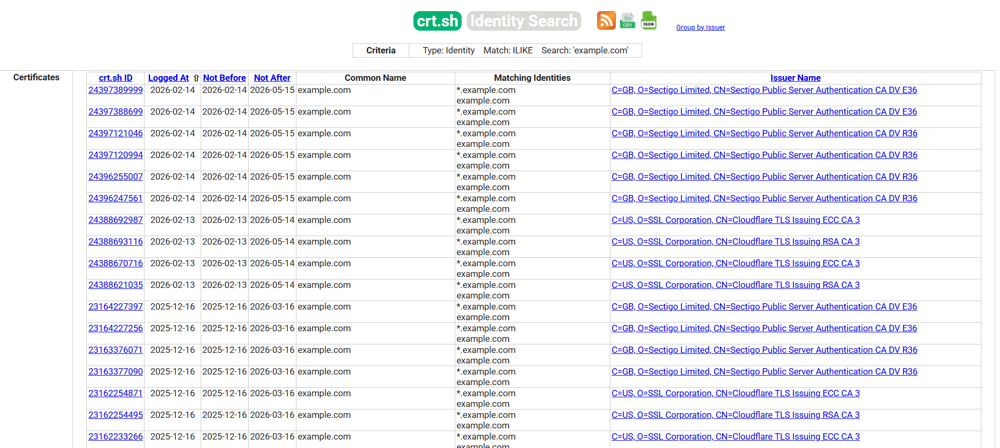

# Identificación de la superficie de ataque

|ID          |
|------------|
|WSTG-INFO-04|

## Resumen

Identificar la superficie de ataque de una aplicación web implica descubrir todas las aplicaciones, dominios, hosts virtuales y servicios expuestos externamente asociados con la infraestructura objetivo. Este proceso va más allá de identificar las aplicaciones alojadas e incluye la enumeración de DNS, el descubrimiento de subdominios, el análisis de hosts virtuales, los puertos no estándar y la revisión de certificados digitales y registros de Certificate Transparency.

Con la proliferación del alojamiento virtual y de la infraestructura compartida, la relación tradicional de 1:1 entre una dirección IP y un servidor web prácticamente ha desaparecido. Una sola dirección IP puede alojar varias aplicaciones en diferentes dominios, entornos o interfaces administrativas. No identificar estos activos puede dar lugar a evaluaciones incompletas y vulnerabilidades que pasen desapercibidas.

A veces, los profesionales de seguridad reciben un conjunto de direcciones IP como objetivo de prueba. Puede discutirse si este escenario se parece más a una evaluación de tipo prueba de penetración, pero, en cualquier caso, se espera que la asignación abarque todas las aplicaciones web accesibles a través de este objetivo. El problema es que la dirección IP proporcionada aloja un servicio HTTP en el puerto 80, pero, si un evaluador intenta acceder especificando la dirección IP (que es todo lo que conoce), recibe el mensaje «No web server configured at this address» o uno similar. Sin embargo, ese sistema podría «ocultar» varias aplicaciones web asociadas a nombres simbólicos (DNS) no relacionados. Obviamente, el alcance del análisis se ve profundamente afectado por el hecho de que el evaluador pruebe todas las aplicaciones o solo las que conoce.

A veces, la especificación del objetivo es más completa. El evaluador puede recibir una lista de direcciones IP y sus nombres simbólicos correspondientes. No obstante, esta lista podría contener información parcial; es decir, podría omitir algunos nombres simbólicos, y puede que el cliente ni siquiera lo sepa (esto es más probable en organizaciones grandes).

Otros problemas que afectan al alcance de la evaluación son las aplicaciones web publicadas en URL no evidentes (por ejemplo, `https://www.example.com/some-strange-URL`) que no se mencionan en ningún otro lugar. Esto puede ocurrir por error (debido a configuraciones incorrectas) o de forma intencional (por ejemplo, en el caso de interfaces administrativas que no se anuncian).

Para abordar estos problemas, debe llevarse a cabo un proceso integral de identificación de la superficie de ataque.

## Objetivos de la prueba

- Enumerar todas las aplicaciones web incluidas en el alcance.
- Identificar los nombres DNS, dominios y hosts virtuales asociados con el objetivo.
- Descubrir dominios y subdominios adicionales mediante técnicas DNS pasivas y activas.
- Analizar certificados digitales y registros de Certificate Transparency para encontrar nombres de host adicionales.

## Cómo realizar las pruebas

El descubrimiento de aplicaciones web es un proceso cuyo objetivo es identificar aplicaciones web en una infraestructura determinada. Esta suele especificarse como un conjunto de direcciones IP (quizá un bloque de red), pero también puede consistir en un conjunto de nombres simbólicos DNS o una combinación de ambos. Esta información se proporciona antes de ejecutar una evaluación, ya sea una prueba de penetración de estilo clásico o una evaluación centrada en la aplicación. En ambos casos, a menos que las reglas de la evaluación indiquen lo contrario (por ejemplo, probar solo la aplicación ubicada en la URL `https://www.example.com/`), la evaluación debería procurar abarcar el mayor alcance posible; es decir, debería identificar todas las aplicaciones accesibles a través del objetivo proporcionado. En los siguientes ejemplos se examinan algunas técnicas que pueden utilizarse para lograrlo.

> Algunas de las siguientes técnicas se aplican a servidores web expuestos a Internet, concretamente DNS, servicios web de búsqueda de IP inversa y el uso de motores de búsqueda. En los ejemplos se utilizan direcciones IP privadas (como `192.168.1.100`) que, salvo que se indique lo contrario, representan direcciones IP *genéricas* y se usan únicamente con fines de anonimato.

Hay tres factores que influyen en la cantidad de aplicaciones asociadas a un nombre DNS determinado (o a una dirección IP):

1. **URL base diferente**

    El punto de entrada evidente de una aplicación web es `www.example.com`; es decir, con esta notación abreviada, pensamos en la aplicación web como si se originara en `https://www.example.com/` (lo mismo se aplica a HTTPS). Sin embargo, aunque esta sea la situación más común, nada obliga a que la aplicación comience en `/`.

    Por ejemplo, el mismo nombre simbólico puede estar asociado a tres aplicaciones web, como en: `https://www.example.com/app1` `https://www.example.com/app2` `https://www.example.com/app3`

    En este caso, la URL `https://www.example.com/` no estaría asociada a una página significativa. Las tres aplicaciones permanecerían **ocultas** a menos que el evaluador supiera explícitamente cómo acceder a ellas; es decir, que conociera *app1*, *app2* o *app3*. Por lo general, no hay necesidad de publicar aplicaciones web de esta manera, salvo que el propietario no quiera que sean accesibles de una forma estándar y esté dispuesto a informar a los usuarios de su ubicación exacta. Esto no significa que estas aplicaciones sean secretas, sino que su existencia y ubicación no se anuncian de forma explícita.

2. **Puertos no estándar**

    Aunque las aplicaciones web suelen utilizar los puertos 80 (HTTP) y 443 (HTTPS), estos números de puerto no son fijos ni obligatorios. De hecho, las aplicaciones web pueden estar asociadas a puertos TCP arbitrarios y se puede hacer referencia a ellas especificando el número de puerto de la siguiente manera: `http[s]://www.example.com:port/`. Por ejemplo, `https://www.example.com:20000/`.

3. **Hosts virtuales**

    DNS permite asociar una sola dirección IP con uno o varios nombres simbólicos. Por ejemplo, la dirección IP `192.168.1.100` podría estar asociada a los nombres DNS `www.example.com`, `helpdesk.example.com`, `webmail.example.com`. No es necesario que todos los nombres pertenezcan al mismo dominio DNS. Esta relación de 1 a N puede reflejarse al servir contenido diferente mediante los llamados hosts virtuales. La información que especifica el host virtual al que nos referimos está incluida en el [encabezado Host](https://datatracker.ietf.org/doc/html/rfc7230#section-5.4) de HTTP 1.1.

    No se sospecharía que existen otras aplicaciones web además de la evidente `www.example.com`, a menos que se conozcan `helpdesk.example.com` y `webmail.example.com`.

### Enfoques para abordar el problema 1 - URL no estándar

No hay forma de determinar por completo la existencia de aplicaciones web con nombres no estándar. Al no ser estándar, no hay criterios fijos que rijan la convención de nomenclatura; sin embargo, el evaluador puede emplear varias técnicas para obtener información adicional.

En primer lugar, si el servidor web está mal configurado y permite la exploración de directorios, podría ser posible detectar estas aplicaciones. Los escáneres de vulnerabilidades pueden ayudar en este sentido.

En segundo lugar, es posible que otras páginas web hagan referencia a estas aplicaciones y que los motores de búsqueda web las hayan rastreado e indexado. Si los evaluadores sospechan que existen aplicaciones **ocultas** en `www.example.com`, pueden buscar usando el operador *site* y examinar los resultados de una consulta para `site: www.example.com`. Entre las URL devueltas podría haber una que apunte a una aplicación no evidente.

Otra opción es probar URL que podrían ser candidatas probables para aplicaciones no publicadas. Por ejemplo, podría accederse a una interfaz web de correo desde URL como `https://www.example.com/webmail`, `https://webmail.example.com/` o `https://mail.example.com/`. Lo mismo se aplica a las interfaces administrativas, que podrían publicarse en URL ocultas (por ejemplo, una interfaz administrativa de Tomcat) sin que se haga referencia a ellas en ningún lugar. Por tanto, una búsqueda tipo diccionario (o una «adivinación inteligente») podría dar resultados. Los escáneres de vulnerabilidades pueden ayudar en este sentido.

### Enfoques para abordar el problema 2 - Puertos no estándar

Es fácil comprobar si existen aplicaciones web en puertos no estándar. Un escáner de puertos como Nmap puede reconocer servicios mediante la opción `-sV` e identificar servicios http[s] en puertos arbitrarios. Para ello, es necesario realizar un análisis completo de todo el espacio de direcciones de los 64k puertos TCP.

Por ejemplo, el siguiente comando buscará todos los puertos abiertos en la IP `192.168.1.100` mediante un análisis TCP connect e intentará determinar qué servicios están asociados a ellos (solo se muestran las opciones *esenciales*; Nmap cuenta con un amplio conjunto de opciones cuya descripción queda fuera del alcance de este documento):

`nmap -Pn -sT -sV -p0-65535 192.168.1.100`

Basta con examinar la salida y buscar HTTP o indicios de servicios encapsulados en TLS (que deberían probarse para confirmar que son HTTPS). Por ejemplo, la salida del comando anterior podría ser similar a la siguiente:

```bash
Interesting ports on 192.168.1.100:
(The 65527 ports scanned but not shown below are in state: closed)
PORT      STATE SERVICE     VERSION
22/tcp    open  ssh         OpenSSH 3.5p1 (protocol 1.99)
80/tcp    open  http        Apache httpd 2.0.40 ((Red Hat Linux))
443/tcp   open  ssl         OpenSSL
901/tcp   open  http        Samba SWAT administration server
1241/tcp  open  ssl         Nessus security scanner
3690/tcp  open  unknown
8000/tcp  open  http-alt?
8080/tcp  open  http        Apache Tomcat/Coyote JSP engine 1.1
```

En este ejemplo se puede observar que:

- Hay un servidor HTTP Apache ejecutándose en el puerto 80.
- Parece haber un servidor HTTPS en el puerto 443 (pero esto debe confirmarse, por ejemplo, visitando `https://192.168.1.100` con un navegador).
- En el puerto 901 hay una interfaz web de administración Samba SWAT.
- El servicio del puerto 1241 no es HTTPS, sino el daemon Nessus encapsulado en TLS.
- En el puerto 3690 hay un servicio no especificado (Nmap devuelve su *fingerprint* —omitido aquí para mayor claridad— junto con instrucciones para enviarlo e incorporarlo a la base de datos de fingerprints de Nmap, siempre que se sepa qué servicio representa).
- Hay otro servicio no especificado en el puerto 8000; posiblemente sea HTTP, ya que no es raro encontrar servidores HTTP en este puerto. Examinemos este caso:

```bash
$ ncat 192.168.10.100 8000
GET / HTTP/1.0

HTTP/1.0 200 OK
pragma: no-cache
Content-Type: text/html
Server: MX4J-HTTPD/1.0
expires: now
Cache-Control: no-cache

<html>
...
```

Esto confirma que, en efecto, se trata de un servidor HTTP. También podrían haber visitado la URL con un navegador web o haber usado los comandos GET o HEAD de Perl, que imitan interacciones HTTP como la anterior (sin embargo, es posible que no todos los servidores acepten solicitudes HEAD).

- Apache Tomcat se ejecuta en el puerto 8080.

Los escáneres de vulnerabilidades también pueden realizar esta tarea, pero primero hay que comprobar que el escáner elegido pueda identificar servicios HTTP[S] en puertos no estándar. Por ejemplo, Nessus puede identificarlos en puertos arbitrarios (siempre que se le indique que analice todos los puertos) y, además de las funciones de Nmap, ejecutará varias pruebas para detectar vulnerabilidades conocidas de servidores web y analizar la configuración TLS/SSL de los servicios HTTPS. Como se mencionó antes, Nessus también puede detectar aplicaciones populares o interfaces web que, de otro modo, podrían pasar desapercibidas (por ejemplo, una interfaz administrativa de Tomcat).

Un análisis de Nmap de los 65535 puertos con detección de servicios puede tardar en completarse cuando se realiza en muchos hosts. [naabu](https://github.com/projectdiscovery/naabu) es un escáner de puertos rápido que permite identificar rápidamente puertos abiertos en una lista extensa de hosts y enviar directamente sus resultados a Nmap para detectar servicios solo en los puertos abiertos que haya encontrado:

```bash
naabu -p - -rate 2000 -c 50 -retries 2 -warm-up-time 1 -silent -host 192.168.1.100 -nmap-cli 'nmap -sV -oX scan.xml'
```

Esta combinación primero analiza todos los puertos con naabu y luego ejecuta el análisis más lento de detección de servicios de Nmap únicamente en los puertos que naabu haya encontrado abiertos, lo que reduce considerablemente el tiempo total del análisis.

### Enfoques para abordar el problema 3 - Hosts virtuales

Existen varias técnicas para identificar los nombres DNS asociados a una dirección IP determinada `x.y.z.t`.

#### Enumeración DNS

La enumeración DNS tiene como objetivo identificar dominios, subdominios y registros DNS relacionados con la organización objetivo para ampliar el alcance de la evaluación. Desempeña un papel clave en la identificación de hosts virtuales adicionales asociados a la misma dirección IP. Esto puede revelar sistemas de desarrollo, entornos de pruebas, servicios heredados o interfaces administrativas.

Se pueden utilizar tanto técnicas pasivas como activas.

#### Enumeración DNS pasiva

Las técnicas pasivas no interactúan directamente con la infraestructura objetivo; en su lugar, se basan en fuentes de datos disponibles públicamente. Algunos ejemplos son:

- Registros DNS públicos (A, AAAA, MX, TXT, NS)
- Consultas DNS inversas (registros PTR)
- Motores de búsqueda
- Bases de datos DNS pasivas
- Registros de Certificate Transparency

Se prefieren las técnicas pasivas durante las primeras fases del reconocimiento para evitar la detección.

[Chaos](https://chaos.projectdiscovery.io/) y su [chaos-client](https://github.com/projectdiscovery/chaos-client) permiten acceder a un conjunto de datos seleccionado de subdominios que ProjectDiscovery ya ha rastreado, procedentes principalmente de los alcances de programas públicos de recompensas por errores. Puede ser un complemento útil y rápido para la enumeración DNS pasiva en los dominios que ya ha indexado, pero requiere una clave API, solo abarca los dominios de su conjunto de datos y no debe considerarse un sustituto de herramientas activas como `subfinder` o `amass` para objetivos arbitrarios de una evaluación.

#### Enumeración DNS activa

Las técnicas activas consultan directamente la infraestructura DNS del objetivo y pueden generar registros en los sistemas objetivo. Entre ellas se incluyen:

- Fuerza bruta de subdominios
- Intentos de transferencia de zona DNS
- Enumeración de registros DNS mediante herramientas

Entre las herramientas habituales para la enumeración DNS se incluyen:

- `amass`
- `subfinder`
- `dnsrecon`
- `fierce`
- `dig`
- `nslookup`

Ejemplo con `dig`:

```bash
dig example.com ANY
```

```text
; <<>> DiG 9.10.6 <<>> example.com ANY
;; QUESTION SECTION:
;example.com.                  IN      ANY

;; ANSWER SECTION:
example.com.            86400   IN      A       93.184.216.34
example.com.            86400   IN      MX      10 mail.example.com.
example.com.            86400   IN      NS      ns1.secure.net.
example.com.            86400   IN      NS      ns2.secure.net.
example.com.            86400   IN      TXT     "v=spf1 -all"
```

Ejemplo con `subfinder`:

```bash
subfinder -d example.com -silent
```

```text
www.example.com
dev.example.com
staging.example.com
mail.example.com
api.example.com
```

#### Permutación de subdominios

Una vez recopilado un conjunto inicial de subdominios, las técnicas de permutación (o alteración) pueden generar candidatos adicionales combinando etiquetas conocidas con prefijos o sufijos comunes, o aplicando mutaciones (por ejemplo, `dev-` → `staging-`, insertar números, etc.). Para ello se suelen utilizar herramientas como [altdns](https://github.com/infosec-au/altdns), [dnsgen](https://github.com/ProjectAnte/dnsgen) o [gotator](https://github.com/Josue87/gotator). A continuación, se deben resolver los candidatos generados (`dnsx` / [MassDNS](https://github.com/blechschmidt/massdns)) y sondearlos (`httpx`).

MassDNS es un resolvedor DNS de alta velocidad, útil para resolver rápidamente las extensas listas de candidatos que producen las herramientas de permutación o la fuerza bruta basada en listas de palabras.

#### Transferencias de zona DNS

Hoy en día, esta técnica tiene un uso limitado, dado que los servidores DNS suelen rechazar las transferencias de zona. Sin embargo, todavía puede valer la pena intentarlo. En primer lugar, los evaluadores deben determinar los servidores de nombres que dan servicio a `x.y.z.t`. Si se conoce un nombre simbólico para `x.y.z.t` (por ejemplo, `www.example.com`), pueden determinarse sus servidores de nombres mediante herramientas como `nslookup`, `host` o `dig`, solicitando registros NS de DNS.

Si no se conocen nombres simbólicos para `x.y.z.t`, pero la definición del objetivo contiene al menos un nombre simbólico, los evaluadores pueden intentar aplicar el mismo proceso y consultar el servidor de nombres de ese nombre (con la esperanza de que ese servidor de nombres también dé servicio a `x.y.z.t`). Por ejemplo, si el objetivo consta de la dirección IP `x.y.z.t` y del nombre `mail.example.com`, se deben determinar los servidores de nombres del dominio `example.com`.

El siguiente ejemplo muestra cómo identificar los servidores de nombres de `www.owasp.org` mediante el comando `host`:

```bash
$ host -t ns www.owasp.org
www.owasp.org is an alias for owasp.org.
owasp.org name server ns1.secure.net.
owasp.org name server ns2.secure.net.
```

A continuación, se puede solicitar una transferencia de zona a los servidores de nombres del dominio `example.com`. Si el evaluador tiene suerte, recibirá como respuesta una lista de las entradas DNS de ese dominio. Esta incluirá el evidente `www.example.com` y los menos evidentes `helpdesk.example.com` y `webmail.example.com` (y posiblemente otros). Compruebe todos los nombres devueltos por la transferencia de zona y considere aquellos relacionados con el objetivo evaluado.

Intento de solicitar una transferencia de zona de `owasp.org` a uno de sus servidores de nombres:

```bash
$ host -l www.owasp.org ns1.secure.net
Using domain server:
Name: ns1.secure.net
Address: 192.220.124.10#53
Aliases:

Host www.owasp.org not found: 5(REFUSED)
; Transfer failed.
```

#### Consultas DNS inversas

Este proceso es similar al anterior, pero se basa en registros DNS inversos (PTR). En lugar de solicitar una transferencia de zona, intente establecer el tipo de registro en PTR y realizar una consulta para la dirección IP proporcionada. Si tienen suerte, los evaluadores recibirán como respuesta una entrada de nombre DNS. Esta técnica depende de que existan mapas de direcciones IP a nombres simbólicos, algo que no está garantizado.

#### Búsquedas DNS basadas en la web

Este tipo de búsqueda es similar a una transferencia de zona DNS, pero se basa en servicios web que permiten realizar búsquedas DNS por nombre. Uno de esos servicios es [Netcraft Search DNS](https://searchdns.netcraft.com/?host). El evaluador puede consultar una lista de nombres pertenecientes al dominio de su elección, como `example.com`. Después, comprobará si los nombres obtenidos son pertinentes para el objetivo que está examinando.

#### Servicios de IP inversa

Los servicios de IP inversa son similares a las consultas DNS inversas, con la diferencia de que los evaluadores consultan una aplicación web en lugar de un servidor de nombres. Hay varios servicios de este tipo disponibles. Como suelen devolver resultados parciales (y a menudo diferentes), es mejor utilizar varios servicios para obtener un análisis más completo.

- [MxToolbox Reverse IP](https://mxtoolbox.com/ReverseLookup.aspx)
- [DNSstuff](https://www.dnsstuff.com/) (hay varios servicios disponibles)

Los motores de búsqueda de activos en Internet, como [Shodan](https://www.shodan.io/), [Censys](https://censys.com) y [FOFA](https://fofa.info), indexan hosts y servicios conectados a Internet. También permiten realizar búsquedas por IP, certificado o contenido del banner para descubrir otros nombres de host y servicios alojados en la misma dirección. FOFA, en particular, ofrece una amplia cobertura de infraestructura en China y Asia-Pacífico, que puede complementar la cobertura de Shodan y Censys. Por ejemplo, se puede hacer una búsqueda de FOFA basada en IP: `ip="192.168.1.100"`, o buscar un título o encabezado específico: `title="Example App"`. Al igual que en los otros servicios de IP inversa mencionados, hay disponible un nivel gratuito con consultas limitadas, así como planes de pago para obtener un acceso más completo.

#### Búsquedas en Google

Tras recopilar información mediante las técnicas anteriores, los evaluadores pueden recurrir a los motores de búsqueda para afinar y ampliar su análisis. Esto puede aportar pruebas de la existencia de nombres simbólicos adicionales relacionados con el objetivo o de aplicaciones accesibles mediante URL no evidentes.

Por ejemplo, teniendo en cuenta el caso anterior de `www.owasp.org`, el evaluador podría consultar Google y otros motores de búsqueda para encontrar información (y, por tanto, nombres DNS) relacionada con los dominios recién descubiertos `webgoat.org`, `webscarab.com` y `webscarab.net`.

Las técnicas de búsqueda en Google se explican en [Pruebas: arañas, robots y rastreadores](01-Conduct_Search_Engine_Reconnaissance_for_Information_Leakage.md).

#### Certificados digitales

Si el servidor acepta conexiones HTTPS, el Common Name (CN) y el Subject Alternate Name (SAN) del certificado pueden contener uno o varios nombres de host. Sin embargo, si el servidor web no cuenta con un certificado de confianza o se utilizan comodines, es posible que no se obtenga información válida.

El CN y el SAN pueden obtenerse inspeccionando manualmente el certificado o mediante otras herramientas, como OpenSSL:

```sh
openssl s_client -connect 93.184.216.34:443 </dev/null 2>/dev/null | openssl x509 -noout -text | grep -E 'DNS:|Subject:'

Subject: C = US, ST = California, L = Los Angeles, O = Internet Corporation for Assigned Names and Numbers, CN = www.example.org
DNS:www.example.org, DNS:example.com, DNS:example.edu, DNS:example.net, DNS:example.org, DNS:www.example.com, DNS:www.example.edu, DNS:www.example.net
```

#### Registros de Certificate Transparency

Los registros de Certificate Transparency (CT) son registros de acceso público de los certificados TLS emitidos. Se pueden consultar para identificar nombres de host y subdominios asociados a una organización objetivo, incluidos sistemas de pruebas, interfaces administrativas, sistemas heredados u otros servicios accesibles externamente.

La revisión de los registros de CT puede revelar nombres de host que no se descubren directamente mediante transferencias de zona DNS, consultas inversas o búsquedas en motores de búsqueda por sí solas. Los evaluadores deben extraer los nombres de host descubiertos y validarlos mediante la resolución DNS para determinar si están activos y dentro del alcance definido de la evaluación.

Al revisar los datos de los registros de CT, tenga en cuenta lo siguiente:

- Nombres de host que indiquen entornos de desarrollo, pruebas o verificación.
- Interfaces administrativas o de gestión.
- Sistemas obsoletos o heredados que aún puedan ser accesibles.
- Certificados comodín que puedan indicar la existencia de subdominios adicionales aún no descubiertos.

La información obtenida de los registros de CT debe validarse para confirmar su titularidad y pertinencia antes de realizar pruebas adicionales.

Debe tenerse cuidado de respetar las limitaciones de alcance definidas para la evaluación.

Los activos descubiertos deben validarse y documentarse antes de realizar otras actividades de prueba.

Una forma habitual de consultar los registros de CT es utilizar portales de búsqueda de acceso público que agregan datos de certificados. Por ejemplo, el evaluador puede buscar certificados emitidos para `example.com` y revisar los subdominios enumerados.

Por ejemplo: `https://crt.sh/?q=%25.example.com`

> Nota: [crt.sh](https://crt.sh) puede sufrir períodos de interrupción del servicio o de alta latencia. [Merklemap](https://www.merklemap.com/) y [Cert Spotter de SSLMate](https://sslmate.com/certspotter/) son servicios alternativos de búsqueda de Certificate Transparency que conviene tener como respaldo.

  

*Figura 4.1.4-1: Ejemplo de resultados de búsqueda en registros de Certificate Transparency.*

Los resultados pueden incluir subdominios como `dev.example.com`, `staging.example.com` u otros nombres de host a los que no se haga referencia directa desde el sitio principal. Los nombres de host descubiertos deben validarse mediante resolución DNS antes de realizar pruebas adicionales.

### Ejemplo de flujo de trabajo moderno, de pasivo a activo

Una secuencia de herramientas ligera y habitual en las evaluaciones actuales:

```bash
# Passive subdomain discovery
subfinder -d example.com -silent | tee subs.txt
amass enum -passive -d example.com -o amass.txt

# Resolve and probe live hosts
cat subs.txt amass.txt | sort -u | dnsx -silent | httpx -silent -title -tech-detect -status-code -o live.txt

# Historical URLs (feed interesting hosts later)
cat live.txt | unfurl domains | sort -u | gau --subs | tee archive-urls.txt

# Screenshot live hosts for visual triage of a large host list
gowitness scan file -f live.txt
```

Cuando se descubre una gran cantidad de hosts, tomar una captura de pantalla de cada uno permite realizar un triaje visual rápido de los resultados; por ejemplo, para detectar páginas de inicio de sesión, paneles de administración, páginas de instalación predeterminadas o páginas de error sin visitar manualmente cada host. [gowitness](https://github.com/sensepost/gowitness) es una herramienta actual y en mantenimiento activo para este fin; `httpx` también admite una opción integrada `-screenshot` que permite hacer lo mismo sin añadir otra herramienta a la secuencia.

Respete siempre el alcance, los límites de velocidad y las reglas de la evaluación. Valide la titularidad de los activos recién descubiertos antes de realizar pruebas más profundas.

## Herramientas

- Herramientas de consulta DNS, como `nslookup`, `dig` y `host`
- Herramientas de enumeración de subdominios y mapeo de la superficie de ataque:
    - [Amass](https://github.com/owasp-amass/amass) (proyecto de OWASP: pasivo y activo, con salida en forma de grafo)
    - [subfinder](https://github.com/projectdiscovery/subfinder)
    - [Chaos](https://chaos.projectdiscovery.io/) / [chaos-client](https://github.com/projectdiscovery/chaos-client) (conjunto de datos seleccionado de subdominios; requiere una clave API)
    - [dnsx](https://github.com/projectdiscovery/dnsx)
    - [httpx](https://github.com/projectdiscovery/httpx) (sondeo de hosts activos, detección de tecnologías y títulos)
    - [gowitness](https://github.com/sensepost/gowitness) (capturas de pantalla para el triaje visual de hosts activos)
    - `dnsrecon`, `fierce`
- Permutación de subdominios: [altdns](https://github.com/infosec-au/altdns), [dnsgen](https://github.com/ProjectAnte/dnsgen), [gotator](https://github.com/Josue87/gotator)
- [MassDNS](https://github.com/blechschmidt/massdns) (resolvedor de alta velocidad para resultados de listas de palabras o herramientas de permutación)
- Motores de búsqueda (Google, Bing y otros motores de búsqueda importantes)
- Servicios de consulta de IP inversa
- Motores de búsqueda de activos en Internet: [Shodan](https://www.shodan.io/), [Censys](https://censys.com), [FOFA](https://fofa.info)
- Portales de búsqueda de Certificate Transparency: [crt.sh](https://crt.sh), [Merklemap](https://www.merklemap.com/), [Cert Spotter de SSLMate](https://sslmate.com/certspotter/)
- Herramientas de recopilación de URL históricas y de archivos: [gau](https://github.com/lc/gau), [waybackurls](https://github.com/tomnomnom/waybackurls), [waymore](https://github.com/xnl-h4ck3r/waymore)
- [Nmap](https://nmap.org/)
- [naabu](https://github.com/projectdiscovery/naabu) (análisis rápido de puertos; permite enviar resultados a Nmap)
- [Nessus Vulnerability Scanner](https://www.tenable.com/products/nessus)
- [Nikto](https://github.com/sullo/nikto)
- Descubrimiento de contenido y hosts virtuales: [ffuf](https://github.com/ffuf/ffuf), [feroxbuster](https://github.com/epi052/feroxbuster), [gobuster](https://github.com/OJ/gobuster)
- Análisis del código fuente para descubrir endpoints (evaluaciones de caja blanca o caja gris): [OWASP Noir](https://github.com/owasp-noir/noir), [OWASP Attack Surface Detector](https://owasp.org/projects/attack-surface-detector)