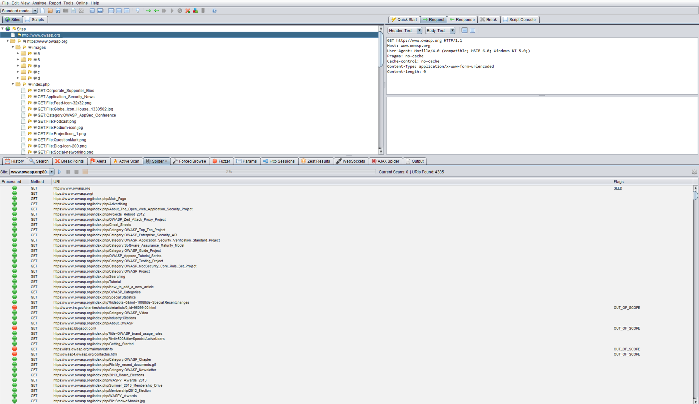

# Mapear las rutas de ejecución de la aplicación

|ID          |
|------------|
|WSTG-INFO-07|

## Resumen

Antes de comenzar las pruebas de seguridad, es primordial comprender la estructura de la aplicación. Sin un conocimiento exhaustivo de la organización de la aplicación, es poco probable que se pueda realizar una prueba integral.

## Objetivos de las pruebas

- Mapear la aplicación objetivo y comprender los flujos de trabajo principales.

## Cómo probar

En las pruebas de caja negra, es extremadamente difícil probar toda la base de código. Esto no se debe únicamente a que el evaluador no puede ver las rutas del código de la aplicación, sino también a que probar todas esas rutas consumiría muchísimo tiempo. Una forma de abordar esta dificultad es documentar las rutas de código descubiertas y probadas.

Hay varias maneras de abordar las pruebas y la medición de la cobertura de código:

- **Rutas**: probar cada una de las rutas de la aplicación, incluido el análisis combinatorio y de valores límite para cada ruta de decisión. Aunque este enfoque es exhaustivo, el número de rutas que se pueden probar crece exponencialmente con cada bifurcación de decisión.
- **Flujo de datos (o análisis de contaminación)**: prueba la asignación de variables mediante interacciones externas (normalmente, de los usuarios). Se centra en mapear el flujo, la transformación y el uso de los datos en toda la aplicación.
- **Carrera**: prueba varias instancias concurrentes de la aplicación que manipulan los mismos datos.

La elección del método y el grado en que se utilice cada uno deben acordarse con el propietario de la aplicación. También se pueden adoptar enfoques más sencillos. Por ejemplo, el evaluador puede preguntar al propietario de la aplicación por funciones o secciones de código específicas que le preocupen especialmente y conversar sobre cómo se puede llegar a esos segmentos de código.

Para demostrar la cobertura de código al propietario de la aplicación, el evaluador puede empezar por documentar en una hoja de cálculo todos los enlaces descubiertos al rastrear la aplicación, ya sea de forma manual o automática. A continuación, puede examinar más de cerca los puntos de decisión de la aplicación e investigar cuántas rutas de código importantes se descubren. Después, estas rutas deben documentarse en la hoja de cálculo, junto con las URL, descripciones y capturas de pantalla de las rutas descubiertas.

### Rastreo automático

Un rastreador automático es una herramienta que se utiliza para descubrir automáticamente nuevos recursos (URL) en un sitio específico. Comienza con una lista de URL que debe visitar, denominadas semillas, que depende de cómo se inicie el rastreador. Aunque existen muchas herramientas de rastreo, el siguiente ejemplo utiliza [Zed Attack Proxy (ZAP)](https://www.zaproxy.org):

\
*Figura 4.1.7-1: Pantalla de Zed Attack Proxy*

ZAP ofrece varias opciones de rastreo automático que pueden aprovecharse según las necesidades del evaluador:

- [Spider](https://www.zaproxy.org/docs/desktop/start/features/spider/)
- [Client Spider](https://www.zaproxy.org/docs/desktop/addons/client-side-integration/spider/)
- [Compatibilidad con OpenAPI](https://www.zaproxy.org/docs/desktop/addons/openapi-support/)
- [Compatibilidad con GraphQL](https://www.zaproxy.org/docs/desktop/addons/graphql-support/)

### Rastreo de aplicaciones modernas con mucho JavaScript

El rastreo básico suele cubrir de forma insuficiente las aplicaciones modernas, ya que muchas rutas y recorridos de decisión solo son accesibles mediante el enrutamiento del lado del cliente, contenido renderizado dinámicamente o llamadas a API que se activan mediante interacciones del usuario, en lugar de seguir enlaces `<a href>`. Esto significa que es posible que un rastreador que solo analiza HTML estático nunca descubra una parte significativa de las rutas de ejecución de la aplicación.

Para mejorar la cobertura de estas aplicaciones, considere utilizar rastreadores capaces de ejecutar JavaScript y seguir la navegación del lado del cliente, como [katana](https://github.com/projectdiscovery/katana) (que admite un modo sin interfaz gráfica para este fin), [Client Spider](https://www.zaproxy.org/docs/desktop/addons/client-side-integration/spider/) de ZAP o el rastreador de Burp Suite. Sigue siendo importante recorrer manualmente los flujos de trabajo de la aplicación mediante un proxy de interceptación, como se describe en [Identificar los puntos de entrada de la aplicación](06-Identify_Application_Entry_Points.md), para llegar a las rutas protegidas por flujos de varios pasos, estados de autenticación o lógica condicional que los rastreadores automatizados quizá no activen por sí solos.

## Herramientas

- [Zed Attack Proxy (ZAP)](https://www.zaproxy.org)
- [Software de diagramación](https://en.wikipedia.org/wiki/List_of_concept-_and_mind-mapping_software)

## Referencias

- [Cobertura de código](https://en.wikipedia.org/wiki/Code_coverage)