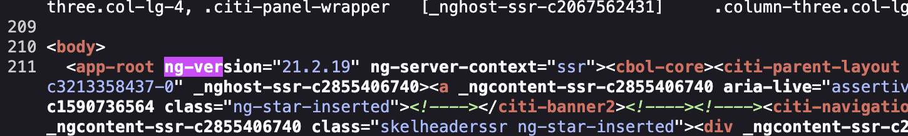
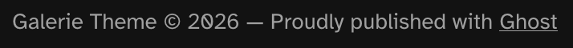
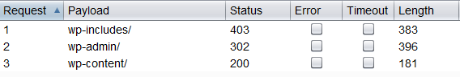
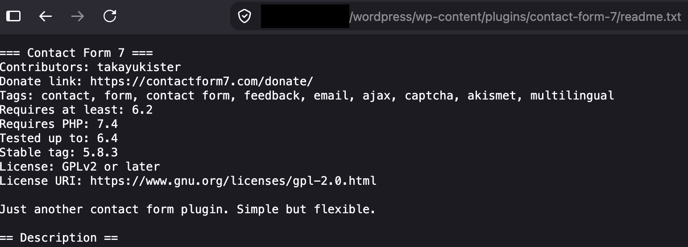
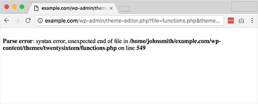
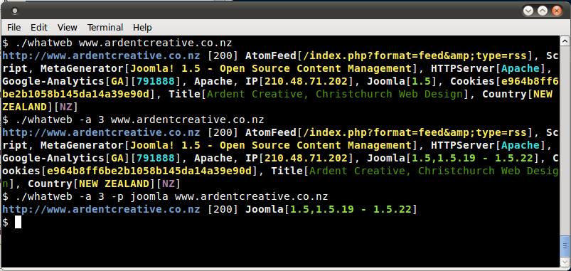

# Identificar la huella digital del framework de una aplicación web

|ID          |
|------------|
|WSTG-INFO-08|

## Resumen

No sería exagerado afirmar que casi todas las ideas concebibles para una aplicación web ya se han puesto en desarrollo. Dada la enorme cantidad de proyectos de software libre y de código abierto que se desarrollan e implementan activamente en todo el mundo, es muy probable que una prueba de seguridad de aplicaciones encuentre un objetivo que dependa total o parcialmente de estas aplicaciones o frameworks conocidos (p. ej., WordPress, phpBB, Mediawiki, etc.). Conocer los componentes de la aplicación web que se están probando facilita considerablemente el proceso de pruebas y también reduce drásticamente el esfuerzo necesario durante la prueba. Estas aplicaciones web conocidas tienen encabezados HTML, cookies y estructuras de directorios específicos que se pueden enumerar para identificar la aplicación. La mayoría de los frameworks web tienen varios indicadores en estas ubicaciones, que pueden ayudar a un atacante o evaluador a reconocerlos. Básicamente, eso es lo que hacen todas las herramientas automáticas: buscan un indicador en una ubicación predefinida y luego lo comparan con la base de datos de firmas conocidas. Para obtener mayor precisión, se suelen utilizar varios indicadores.

## Objetivos de las pruebas

- Identificar los componentes utilizados por las aplicaciones web.

## Cómo probar

### Pruebas de caja negra

Hay varias ubicaciones habituales que se deben considerar para identificar frameworks o componentes:

- Encabezados HTTP
- Cookies
- Código fuente HTML
- Archivos y carpetas específicos
- Extensiones de archivo
- Mensajes de error

#### Encabezados HTTP

La forma más básica de identificar un framework web es revisar el campo `X-Powered-By` del encabezado de respuesta HTTP. Se pueden utilizar muchas herramientas para identificar la huella digital de un objetivo; la más sencilla es netcat.

Considere la siguiente solicitud y respuesta HTTP:

```html
$ nc 127.0.0.1 80
HEAD / HTTP/1.0

HTTP/1.1 200 OK
Server: nginx/1.0.14
[...]
X-Powered-By: Mono
```

A partir del campo `X-Powered-By`, podemos deducir que es probable que el framework de la aplicación web sea `Mono`. Sin embargo, aunque este método es sencillo y rápido, no funciona en todos los casos. Es posible desactivar fácilmente el encabezado `X-Powered-By` mediante una configuración adecuada. También existen varias técnicas que permiten a un sitio ofuscar los encabezados HTTP (consulte un ejemplo en la sección [Mitigación](#mitigación)). En el ejemplo anterior, también podemos observar que se está utilizando una versión específica de `nginx` para servir el contenido.

En el mismo ejemplo, es posible que el evaluador no detecte el encabezado `X-Powered-By` o que obtenga una respuesta como la siguiente:

```html
HTTP/1.1 200 OK
Server: nginx/1.0.14
Date: Sat, 07 Sep 2013 08:19:15 GMT
Content-Type: text/html;charset=ISO-8859-1
Connection: close
Vary: Accept-Encoding
X-Powered-By: Blood, sweat and tears
```

A veces, hay otros encabezados HTTP que apuntan a un framework determinado. En el siguiente ejemplo, según la información de la solicitud HTTP, se observa que el encabezado `X-Powered-By` contiene la versión de PHP. Sin embargo, el encabezado `X-Generator` indica que el framework utilizado en realidad es `Swiftlet`, lo que ayuda a un evaluador de penetración a ampliar sus vectores de ataque. Al identificar la huella digital, inspeccione cuidadosamente todos los encabezados HTTP para detectar este tipo de filtraciones.

```html
HTTP/1.1 200 OK
Server: nginx/1.4.1
Date: Sat, 07 Sep 2013 09:22:52 GMT
Content-Type: text/html
Connection: keep-alive
Vary: Accept-Encoding
X-Powered-By: PHP/5.4.16-1~dotdeb.1
Expires: Thu, 19 Nov 1981 08:52:00 GMT
Cache-Control: no-store, no-cache, must-revalidate, post-check=0, pre-check=0
Pragma: no-cache
X-Generator: Swiftlet
```

#### Cookies

Otra forma similar y algo más fiable de determinar el framework web utilizado consiste en revisar las cookies específicas del framework.

Considere los siguientes encabezados de respuesta HTTP de una aplicación Laravel:

```http
HTTP/1.1 200 OK
Server: nginx
Content-Type: text/html; charset=utf-8
Cache-Control: no-cache, private
Date: Sun, 13 Sep 2026 12:10:25 GMT
Set-Cookie: XSRF-TOKEN=eyJpdiI6IkpyQWZUUUFjVXBPWWpkSjF3cHlJZnc9PSIsInZhbHVlIjoiZzZlVm1QWlMxRDlqVGpDVHlwdVVPa3BpWDhYd0F2NXlodm1jTmRSU2pFaUh1VUxvL3cyLzhNU2o1blBJSUpQS2srNnBQQUVpUlJJeW9wMkRvZXhqejBySnpGUVVzclllendrQzZDWDBUa0ZiVmVnNlRidDFwVExrdGRZekJyd1ciLCJtYWMiOiJjMjcyN2FjOThlNjEyMGY0YjZkYjEwNWJjZGI2YWE4MzJiNDZjZDg1NDQxN2U0YzcxMDg5NTJhOTVjODE5YzY2IiwidGFnIjoiIn0%3D; expires=Sun, 13 Sep 2026 14:10:26 GMT; Max-Age=7200; path=/; samesite=lax
Set-Cookie: laravel_session=eyJpdiI6IlV4QkdjeWE2dGpzU2EyWEd4cDRHbXc9PSIsInZhbHVlIjoiMnlFWS9CcW9ncEFKODQzMFFxK0F6ekN4dStJbnF2b2NhaUlmRWVuRU81WFo2OHZwQTlYZ2owdGZlUVVLY29ScWRsZDllTTVVTXBuaE1SanBSak5JeU5NZFJnNFdZUmtOZnUwVTBUYndRbmpJdVRKdW9mZUtrMnRwRXg3TUxiM2MiLCJtYWMiOiI5NDU1ODY2Y2Q5NjhjMGI4NWZkNmZjNjI1NTI1ZDNiNTJjMDU3MTc3ZjAyZDc2YjlmZGE4OTM5NjFhNTY3ZTE3IiwidGFnIjoiIn0%3D; expires=Sun, 13 Sep 2026 14:10:26 GMT; Max-Age=7200; path=/; httponly; samesite=lax
content-length: 88805
```

La cookie `laravel_session`, junto con la cookie `XSRF-TOKEN` que la acompaña y que se utiliza para la protección contra CSRF, se ha establecido automáticamente, lo que proporciona información sobre el framework utilizado. En la sección [Cookies](#cookies-1) se presenta una lista de nombres de cookies habituales. Este mecanismo de identificación tiene limitaciones: es posible cambiar el nombre de las cookies. Por ejemplo, en Laravel se puede hacer mediante el valor `cookie` de `config/session.php`:

```php
/*
|--------------------------------------------------------------------------
| Session Cookie Name
|--------------------------------------------------------------------------
|
| Here you may change the name of the cookie used to identify a session
| instance by ID. The name specified here will get used every time a
| new session cookie is created by the framework for every driver.
|
*/

'cookie' => env(
    'SESSION_COOKIE',
    Str::slug(env('APP_NAME', 'laravel'), '_').'_session'
),
```

Sin embargo, es menos probable que se realicen estos cambios que los cambios en el encabezado `X-Powered-By`, por lo que este método de identificación es más fiable.

#### Código fuente HTML

Esta técnica consiste en buscar ciertos patrones en el código fuente de la página HTML. A menudo se puede encontrar mucha información que ayuda al evaluador a reconocer un componente específico. Uno de los indicadores habituales son los comentarios HTML que revelan directamente el framework. Con más frecuencia, pueden encontrarse rutas específicas del framework, como enlaces a carpetas CSS o JS propias del framework. Por último, ciertas variables de scripts también pueden indicar un framework determinado.

A partir de la captura de pantalla siguiente, es fácil determinar el framework utilizado y su versión mediante los indicadores mencionados. Por ejemplo, las aplicaciones Angular agregan un atributo `ng-version` directamente al elemento raíz de la página, lo que revela explícitamente la versión exacta del framework utilizado.

\
*Figura 4.1.8-1: Ejemplo de código fuente HTML de Angular*

A menudo, esta información se encuentra en la sección `<head>` de las respuestas HTTP, en etiquetas `<meta>` o al final de la página. No obstante, se deben analizar las respuestas completas, ya que esto puede ser útil para otros fines, como inspeccionar otros comentarios útiles y campos ocultos. En ocasiones, los desarrolladores web no ocultan suficientemente la información sobre los frameworks o componentes utilizados. Aún es posible encontrar algo como esto al final de la página, por ejemplo, un pie de página «Publicado con orgullo con Ghost» que revela que el sitio funciona con la plataforma de publicación [Ghost](https://ghost.org/):

\
*Figura 4.1.8-2: Parte inferior de la página de Ghost*

### Archivos y carpetas específicos

Existe otro método que ayuda mucho a un atacante o evaluador a identificar aplicaciones o componentes con gran precisión. Cada componente de una aplicación web tiene una estructura de archivos y carpetas específica en el servidor. Se ha observado que es posible ver la ruta específica en el código fuente de la página HTML, pero a veces no se muestra explícitamente allí y puede seguir existiendo en el servidor.

Para encontrarlas, se utiliza una técnica conocida como navegación forzada o «dirbusting». El dirbusting consiste en aplicar fuerza bruta a un objetivo con nombres de carpetas y archivos conocidos, y supervisar las respuestas HTTP para enumerar el contenido del servidor. Esta información puede utilizarse tanto para encontrar archivos predeterminados y atacarlos como para identificar la huella digital de la aplicación web. El dirbusting se puede realizar de varias maneras; el ejemplo siguiente muestra un ataque de dirbusting exitoso contra un objetivo basado en WordPress, con la ayuda de una lista definida y la funcionalidad Intruder de Burp Suite.

\
*Figura 4.1.8-3: Dirbusting con Burp*

Podemos observar que, para algunas carpetas específicas de WordPress (por ejemplo, `/wp-includes/`, `/wp-admin/` y `/wp-content/`), las respuestas HTTP son 403 (Forbidden), 302 (Found, redirección a `wp-login.php`) y 200 (OK), respectivamente. Esto es un buen indicio de que el objetivo funciona con WordPress. Del mismo modo, es posible realizar dirbusting en diferentes carpetas de complementos de aplicaciones y determinar sus versiones. En la captura de pantalla siguiente se puede ver un archivo `readme.txt` típico de un complemento de WordPress, accesible en `/wp-content/plugins/<plugin-name>/readme.txt`, que proporciona información sobre el complemento utilizado y revela su versión exacta, potencialmente vulnerable, mediante el campo `Stable tag`.

\
*Figura 4.1.8-4: Divulgación del archivo Readme de un complemento de WordPress*

Consejo: antes de empezar con el dirbusting, compruebe primero el archivo `robots.txt`. A veces también se pueden encontrar allí carpetas específicas de la aplicación y otra información confidencial. En la captura de pantalla siguiente se muestra un ejemplo de este tipo de archivo `robots.txt`.

```text
User-agent: *
Disallow: /wp-admin/
Allow: /wp-admin/admin-ajax.php
```

Los archivos y carpetas específicos varían según cada aplicación. Si la aplicación o el componente identificado es de código abierto, puede resultar útil configurar una instalación temporal durante las pruebas de penetración para comprender mejor qué infraestructura o funcionalidades se presentan y qué archivos podrían permanecer en el servidor. Sin embargo, ya existen varias listas útiles de archivos; un ejemplo destacado son las [listas de palabras de FuzzDB de archivos y carpetas predecibles](https://github.com/fuzzdb-project/fuzzdb).

#### Extensiones de archivo

Las URL pueden incluir extensiones de archivo que también ayudan a identificar la plataforma o tecnología web.

Por ejemplo, la antigua wiki de OWASP utilizaba PHP:

```text
https://example.owasp.org/index.php?title=Fingerprint_Web_Application_Framework&action=edit&section=4
```

A continuación se muestran algunas extensiones de archivo web habituales y las tecnologías asociadas:

- `.php` -- PHP
- `.aspx` -- Microsoft ASP.NET
- `.jsp` -- Java Server Pages

#### Mensajes de error

Como puede verse en la captura de pantalla siguiente, la ruta del sistema de archivos indicada apunta al uso de WordPress (`wp-content`). Además, los evaluadores deben tener en cuenta que WordPress está basado en PHP (`functions.php`).

\
*Figura 4.1.8-5: Error de análisis de WordPress*

## Identificadores habituales

### Cookies

| Framework          | Nombre de la cookie                                   |
|--------------------|-----------------------------------------------|
| WordPress          | `wordpress_logged_in_*`, `wp-settings-*`      |
| Laravel            | `laravel_session`                             |
| Django             | `sessionid`, `csrftoken`                      |
| Express.js (Node)  | `connect.sid`                                 |
| ASP.NET Core       | `.AspNetCore.Session`, `.AspNetCore.Antiforgery.*` |
| phpBB              | `phpbb3_*`                                    |
| Drupal             | `SESS*` / `SSESS*` (el nombre es un hash; no hay un prefijo fijo aparte de `SESS`/`SSESS`) |
| CakePHP            | `CAKEPHP` (configurable; este es el valor predeterminado) |
| TYPO3              | `fe_typo_user`                                |
| DNN Platform (DotNetNuke) | `DotNetNukeAnonymous`                  |

### Código fuente HTML

| Aplicación | Palabra clave                                                                    |
|-------------|--------------------------------------------------------------------------------|
| WordPress   | `<meta name="generator" content="WordPress X.X" />`                            |
| phpBB       | `<body id="phpbb"`                                                             |
| MediaWiki   | `<meta name="generator" content="MediaWiki X.X" />`                            |
| Joomla      | `<meta name="generator" content="Joomla! - Open Source Content Management" />` |
| Drupal      | `<meta name="Generator" content="Drupal X (https://drupal.org)" />`            |
| Ghost       | `<meta name="generator" content="Ghost X.X" />`                                |
| DotNetNuke  | `DNN Platform - [https://www.dnnsoftware.com](https://www.dnnsoftware.com)`    |
| Angular     | Atributo `ng-version="X.X.X"` en el elemento raíz de la aplicación              |
| Next.js     | `<script id="__NEXT_DATA__" type="application/json">`                          |

#### Indicadores generales

- `%framework_name%`
- `powered by`
- `built upon`
- `running`

#### Indicadores específicos

| Framework         | Palabra clave                                   |
|-------------------|-------------------------------------------|
| Adobe ColdFusion  | `<!-- START headerTags.cfm`               |
| Microsoft ASP.NET | `__VIEWSTATE`                             |
| ZK                | `<!-- ZK [.\d\s]+-->`, scripts under `zkau/` |
| Indexhibit        | `ndxz-studio` (in `<link>`/`<a href>`, or as `<meta name="generator" content="Indexhibit">`) |
| Next.js           | `<script id="__NEXT_DATA__" type="application/json">`, `x-powered-by: Next.js` |
| Nuxt              | `<div id="__nuxt"`, inline `window.__NUXT__`, script paths under `/_nuxt/` |
| htmx              | Global JS object `htmx`, script src matching `htmx.org@X.X.X`             |

### WhatWeb

Sitio: [https://github.com/urbanadventurer/WhatWeb](https://github.com/urbanadventurer/WhatWeb)

WhatWeb es una de las mejores herramientas de código abierto para identificar huellas digitales disponibles actualmente y se incluye en la instalación predeterminada de [Kali Linux](https://www.kali.org/). Lenguaje: Ruby. Las coincidencias para identificar huellas digitales se realizan mediante:

- Cadenas de texto (distinguen entre mayúsculas y minúsculas)
- Expresiones regulares
- Consultas a Google Hack Database (conjunto limitado de palabras clave)
- Hashes MD5
- Reconocimiento de URL
- Patrones de etiquetas HTML
- Código Ruby personalizado para operaciones pasivas y agresivas

A continuación se muestra un ejemplo de salida en una captura de pantalla:

\
*Figura 4.1.8-6: Ejemplo de salida de WhatWeb*

## Mitigación

Aunque se pueden tomar medidas como utilizar nombres de cookies distintos (cambiando las configuraciones), ocultar o cambiar las rutas de archivos y directorios (mediante reescrituras o cambios en el código fuente), eliminar encabezados conocidos, etc., estas medidas se reducen a «seguridad por oscuridad». Los propietarios o administradores de sistemas deben reconocer que estas medidas solo ralentizan a los adversarios más rudimentarios. Tal vez sería mejor dedicar ese tiempo y esfuerzo a aumentar la concienciación de las partes interesadas y mantener las soluciones.

## Herramientas

A continuación se presenta una lista de herramientas generales y conocidas. También existen muchas otras utilidades, así como herramientas para identificar huellas digitales basadas en frameworks.

## Referencias

### Artículos técnicos

- [Saumil Shah: «An Introduction to HTTP fingerprinting»](https://web.archive.org/web/20190526182734/https://net-square.com/httprint_paper.html)
- [Anant Shrivastava: «Web Application Finger Printing»](https://anantshri.info/articles/web_app_finger_printing.html)