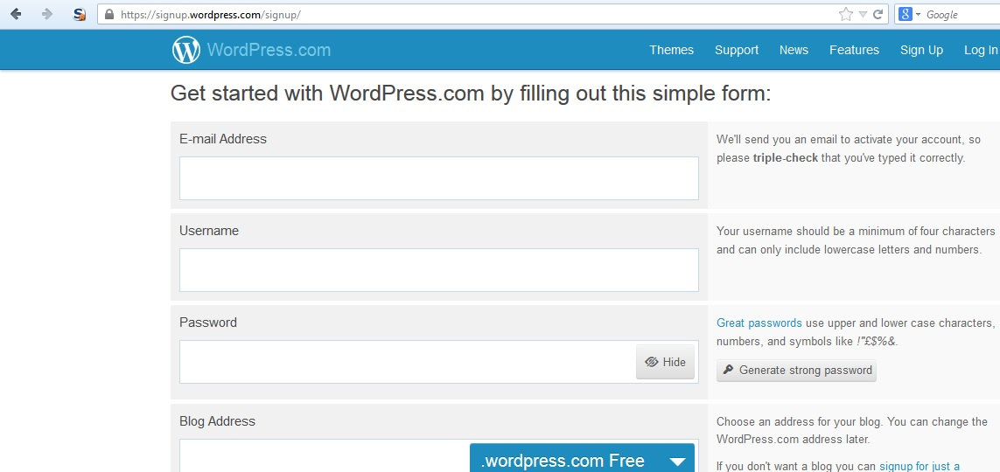
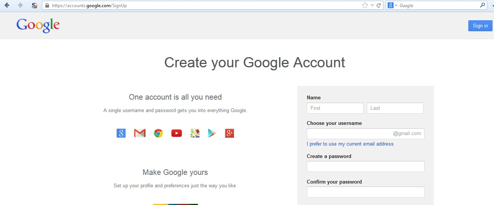

# Proceso de registro de usuarios

|ID          |
|------------|
|WSTG-IDNT-02|

## Resumen

Algunos sitios web ofrecen un proceso de registro de usuarios que automatiza (o semi-automatiza) el aprovisionamiento de acceso al sistema. Los requisitos de identidad para acceder varían desde la identificación fehaciente hasta la ausencia total de requisitos, según las necesidades de seguridad del sistema. Muchas aplicaciones públicas automatizan completamente el proceso de registro y aprovisionamiento porque el tamaño de la base de usuarios hace imposible gestionarlo manualmente. Sin embargo, muchas aplicaciones corporativas aprovisionan usuarios manualmente, por lo que este caso de prueba puede no ser aplicable.

## Objetivos de prueba

- Verificar que los requisitos de identidad para el registro de usuarios estén alineados con los requisitos empresariales y de seguridad.
- Validar el proceso de registro.

## Cómo probar

Verifique que los requisitos de identidad para el registro de usuarios estén alineados con los requisitos empresariales y de seguridad:

1. ¿Puede cualquiera registrarse para obtener acceso?
2. ¿Una persona revisa y aprueba los registros antes del aprovisionamiento, o se conceden automáticamente si se cumplen los criterios?
3. ¿Puede la misma persona o identidad registrarse varias veces?
4. ¿Pueden los usuarios registrarse para obtener diferentes roles o permisos?
5. ¿Qué prueba de identidad se requiere para que un registro tenga éxito?
6. ¿Se verifican las identidades registradas?

Valide el proceso de registro:

1. ¿Se puede falsificar fácilmente la información de identidad?
2. ¿Se puede manipular el intercambio de información de identidad durante el registro?

### Ejemplo

En el ejemplo de WordPress que aparece a continuación, el único requisito de identificación es una dirección de correo electrónico a la que la persona que se registra tenga acceso.

\
*Figura 4.3.2-1: Página de registro de WordPress*

En cambio, en el ejemplo de Google que aparece a continuación, los requisitos de identificación incluyen nombre, fecha de nacimiento, país, número de teléfono móvil, dirección de correo electrónico y respuesta al CAPTCHA. Aunque solo se pueden verificar dos de estos datos (la dirección de correo electrónico y el número de teléfono móvil), los requisitos de identificación son más estrictos que los de WordPress.

\
*Figura 4.3.2-2: Página de registro de Google*

Algunas aplicaciones también pueden asignar automáticamente roles privilegiados a los usuarios cuando registran una cuenta con una dirección de correo electrónico de un dominio de confianza. Si no se valida la titularidad de la dirección de correo electrónico como parte del proceso de registro, un atacante podría obtener acceso a una cuenta privilegiada al registrar un nuevo usuario en ese dominio.

Por otra parte, si solo se realiza una coincidencia parcial del dominio, podría ser posible registrar una cuenta privilegiada mediante otros dominios similares. Por ejemplo, si la aplicación comprueba que las direcciones de correo electrónico terminen en `example.org`, podría ser posible usar el dominio `notexample.org`; o, si comprueba que la dirección de correo electrónico contenga `@example.org`, podría ser posible usar `@example.org.attacker.com`.

## Remediación

Implemente requisitos de identificación y verificación que correspondan a los requisitos de seguridad de la información que protegen las credenciales.

## Herramientas

Un proxy HTTP puede ser una herramienta útil para probar este control.

## Referencias

[Diseño del registro de usuarios](https://mashable.com/2011/06/09/user-registration-design/)