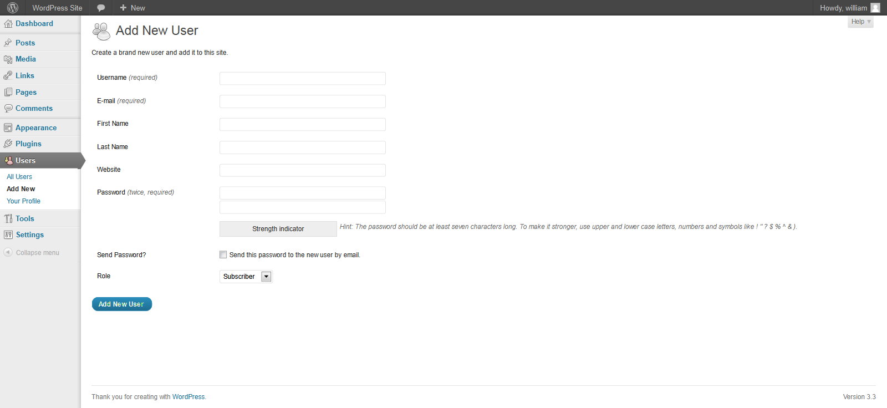
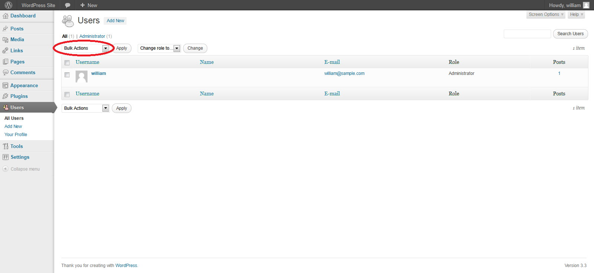

# Proceso de aprovisionamiento de cuentas

|ID          |
|------------|
|WSTG-IDNT-03|

## Resumen

El aprovisionamiento de cuentas ofrece a un atacante la oportunidad de crear una cuenta válida sin que se aplique el proceso adecuado de identificación y autorización.

## Objetivos de la prueba

- Verificar qué cuentas pueden aprovisionar otras cuentas y de qué tipo.

## Cómo realizar la prueba

Determinar qué roles pueden aprovisionar usuarios y qué tipo de cuentas pueden aprovisionar.

- ¿Se verifican, evalúan y autorizan las solicitudes de aprovisionamiento?
- ¿Se verifican, evalúan y autorizan las solicitudes de desaprovisionamiento?
- ¿Puede un administrador aprovisionar a otros administradores o solo a usuarios?
- ¿Puede un administrador u otro usuario aprovisionar cuentas con privilegios superiores a los suyos?
- ¿Puede un administrador o usuario desaprovisionarse a sí mismo?
- ¿Cómo se gestionan los archivos o recursos que pertenecen al usuario desaprovisionado? ¿Se eliminan? ¿Se transfiere el acceso?

### Ejemplo

En WordPress, solo se necesitan el nombre y la dirección de correo electrónico de un usuario para aprovisionar la cuenta, como se muestra a continuación:

\
*Figura 4.3.3-1: Agregar usuario de WordPress*

Para desaprovisionar usuarios, el administrador debe seleccionar los usuarios correspondientes, elegir Delete en el menú desplegable (marcado con un círculo) y, a continuación, aplicar esta acción. Después, se muestra al administrador un cuadro de diálogo que pregunta qué hacer con las publicaciones del usuario (eliminarlas o transferirlas).

\
*Figura 4.3.3-2: Autenticación y usuarios de WordPress*

## Herramientas

Aunque el método más exhaustivo y preciso para realizar esta prueba es llevarla a cabo manualmente, las herramientas de proxy HTTP también pueden resultar útiles.