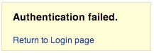
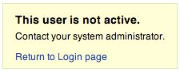

# Enumeración de cuentas y cuentas de usuario adivinables

|ID          |
|------------|
|WSTG-IDNT-04|

## Resumen

El alcance de esta prueba es verificar si es posible recopilar un conjunto de nombres de usuario válidos interactuando con el mecanismo de autenticación de la aplicación. Esta prueba será útil para las pruebas de fuerza bruta, en las que el tester verifica si, dado un nombre de usuario válido, es posible encontrar la contraseña correspondiente.

A menudo, las aplicaciones web revelan si un nombre de usuario existe en el sistema, ya sea como consecuencia de una configuración incorrecta o como una decisión de diseño. Por ejemplo, a veces, cuando enviamos credenciales incorrectas, recibimos un mensaje que indica que el nombre de usuario existe en el sistema o que la contraseña proporcionada es incorrecta. Un atacante puede utilizar la información obtenida para elaborar una lista de usuarios del sistema. Esta información puede utilizarse para atacar la aplicación web, por ejemplo, mediante un ataque de fuerza bruta o un ataque con nombres de usuario y contraseñas predeterminados.

El tester debería interactuar con el mecanismo de autenticación de la aplicación para determinar si el envío de solicitudes específicas hace que la aplicación responda de distintas maneras. Este problema se produce porque la información que la aplicación web o el servidor web divulgan cuando el usuario proporciona un nombre de usuario válido es distinta de la que divulgan cuando se utiliza uno no válido.

En algunos casos, se recibe un mensaje que revela si las credenciales proporcionadas son incorrectas porque se utilizó un nombre de usuario no válido o una contraseña no válida. A veces, los testers pueden enumerar los usuarios existentes enviando un nombre de usuario y una contraseña vacía.

> Nota: Algunas aplicaciones no consideran que los nombres de usuario sean información confidencial y pueden ofrecer funciones que permiten verlos o enumerarlos directamente. Asegúrese de comprender los requisitos de seguridad de la aplicación antes de informar sobre problemas relacionados con la enumeración de nombres de usuario.

## Objetivos de la prueba

- Revisar los procesos relacionados con la identificación de usuarios (*por ejemplo*, el registro, el inicio de sesión, etc.).
- Enumerar usuarios cuando sea posible mediante el análisis de las respuestas.

## Cómo probar

En las pruebas de caja negra, el tester no sabe nada sobre la aplicación específica, los nombres de usuario, la lógica de la aplicación, los mensajes de error de la página de inicio de sesión ni las funciones de recuperación de contraseñas. Si la aplicación es vulnerable, el tester recibe un mensaje de respuesta que revela, directa o indirectamente, información útil para enumerar usuarios.

### Mensaje de respuesta HTTP

#### Credenciales válidas

Registre la respuesta del servidor cuando envíe un ID de usuario y una contraseña válidos.

> Mediante un proxy web, observe la información obtenida de esta autenticación exitosa (respuesta HTTP 200, longitud de la respuesta).

#### Usuario válido con contraseña incorrecta

A continuación, el tester debería intentar introducir un ID de usuario válido y una contraseña incorrecta, y registrar el mensaje de error generado por la aplicación.

> El navegador debería mostrar un mensaje similar al siguiente:
>
> \
> *Figura 4.3.4-1: Autenticación fallida*
>
> A diferencia de un mensaje que revele la existencia del usuario, como el siguiente:
>
> `Login for User foo: invalid password`
>
> Mediante un proxy web, observe la información obtenida de este intento de autenticación fallido (respuesta HTTP 200, longitud de la respuesta).

#### Nombre de usuario inexistente

A continuación, el tester debería intentar introducir un ID de usuario no válido y una contraseña incorrecta, y registrar la respuesta del servidor (el tester debería tener la certeza de que el nombre de usuario no es válido en la aplicación). Registre el mensaje de error y la respuesta del servidor.

> Si el tester introduce un ID de usuario inexistente, podría recibir un mensaje similar al siguiente:
>
> \
> *Figura 4.3.4-3: Este usuario no está activo*
>
> o un mensaje como el siguiente:
>
> `Login failed for User foo: invalid Account`
>
> Por lo general, la aplicación debería responder con el mismo mensaje de error y la misma longitud ante las distintas solicitudes incorrectas. Si las respuestas no son iguales, el tester debería investigar y averiguar qué elemento produce la diferencia entre ellas. Por ejemplo:
>
> 1. Solicitud del cliente: usuario válido/contraseña incorrecta
> 2. Respuesta del servidor: la contraseña no es correcta
> 3. Solicitud del cliente: usuario incorrecto/contraseña incorrecta
> 4. Respuesta del servidor: usuario no reconocido
>
> Las respuestas anteriores permiten al cliente entender que, para la primera solicitud, tiene un nombre de usuario válido. Por lo tanto, puede interactuar con la aplicación solicitando un conjunto de posibles IDs de usuario y observando la respuesta.
>
> Al analizar la segunda respuesta del servidor, el tester entiende del mismo modo que no tiene un nombre de usuario válido. Por lo tanto, puede interactuar de la misma manera y crear una lista de IDs de usuario válidos a partir de las respuestas del servidor.

### Otras formas de enumerar usuarios

Los testers pueden enumerar usuarios de varias maneras, como las siguientes:

#### Analizar el código de error recibido en las páginas de inicio de sesión

Algunas aplicaciones web muestran un código o mensaje de error específico que se puede analizar.

#### Analizar URL y redirecciones de URL

Por ejemplo:

- `https://www.foo.com/err.jsp?User=baduser&Error=0`
- `https://www.foo.com/err.jsp?User=gooduser&Error=2`

Como se observa arriba, cuando un tester proporciona un ID de usuario y una contraseña a la aplicación web, ve en la URL un mensaje que indica que se ha producido un error. En el primer caso, ha proporcionado un ID de usuario no válido y una contraseña incorrecta. En el segundo, ha proporcionado un ID de usuario válido y una contraseña incorrecta, por lo que puede identificar un ID de usuario válido.

#### Sondeo de URI

A veces, un servidor web responde de manera diferente si recibe una solicitud para un directorio existente o para uno inexistente. Por ejemplo, en algunos portales, cada usuario está asociado a un directorio. Si los testers intentan acceder a un directorio existente, podrían recibir un error del servidor web.

Algunos de los errores habituales que se reciben de los servidores web son:

- Código de error 403 Forbidden
- Código de error 404 Not found

Ejemplo:

- `https://www.foo.com/account1` - el servidor web devuelve: 403 Forbidden
- `https://www.foo.com/account2` - el servidor web devuelve: 404 file Not Found

En el primer caso, el usuario existe, pero el tester no puede ver la página web. En el segundo caso, en cambio, el usuario "account2" no existe. Al recopilar esta información, los testers pueden enumerar los usuarios.

#### Analizar los títulos de las páginas web

Los testers pueden obtener información útil del título de la página web, donde podrían encontrar un código o mensaje de error específico que revele si el problema está relacionado con el nombre de usuario o con la contraseña.

Por ejemplo, si un usuario no puede autenticarse en una aplicación y recibe una página web cuyo título es similar a uno de los siguientes:

- `Invalid user`
- `Invalid authentication`

#### Analizar un mensaje recibido de una función de recuperación

Cuando se utiliza una función de recuperación (es decir, una función para recuperar una contraseña olvidada), una aplicación vulnerable podría devolver un mensaje que revele si un nombre de usuario existe o no.

Por ejemplo, mensajes similares a los siguientes:

- `Invalid username: email address is not valid or the specified user was not found.`
- `Valid username: Your password has been successfully sent to the email address you registered with.`

#### Mensaje 404 personalizado

Cuando solicitamos un usuario dentro de un directorio que no existe, no siempre recibimos un código de error 404. En su lugar, podríamos recibir un "200 OK" con una imagen; en ese caso, podemos suponer que, cuando recibimos esa imagen específica, el usuario no existe. Esta lógica puede aplicarse a otras respuestas del servidor web; la clave es analizar correctamente los mensajes del servidor web y de la aplicación web.

#### Analizar los tiempos de respuesta

Además de analizar el contenido de las respuestas, también debería tenerse en cuenta cuánto tarda en llegar cada respuesta. Esto es especialmente relevante cuando la solicitud provoca una interacción con un servicio externo (como el envío de un correo electrónico para recuperar una contraseña olvidada), ya que dicha interacción puede añadir varios cientos de milisegundos a la respuesta y permitir determinar si el usuario solicitado es válido.

### Adivinar usuarios

#### Estructuras predecibles de nombres de usuario

En muchas organizaciones, los nombres de usuario siguen patrones uniformes (por ejemplo, la inicial del nombre + el apellido, como jbloggs, o identificadores estructurados, como CN000100). Si se puede identificar la convención de nomenclatura, a menudo es posible derivar sistemáticamente nombres de usuario válidos.

Los testers deberían:

- Identificar si los nombres de usuario siguen una estructura predecible.
- Intentar generar nombres de usuario adicionales a partir de los patrones observados.
- Usar diccionarios de nombres de usuario derivados de datos de la organización (por ejemplo, nombres del personal, formatos de correo electrónico).
- Observar las respuestas de la aplicación para determinar si los nombres de usuario generados son válidos.

Las estructuras predecibles de nombres de usuario reducen significativamente el esfuerzo necesario para enumerar cuentas válidas y pueden facilitar otros ataques, como los intentos de fuerza bruta.

En algunos casos, los IDs de usuario se crean conforme a políticas específicas del administrador o de la empresa. Por ejemplo, podemos observar un usuario con un ID de usuario creado en orden secuencial:

```text
CN000100
CN000101
...
```

A veces, los nombres de usuario se crean con un alias REALM seguido de números secuenciales:

- R1001 - usuario 001 para REALM1
- R2001 - usuario 001 para REALM2

En el ejemplo anterior, podemos crear scripts shell sencillos que compongan IDs de usuario y envíen una solicitud con una herramienta como wget para automatizar una consulta web y determinar cuáles IDs de usuario son válidos. También podemos usar Perl y curl para crear un script.

Otras posibilidades son: - IDs de usuario asociados a números de tarjetas de crédito o, en general, a números que siguen un patrón. - IDs de usuario asociados a nombres reales; por ejemplo, si Freddie Mercury tiene el ID de usuario "fmercury", se podría adivinar que Roger Taylor tiene el ID de usuario "rtaylor".

También podemos adivinar un nombre de usuario a partir de la información obtenida mediante una consulta LDAP o de la recopilación de información en Google, por ejemplo, sobre un dominio específico. Google puede ayudar a encontrar usuarios de un dominio mediante consultas específicas o con un script shell o una herramienta sencillos.

> Al enumerar cuentas de usuario, se corre el riesgo de bloquearlas después de un número predefinido de intentos fallidos de sondeo (según la política de la aplicación). Además, a veces, el firewall de la aplicación o el Sistema de Prevención de Intrusiones pueden bloquear la dirección IP mediante reglas dinámicas.

### Suplantación del personal

Asegúrese de que los usuarios no registrados no puedan seleccionar nombres de usuario reservados (por ejemplo, admin, administrator, moderator) durante el proceso de registro. Además, verifique que los usuarios no puedan cambiar su nombre de usuario actual por uno de estos nombres de usuario reservados en la página de edición del perfil.

Si la aplicación web ofrece funciones que permiten a un usuario acceder a las funciones de registro y edición del perfil, las interacciones que se deben probar incluyen las siguientes:

- Proceso de registro:
    - Acceda a la página de registro como usuario no registrado y complete el formulario de registro introduciendo uno de los nombres de usuario reservados (por ejemplo, admin, administrator, moderator); envíe el formulario de registro y, a continuación, verifique la respuesta.
    - El proceso de registro debería rechazar el envío del formulario y mostrar un mensaje de error que indique que el nombre de usuario seleccionado no está disponible para registrarse.
- Página de edición del perfil:
    - Inicie sesión en la aplicación web con credenciales válidas y vaya a la página de edición del perfil. Intente cambiar el nombre de usuario actual por uno de los nombres de usuario reservados (por ejemplo, admin, administrator, moderator) y guarde los cambios para verificar el comportamiento.
    - El proceso de edición del perfil debería rechazar la solicitud de cambio de nombre de usuario y mostrar un mensaje de error que indique que el nombre de usuario seleccionado no está disponible.
- Probar variantes y similitudes:
    - Repita los pasos anteriores con distintas variantes de los nombres de usuario reservados (por ejemplo, Admin, ADMIN, Administrator) y realice pruebas con distintas combinaciones de letras mayúsculas y minúsculas para verificar que se gestionen correctamente sin distinguir entre mayúsculas y minúsculas.
    - La aplicación web debería tratar estas variantes como idénticas a los nombres de usuario reservados y rechazar su selección o modificación.

### Pruebas de caja gris

#### Mensajes de error de autenticación

Verifique que la aplicación responda de la misma manera a todas las solicitudes del cliente que produzcan un fallo de autenticación. En este caso, las pruebas de caja negra y de caja gris siguen el mismo principio, basado en el análisis de los mensajes o códigos de error recibidos de la aplicación web.

> La aplicación debería responder de la misma manera ante cada intento fallido de autenticación.
>
> Por ejemplo: *Las credenciales proporcionadas no son válidas*

## Remediación

Asegúrese de que la aplicación devuelva mensajes de error genéricos y uniformes cuando se introduzcan nombres de cuenta, contraseñas u otras credenciales de usuario no válidos durante el proceso de inicio de sesión.

Asegúrese de eliminar las cuentas de sistema predeterminadas y las cuentas de prueba antes de poner el sistema en producción (o exponerlo a una red no confiable).

## Herramientas

- [Zed Attack Proxy (ZAP)](https://www.zaproxy.org)
- [curl](https://curl.se/)
- [PERL](https://www.perl.org)

## Referencias

- [Vulnerabilidades de enumeración de nombres de usuario](https://www.gnucitizen.org/blog/username-enumeration-vulnerabilities/)
- [Prevenir la enumeración de nombres de usuario en WordPress](https://www.jinsonvarghese.com/prevent-wordpress-username-enumeration/)
- [Marco Mella, enumeración de usuarios de Sun Java Access & Identity Manager](https://www.exploit-db.com/exploits/32762)