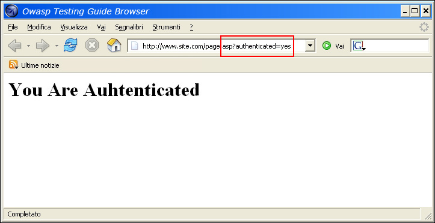
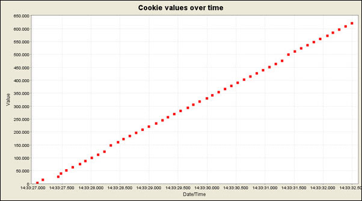
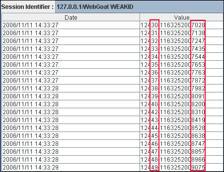
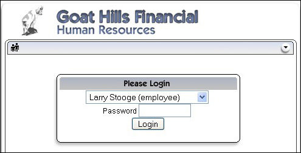
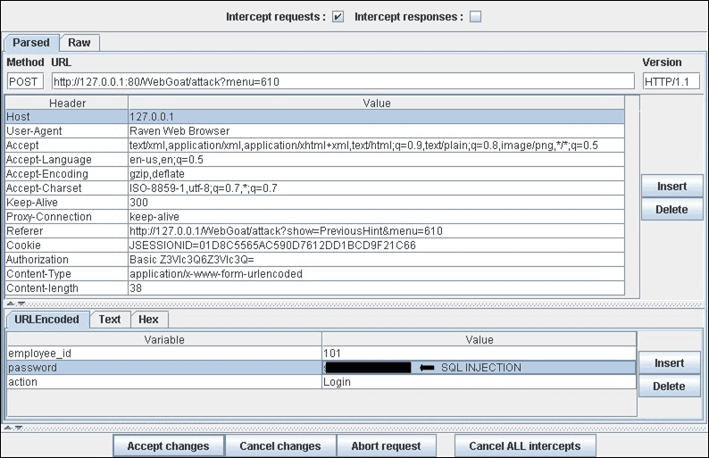

# Omisión del esquema de autenticación

|ID          |
|------------|
|WSTG-ATHN-04|

## Resumen

En seguridad informática, la autenticación es el proceso de intentar verificar la identidad digital del remitente de una comunicación. Un ejemplo común de este proceso es el inicio de sesión. Probar el esquema de autenticación significa comprender cómo funciona el proceso de autenticación y utilizar esa información para eludir el mecanismo de autenticación.

Aunque la mayoría de las aplicaciones requieren autenticación para acceder a información privada o ejecutar tareas, no todos los métodos de autenticación pueden proporcionar una seguridad adecuada. La negligencia, la ignorancia o la simple subestimación de las amenazas de seguridad a menudo dan lugar a esquemas de autenticación que pueden eludirse simplemente saltándose la página de inicio de sesión y accediendo directamente a una página interna que, en teoría, solo debería estar disponible después de que se haya realizado la autenticación.

Además, a menudo es posible eludir las medidas de autenticación manipulando solicitudes y engañando a la aplicación para que crea que el usuario ya está autenticado. Esto puede lograrse modificando el parámetro de URL correspondiente, manipulando el formulario o falsificando sesiones.

Los problemas relacionados con el esquema de autenticación pueden encontrarse en distintas etapas del ciclo de vida del desarrollo de software (SDLC), como las fases de diseño, desarrollo e implementación:

- En la fase de diseño, los errores pueden incluir una definición incorrecta de las secciones de la aplicación que se deben proteger, la decisión de no aplicar protocolos de cifrado sólidos para proteger la transmisión de credenciales y muchos otros.
- En la fase de desarrollo, los errores pueden incluir la implementación incorrecta de la funcionalidad de validación de entradas o no seguir las prácticas recomendadas de seguridad para el lenguaje específico.
- En la fase de implementación de la aplicación, pueden surgir problemas durante su configuración (actividades de instalación y configuración) debido a la falta de las habilidades técnicas necesarias o de documentación adecuada.

## Objetivos de la prueba

- Asegurarse de que la autenticación se aplique en todos los servicios que la requieran.

## Cómo probar

Existen varios métodos para eludir el esquema de autenticación utilizado por una aplicación web:

- Modificación de parámetros
- Predicción del ID de sesión
- Inyección SQL

### Modificación de parámetros

Otro problema relacionado con el diseño de la autenticación se da cuando la aplicación verifica que el inicio de sesión se haya realizado correctamente basándose en parámetros con valores fijos. Un usuario podría modificar estos parámetros para acceder a las áreas protegidas sin proporcionar credenciales válidas. En el ejemplo siguiente, el parámetro "authenticated" se cambia al valor "yes", lo que permite al usuario acceder. En este ejemplo, el parámetro está en la URL, pero también se podría utilizar un proxy para modificarlo, especialmente cuando los parámetros se envían como elementos de formulario en una solicitud POST o se almacenan en una cookie.

```html
https://www.site.com/page.asp?authenticated=no

raven@blackbox /home $nc www.site.com 80
GET /page.asp?authenticated=yes HTTP/1.0

HTTP/1.1 200 OK
Date: Sat, 11 Nov 2006 10:22:44 GMT
Server: Apache
Connection: close
Content-Type: text/html; charset=iso-8859-1

<!DOCTYPE HTML PUBLIC "-//IETF//DTD HTML 2.0//EN">
<HTML><HEAD>
</HEAD><BODY>
<H1>You Are Authenticated</H1>
</BODY></HTML>
```

\
*Figura 4.4.4-1: Solicitud con el parámetro modificado*

### Predicción del ID de sesión

Muchas aplicaciones web gestionan la autenticación mediante identificadores de sesión (ID de sesión). Por lo tanto, si la generación de los ID de sesión es predecible, un usuario malicioso podría encontrar un ID de sesión válido y obtener acceso no autorizado a la aplicación, suplantando a un usuario autenticado anteriormente.

En la siguiente figura, los valores de las cookies aumentan de forma lineal, por lo que un atacante podría adivinar fácilmente un ID de sesión válido.

\
*Figura 4.4.4-2: Valores de las cookies a lo largo del tiempo*

En la siguiente figura, los valores de las cookies solo cambian parcialmente, por lo que es posible limitar un ataque de fuerza bruta a los campos definidos que se muestran a continuación.

\
*Figura 4.4.4-3: Valores de las cookies parcialmente modificados*

### Inyección SQL (autenticación de formulario HTML)

La inyección SQL es una técnica de ataque ampliamente conocida. En esta sección no se describirá esta técnica en detalle, ya que en esta guía hay varias secciones que explican técnicas de inyección que quedan fuera del alcance de esta sección.

\
*Figura 4.4.4-4: Inyección SQL*

La siguiente figura muestra que, con un ataque simple de inyección SQL, a veces es posible eludir el formulario de autenticación.

\
*Figura 4.4.4-5: Ataque simple de inyección SQL*

### Comparación laxa en PHP

Si un atacante ha podido recuperar el código fuente de la aplicación explotando una vulnerabilidad descubierta anteriormente (por ejemplo, recorrido de directorios) o desde un repositorio web (aplicaciones de código abierto), podría llevar a cabo ataques más sofisticados contra la implementación del proceso de autenticación.

En el siguiente ejemplo (PHPBB 2.0.12 - Vulnerabilidad de omisión de autenticación), en la línea 2 la función `unserialize()` analiza una cookie proporcionada por el usuario y establece valores dentro del array `$sessiondata`. En la línea 7, el hash MD5 de la contraseña del usuario almacenado en la base de datos del backend (`$auto_login_key`) se compara con el valor proporcionado por el usuario (`$sessiondata['autologinid']`).

```php
1. if (isset($HTTP_COOKIE_VARS[$cookiename . '_sid'])) {
2.     $sessiondata = isset($HTTP_COOKIE_VARS[$cookiename . '_data']) ? unserialize(stripslashes($HTTP_COOKIE_VARS[$cookiename . '_data'])) : array();
3.     $sessionmethod = SESSION_METHOD_COOKIE;
4. }
5. $auto_login_key = $userdata['user_password'];
6. // We have to login automagically
7. if( $sessiondata['autologinid'] == $auto_login_key )
8. {
9.     // autologinid matches password
10.     $login = 1;
11.     $enable_autologin = 1;
12. }

```

En PHP, una comparación entre un valor de cadena y el valor booleano `true` siempre da como resultado `true` (porque la cadena contiene un valor). Por lo tanto, al proporcionar la siguiente cadena a la función `unserialize()`, es posible eludir el control de autenticación e iniciar sesión como administrador, cuyo `userid` es 2:

```php
a:2:{s:11:"autologinid";b:1;s:6:"userid";s:1:"2";}  // valor original: a:2:{s:11:"autologinid";s:32:"8b8e9715d12e4ca12c4c3eb4865aaf6a";s:6:"userid";s:4:"1337";}
```

Desglosemos lo que hicimos en esta cadena:

1. `autologinid` ahora es un booleano establecido en `true`: esto se puede ver al reemplazar el valor MD5 del hash de la contraseña (`s:32:"8b8e9715d12e4ca12c4c3eb4865aaf6a"`) por `b:1`
2. `userid` ahora tiene el ID de administrador: esto se puede ver en el último fragmento de la cadena, donde reemplazamos nuestro ID de usuario habitual (`s:4:"1337"`) por `s:1:"2"`

### Hashes mágicos de PHP

Puede producirse un problema similar en PHP cuando los hashes se comparan de forma laxa y terminan evaluándose como números.

PHP admite la [notación científica](https://en.wikipedia.org/wiki/Scientific_notation) para los números, por lo que el número `2e4` se interpreta como «dos por diez elevado a la cuarta potencia», lo que equivale a 20 000. Del mismo modo, un número como `0e4` se interpretaría como «cero por diez elevado a la cuarta potencia», lo que equivale a cero. Como cero multiplicado por cualquier número es cero, una comparación como `0e2 == 0e3` daría como resultado `true`, ya que ambos lados equivalen a cero.

Esto puede explotarse cuando se comparan dos hashes de contraseñas y ambos tienen el formato de una cadena de ceros, seguida de la letra "e" y luego una cadena de números. Considere el siguiente código:

```php
<?php
{
    if (md5('240610708') == md5('QLTHNDT')) {
        print("Passwords match");
    } else {
        print("Passwords are different");
    }                                                                           
}
```

Las dos contraseñas son claramente diferentes, pero como ambas se convierten en cadenas que equivalen a cero en notación científica ("0e462097431906509019562988736854" y "0e405967825401955372549139051580", respectivamente), la comparación devolverá `true` y se iniciará sesión con el usuario.

Para probarlo, primero hay que identificar el tipo de hash que utiliza la aplicación. A continuación, se puede establecer para una cuenta de usuario una contraseña que produzca ese tipo de hash y luego intentar iniciar sesión con una contraseña diferente que produzca otro hash que también se evalúe como cero. En el repositorio de GitHub [spaze/hashes](https://github.com/spaze/hashes) hay cadenas para varios tipos de hashes de contraseñas.

Si la prueba tiene éxito, esto no solo implica que la aplicación compara los hashes de contraseñas de forma insegura, sino también que no utiliza sal para las contraseñas y, muy probablemente, que emplea un algoritmo de hash obsoleto.

### Funcionamiento con contraseñas de la misma longitud

En ocasiones, las aplicaciones permiten que los usuarios inicien sesión introduciendo cualquier contraseña que tenga la misma longitud que la contraseña real. Este problema es bastante inusual e indica que hay deficiencias importantes en la forma en que se almacenan y procesan las contraseñas.

Una posible causa de este problema son los errores de codificación de caracteres entre distintas partes de la aplicación, ya que los caracteres desconocidos o no válidos suelen representarse con el carácter `?`, que algunos lenguajes, como SQL, tratan como un comodín de un solo carácter. Por lo tanto, una comparación entre una cadena como `password` y `????????` puede devolver `true` si los signos de interrogación se interpretan como comodines, por ejemplo, en una comparación SQL `LIKE`.

> Nota: Esto también implica que las contraseñas se almacenan en texto plano o mediante cifrado reversible.

La prueba es sencilla: intente iniciar sesión en una cuenta con una contraseña incorrecta que tenga la misma longitud que una contraseña válida.

## Herramientas

- [WebGoat](https://owasp.org/www-project-webgoat/)
- [Zed Attack Proxy (ZAP)](https://www.zaproxy.org)

## Referencias

- [Niels Teusink: omisión de autenticación en phpBB 2.0.12](http://blog.teusink.net/2008/12/classic-bug-phpbb-2012-authentication.html)
- [David Endler: "Explotación y predicción de ID de sesión mediante fuerza bruta"](https://web.archive.org/web/20250711045439/https://www.cgisecurity.com/lib/SessionIDs.pdf)