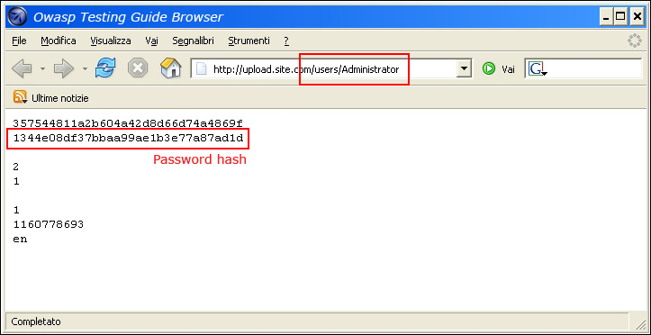

# Omisión del esquema de autorización

|ID          |
|------------|
|WSTG-ATHZ-02|

## Resumen

Este caso de prueba se centra en identificar debilidades de autorización que permiten a un usuario autenticado acceder a recursos o realizar acciones más allá de los permisos que tiene asignados, incluida la escalada horizontal y vertical de privilegios.

Aunque algunas comprobaciones pueden incluir situaciones como el acceso directo a recursos protegidos sin una sesión activa o después de cerrar sesión, el objetivo principal de esta prueba es validar que los controles de autorización se apliquen correctamente a los usuarios y roles autenticados.

En la sección Cómo probar se describen en detalle las situaciones de acceso no autenticado y posteriores a la autenticación.

## Objetivos de la prueba

- Evaluar si es posible el acceso no autenticado, horizontal o vertical.

## Cómo probar

- Acceder a recursos y realizar operaciones sin iniciar sesión. - Solicitud directa de página ([navegación forzada](https://owasp.org/www-community/attacks/Forced_browsing))
- Acceder a recursos y realizar operaciones horizontalmente.
- Acceder a recursos y realizar operaciones verticalmente.

### Acceso no autenticado básico

#### Uso manual de un navegador

Cuando una aplicación web no aplica correctamente los mecanismos de control de acceso, los recursos sensibles quedan expuestos y los usuarios no autenticados pueden verlos. Por ejemplo, si un usuario solicita directamente una página diferente mediante navegación forzada, es posible que esa página no compruebe la autorización del usuario anónimo antes de conceder el acceso. Para probar este método, intente acceder directamente a una página protegida desde la barra de direcciones del navegador.

\
*Figura 4.5.2-1: Solicitud directa a una página protegida*

#### Uso de herramientas automatizadas

Este proceso se puede automatizar si cuenta con una lista de todos los puntos de conexión, con herramientas como ffuf, gobuster, ZAP y Burp Suite Intruder.

En ZAP, el uso de un complemento para [pruebas de control de acceso](https://www.zaproxy.org/docs/desktop/addons/access-control-testing/) permite a los evaluadores determinar qué partes de la aplicación están disponibles para los usuarios anónimos e identificar posibles problemas de control de acceso.

En Burp Suite, las herramientas integradas, como Intruder, y varios complementos, entre ellos Autorize, ayudan al evaluador a automatizar las pruebas de autorización.

### Omisión horizontal

Para cada función, rol específico o solicitud que ejecute la aplicación, es necesario verificar lo siguiente:

- ¿Es posible acceder a recursos que deberían estar disponibles para un usuario con una identidad diferente, pero con el mismo rol o privilegio?
- ¿Es posible ejecutar funciones sobre recursos que deberían estar disponibles para un usuario con una identidad diferente?

Para cada rol:

1. Registre o genere dos usuarios con privilegios idénticos.
2. Establezca y mantenga activas dos sesiones diferentes, una para cada usuario.
3. Para cada solicitud, cambie los parámetros pertinentes y el identificador de sesión del token uno por el token dos, y analice las respuestas de cada token.
4. Se considerará que una aplicación es vulnerable si las respuestas son iguales, contienen los mismos datos privados o indican que se realizó correctamente una operación sobre los recursos o datos de otros usuarios.

Por ejemplo, suponga que la función `viewSettings` forma parte del menú de cuenta de cada usuario de la aplicación con el mismo rol, y que se puede acceder a ella solicitando la siguiente URL: `https://www.example.com/account/viewSettings`. Al llamar a la función `viewSettings`, se genera la siguiente solicitud HTTP:

```http
POST /account/viewSettings HTTP/1.1
Host: www.example.com
[other HTTP headers]
Cookie: SessionID=USER_SESSION

username=example_user
```

Respuesta válida y legítima:

```html
HTTP1.1 200 OK
[other HTTP headers]

{
  "username": "example_user",
  "email": "example@email.com",
  "address": "Example Address"
}
```

El atacante puede intentar ejecutar esa solicitud con el mismo parámetro `username`, pero especificando un usuario diferente:

```html
POST /account/viewSettings HTTP/1.1
Host: www.example.com
[other HTTP headers]
Cookie: SessionID=ATTACKER_SESSION

username=victim_user
```

Si la respuesta del atacante contiene los datos de `victim_user`, la aplicación es vulnerable a ataques de movimiento lateral, en los que un usuario puede leer o modificar los datos de otro usuario.

Es posible automatizar los pasos 3 y 4. La pestaña Authorize de Gori reproduce una solicitud capturada con varias identidades y compara cada respuesta con una referencia. Una identidad es un conjunto con nombre de cambios en las cabeceras: conservar la sesión capturada de la víctima, sustituirla por el token de un segundo usuario o eliminar las cabeceras de sesión para simular un cliente anónimo.

`gori run authorize` realiza la misma reproducción mediante un script y toma las identidades de un archivo:

```json
[
  { "name": "victim (baseline)", "baseline": true },
  { "name": "other-user", "set": [{ "name": "Authorization", "value": "Bearer <other-user-jwt>" }] },
  { "name": "anonymous", "remove": ["Authorization"] }
]
```

Al ejecutarlo contra una solicitud correspondiente a la cesta de la compra de un usuario en OWASP Juice Shop:

```text
$ gori run authorize --query "path:/rest/basket/6" --identities identities.json
authorizing 1 request × 3 identities (victim (baseline), other-user, anonymous) = 3 requests
[!] BYPASS    #1     GET    http://localhost:3000/rest/basket/6  · 1 of 2 identities matched the baseline
      victim (baseline)   baseline  200  154B     -
      other-user          same      200  154B     Δ status 200 · size same · time -11 ms
      anonymous           different 401  984B     Δ status 200 → 401 · size +830 B · time -22 ms
done · 1 request replayed · 3 sends · 1 possible bypass
```

La identidad `other-user` recibe la misma respuesta `200` que la víctima, por lo que el punto de conexión no comprueba que la cesta pertenezca a quien realiza la solicitud. La identidad `anonymous` es rechazada correctamente con el código `401`.

### Acceso a funciones administrativas

Por ejemplo, suponga que la función `addUser` forma parte del menú administrativo de la aplicación y que se puede acceder a ella solicitando la siguiente URL: `https://www.example.com/admin/addUser`.

Al llamar a la función `addUser`, se genera la siguiente solicitud HTTP:

```http
POST /admin/addUser HTTP/1.1
Host: www.example.com
[...]

userID=fakeuser&role=3&group=grp001
```

Otras preguntas o consideraciones serían las siguientes:

- ¿Qué sucede si un usuario no administrativo intenta ejecutar esa solicitud?
- ¿Se creará el usuario?
- Si es así, ¿podrá el nuevo usuario utilizar sus privilegios?

### Acceso a recursos asignados a un rol diferente

Varias aplicaciones configuran controles de acceso a los recursos según los roles de los usuarios. Tomemos como ejemplo los currículos o CV (curriculum vitae) que se cargan en un formulario de empleo a un bucket de S3.

Como usuario normal, intente acceder a la ubicación de esos archivos. Si puede recuperarlos, modificarlos o eliminarlos, la aplicación es vulnerable.

### Manejo de cabeceras de solicitud especiales

Algunas aplicaciones admiten cabeceras no estándar, como `X-Original-URL` o `X-Rewrite-URL`, para permitir que se sobrescriba la URL de destino de las solicitudes con la especificada en el valor de la cabecera.

Este comportamiento se puede aprovechar cuando la aplicación está detrás de un componente que aplica restricciones de control de acceso según la URL de la solicitud.

Por ejemplo, se puede aplicar una restricción de control de acceso basada en la URL de la solicitud para bloquear desde Internet el acceso a una consola de administración expuesta en `/console` o `/admin`.

Para detectar si se admiten las cabeceras `X-Original-URL` o `X-Rewrite-URL`, se pueden seguir estos pasos.

#### 1. Enviar una solicitud normal sin ninguna cabecera X-Original-Url ni X-Rewrite-Url

```http
GET / HTTP/1.1
Host: www.example.com
[...]
```

#### 2. Enviar una solicitud con una cabecera X-Original-Url que apunte a un recurso inexistente

```html
GET / HTTP/1.1
Host: www.example.com
X-Original-URL: /donotexist1
[...]
```

#### 3. Enviar una solicitud con una cabecera X-Rewrite-Url que apunte a un recurso inexistente

```html
GET / HTTP/1.1
Host: www.example.com
X-Rewrite-URL: /donotexist2
[...]
```

Si la respuesta a cualquiera de las solicitudes contiene indicadores de que no se encontró el recurso, esto significa que la aplicación admite las cabeceras de solicitud especiales. Estos indicadores pueden incluir el código de estado HTTP 404 o un mensaje de «recurso no encontrado» en el cuerpo de la respuesta.

Una vez validada la compatibilidad con la cabecera `X-Original-URL` o `X-Rewrite-URL`, se puede intentar omitir la restricción de control de acceso enviando a la aplicación la solicitud prevista, pero especificando como URL principal de la solicitud una URL «permitida» por el componente frontend y especificando la URL de destino real en la cabecera `X-Original-URL` o `X-Rewrite-URL`, según cuál de ellas se admita. Si se admiten ambas, pruebe una y luego la otra para determinar con cuál de las cabeceras se logra la omisión.

#### 4. Otras cabeceras que se deben considerar

A menudo, los paneles de administración o las funciones relacionadas con la administración solo son accesibles para clientes de redes locales. Por lo tanto, es posible que se pueda obtener acceso abusando de diversas cabeceras HTTP relacionadas con proxies o reenvíos. Algunas cabeceras y valores que se pueden probar son:

- Cabeceras:
    - `X-Forwarded-For`
    - `X-Forward-For`
    - `X-Remote-IP`
    - `X-Originating-IP`
    - `X-Remote-Addr`
    - `X-Client-IP`
- Valores
    - `127.0.0.1` (o cualquier dirección de los espacios `127.0.0.0/8` o `::1/128`)
    - `localhost`
    - Cualquier dirección [RFC1918](https://tools.ietf.org/html/rfc1918):
        - `10.0.0.0/8`
        - `172.16.0.0/12`
        - `192.168.0.0/16`
    - Direcciones de enlace local: `169.254.0.0/16`

> Nota: Incluir un puerto junto con la dirección o el nombre de host también puede ayudar a omitir las protecciones perimetrales, como los firewalls de aplicaciones web, entre otras.
Por ejemplo: `127.0.0.4:80`, `127.0.0.4:443`, `127.0.0.4:43982`

## Remediación

Aplique el principio de mínimo privilegio a los usuarios, los roles y los recursos para garantizar que no se produzca ningún acceso no autorizado.

## Herramientas

- [Zed Attack Proxy (ZAP)](https://www.zaproxy.org/)
    - [Complemento de ZAP: Pruebas de control de acceso](https://www.zaproxy.org/docs/desktop/addons/access-control-testing/)
- [Port Swigger Burp Suite](https://portswigger.net/burp)
    - [Extensión de Burp: AuthMatrix](https://github.com/SecurityInnovation/AuthMatrix/)
    - [Extensión de Burp: Autorize](https://github.com/Quitten/Autorize)
- [Gori](https://github.com/hahwul/gori)
    - La pestaña Authorize reproduce una solicitud con varias identidades para detectar omisiones de controles de acceso; también se puede ejecutar mediante un script con `gori run authorize`.

## Referencias

[OWASP Application Security Verification Standard 4.0.1](https://github.com/OWASP/ASVS/tree/master/4.0), v4.0.1-1, v4.0.1-4, v4.0.1-9, v4.0.1-16