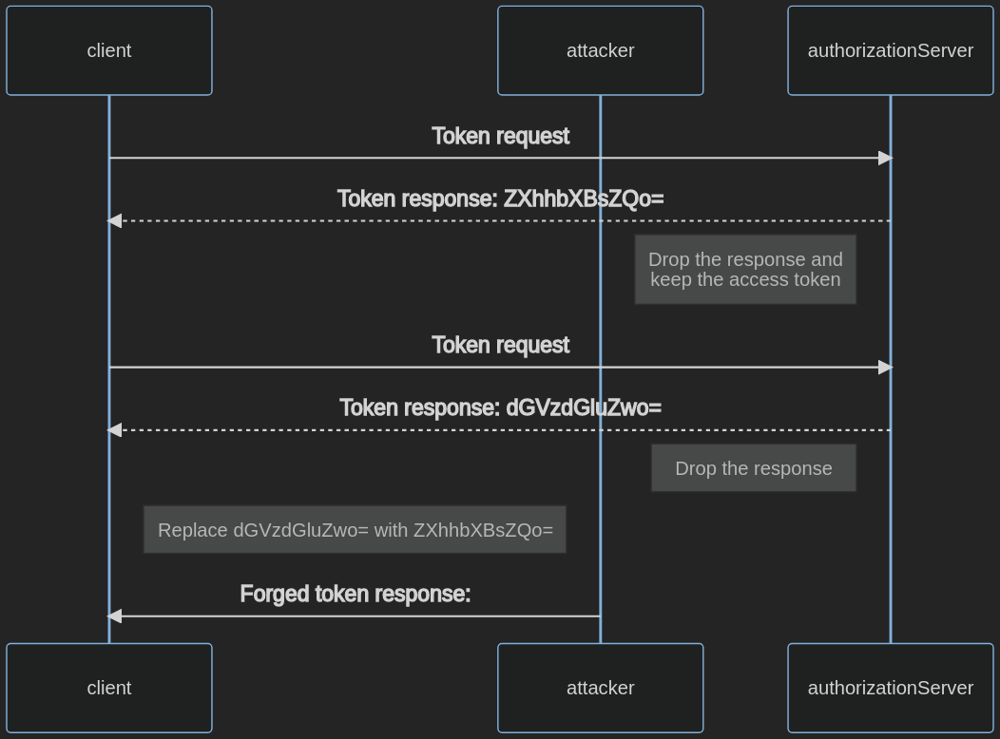

# Debilidades del cliente de OAuth

## Resumen

OAuth otorga a los clientes derechos de acceso a recursos. Esto les permite actuar en nombre del propietario del recurso. El cliente recibe el código de autorización y el token de actualización durante el intercambio de tokens y los almacena.

No proteger el intercambio de tokens y las credenciales puede dar lugar a un acceso no autorizado a los recursos y a una elevación de privilegios.

## Objetivos de la prueba

- Identificar debilidades en el cliente de OAuth.

## Cómo probar

Para probar las debilidades del cliente, se busca:

1. Recuperar las credenciales utilizadas para la autorización.
2. Obtener acceso a recursos arbitrarios mediante navegación forzada.
3. Evadir la autorización.

### Secreto de cliente expuesto

El secreto de cliente se utiliza para autenticar al cliente ante el servidor de autorización (AS) y demostrar que el cliente es un origen de confianza.

Por lo general, los clientes públicos no pueden almacenar el secreto de cliente de forma segura.

Para identificar el secreto de cliente en el código del lado del cliente, realiza un reconocimiento del código del lado del cliente.

1. Navega a la aplicación.
2. Abre las herramientas de desarrollador del navegador.
3. Ve a la pestaña Debugger.
4. Presiona Ctrl+Shift+F para abrir la búsqueda.
5. Busca términos similares a `client-secret` y determina si encuentras alguno.

Si esto no funciona, también puedes:

1. Recorrer el proceso de autorización con un proxy de intercepción HTTP, como ZAP.
2. Recuperar el secreto de cliente de la URI en el parámetro `client-secret`.
3. Reemplazar el término de búsqueda de la búsqueda anterior por el valor del secreto de cliente y determinar si está expuesto.

### Almacenamiento inadecuado de tokens

El cliente recibe tokens de acceso e, idealmente, los almacena en una ubicación donde puedan protegerse de los atacantes.

Los clientes confidenciales deben almacenar los tokens en memoria volátil para impedir el acceso mediante otros ataques, como la inclusión de archivos locales, el acceso al entorno por parte de atacantes o los ataques de inyección SQL.

Los clientes públicos, como las aplicaciones de página única, no pueden almacenar tokens de forma segura. Por ejemplo, un ataque de cross-site scripting permite a los atacantes acceder a las credenciales almacenadas en el navegador.

Los clientes públicos pueden almacenar tokens en el almacenamiento de sesión del navegador o en una cookie, pero no en el almacenamiento local. Para determinar si los tokens están almacenados de forma inadecuada:

1. Navega a la aplicación.
2. Recupera un token de acceso.
3. Abre las herramientas de desarrollador del navegador.
4. Ve a la pestaña Application.
5. Localiza Local Storage y revisa los datos almacenados.
6. Localiza Session Storage y revisa los datos almacenados.
7. Localiza Cookie Store y revisa los datos almacenados.

### Inyección de tokens de acceso

Este ataque solo es posible cuando el cliente utiliza un tipo de respuesta que emite directamente un token de acceso al cliente. Esto ocurre con los tipos de concesión Implicit Flows, Resource Owner Password Credential y los flujos de máquina a máquina. Consulta [Debilidades de OAuth](05-OAuth_Weaknesses.md) para obtener más detalles.

La inyección de tokens de acceso tiene éxito cuando se filtra un token de acceso a un atacante y este lo utiliza para autenticarse con el cliente legítimo.

Para probar la inyección de tokens de acceso, sigue los pasos que se indican a continuación. En este ejemplo, se filtró el token de autorización (`ZXhhbXBsZQo=`).

1. Intercepta el tráfico entre el cliente y el servidor de autorización.
2. Inicia un flujo de OAuth con un cliente que utilice el tipo de concesión Implicit Flow.
3. Inyecta el token de acceso robado:
    - Envía al cliente una respuesta de autorización falsificada con el token de acceso robado (`ZXhhbXBsZQo=`).
    - Intercepta una respuesta de autorización válida y reemplaza el token de acceso (`dGVzdGluZwo=`) por el token filtrado (`ZXhhbXBsZQo=`).

\
*Figura 4.5.5.2-: Flujo de inyección de tokens de acceso*

## Casos de prueba relacionados

- [Cross Site Request Forgery](../06-Session_Management/05-Cross_Site_Request_Forgery.md)
- [Redirección de URL del lado del cliente](../11-Client-side/04-Client-side_URL_Redirect.md)
- [Pruebas de JSON Web Tokens](../06-Session_Management/10-JSON_Web_Tokens.md)
- [Clickjacking](../11-Client-side/09-Clickjacking.md)
- [Pruebas de Cross Origin Resource Sharing](../11-Client-side/07-Cross_Origin_Resource_Sharing.md)

## Remediación

- Utiliza un secreto de cliente solo si el cliente puede almacenarlo de forma segura.
- Sigue las prácticas recomendadas para almacenar los tokens de forma segura. Aplica a estos las mismas consideraciones de seguridad que a otras credenciales.
- Evita los tipos de concesión de OAuth obsoletos. Consulta [Debilidades de OAuth](05-OAuth_Weaknesses.md) para obtener más detalles.

## Herramientas

- [BurpSuite](https://portswigger.net/burp/releases)
- [EsPReSSO](https://github.com/portswigger/espresso)
- [ZAP](https://www.zaproxy.org/)

## Referencias

- [User Authentication with OAuth 2.0](https://oauth.net/articles/authentication/)
- [The OAuth 2.0 Authorization Framework](https://datatracker.ietf.org/doc/html/rfc6749)
- [The OAuth 2.0 Authorization Framework: Bearer Token Usage](https://datatracker.ietf.org/doc/html/rfc6750)
- [OAuth 2.0 Threat Model and Security Considerations](https://datatracker.ietf.org/doc/html/rfc6819)
- [OAuth 2.0 Security Best Current Practice](https://datatracker.ietf.org/doc/html/rfc9700)
- [Authorization Code Flow with Proof Key for Code Exchange](https://auth0.com/docs/get-started/authentication-and-authorization-flow/authorization-code-flow-with-pkce)