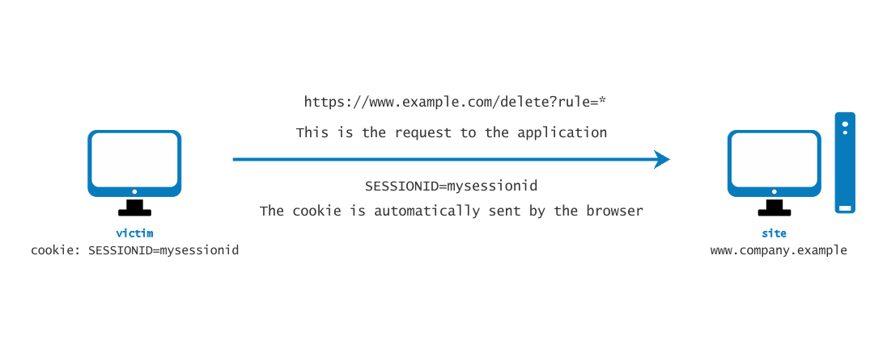
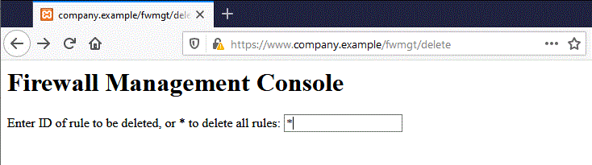
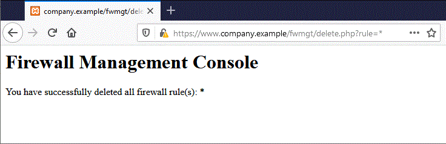

# Falsificación de solicitudes entre sitios

|ID          |
|------------|
|WSTG-SESS-05|

## Resumen

La falsificación de solicitudes entre sitios ([CSRF](https://owasp.org/www-community/attacks/csrf)) es un ataque que obliga a un usuario final a ejecutar acciones no deseadas en una aplicación web en la que ya está autenticado. Con un poco de ayuda de ingeniería social (como enviar un enlace por correo electrónico o chat), un atacante puede obligar a los usuarios de una aplicación web a ejecutar las acciones que el atacante elija. Un exploit CSRF exitoso puede comprometer los datos y las operaciones del usuario final cuando tiene como objetivo a un usuario normal. Si el usuario final objetivo es la cuenta de administrador, un ataque CSRF puede comprometer toda la aplicación web.

CSRF se basa en:

1. El comportamiento del navegador web respecto al manejo de información relacionada con la sesión, como cookies e información de autenticación HTTP.
2. El conocimiento del atacante de URLs, solicitudes o funcionalidades válidas de la aplicación web.
3. La gestión de sesiones de la aplicación depende únicamente de información conocida por el navegador.
4. La existencia de etiquetas HTML cuya presencia provoca el acceso inmediato a un recurso HTTP[S]; por ejemplo, la etiqueta de imagen `img`.

Los puntos 1, 2 y 3 son esenciales para que exista la vulnerabilidad, mientras que el punto 4 facilita la explotación, pero no es estrictamente necesario.

1. Los navegadores envían automáticamente la información utilizada para identificar una sesión de usuario. Supongamos que *site* es un sitio que aloja una aplicación web y que el usuario *victim* acaba de autenticarse en *site*. Como respuesta, *site* envía a *victim* una cookie que identifica las solicitudes enviadas por *victim* como pertenecientes a su sesión autenticada. Una vez que el navegador recibe la cookie establecida por *site*, la enviará automáticamente con cualquier solicitud posterior dirigida a *site*.
2. Si la aplicación no utiliza información relacionada con la sesión en las URLs, es posible identificar las URLs de la aplicación, sus parámetros y los valores legítimos. Esto puede lograrse mediante el análisis del código o accediendo a la aplicación y tomando nota de los formularios y las URLs incluidos en el HTML o JavaScript.
3. «Conocido por el navegador» se refiere a información como cookies o información de autenticación basada en HTTP (como la Autenticación Básica, no la autenticación basada en formularios) que el navegador almacena y que posteriormente está presente en cada solicitud dirigida a un área de la aplicación que requiere esa autenticación. Las vulnerabilidades que se describen a continuación se aplican a las aplicaciones que dependen por completo de este tipo de información para identificar una sesión de usuario.

Por simplicidad, consideremos URLs accesibles mediante GET (aunque la explicación también se aplica a las solicitudes POST). Si *victim* ya se autenticó, al enviar otra solicitud la cookie se enviará automáticamente con ella. La figura siguiente muestra al usuario accediendo a una aplicación en `www.example.com`.

\
*Figura 4.6.5-1: Deslizamiento de sesión*

El usuario puede enviar la solicitud GET de varias formas:

- Usando la aplicación web
- Escribiendo la URL directamente en el navegador
- Siguiendo un enlace externo que apunta a la URL

La aplicación no puede distinguir entre estas formas de invocar la solicitud. En particular, la tercera puede ser bastante peligrosa. Hay varias técnicas y vulnerabilidades que pueden ocultar las propiedades reales de un enlace. El enlace puede estar incluido en un mensaje de correo electrónico, aparecer en un sitio malicioso al que se atrae al usuario o aparecer en contenido alojado por un tercero (como otro sitio o un correo electrónico en HTML) y apuntar a un recurso de la aplicación. Si el usuario hace clic en el enlace, dado que ya está autenticado en la aplicación web de *site*, el navegador enviará una solicitud GET a la aplicación web, acompañada de información de autenticación (la cookie del ID de sesión). Esto da lugar a que se ejecute en la aplicación web una operación válida que el usuario no esperaba; por ejemplo, una transferencia de fondos en una aplicación de banca web.

Al utilizar una etiqueta como `img`, según se especifica en el punto 4 anterior, ni siquiera es necesario que el usuario siga un enlace concreto. Supongamos que el atacante envía al usuario un correo electrónico que lo induce a visitar una URL que apunta a una página con el siguiente HTML (simplificado en exceso).

```html
<html>
    <body>
...

...
    </body>
</html>
```

Cuando el navegador muestra esta página, también intentará mostrar la imagen especificada, de dimensiones nulas (y, por tanto, invisible), desde `https://www.company.example`. Esto provoca que se envíe automáticamente una solicitud a la aplicación web alojada en *site*. No importa que la URL de la imagen no apunte a una imagen válida, ya que su presencia activará de todos modos la solicitud `action` especificada en el campo `src`. Esto ocurre siempre que la descarga de imágenes no esté deshabilitada en el navegador. La mayoría de los navegadores no deshabilitan la descarga de imágenes, pues hacerlo dejaría inutilizables la mayoría de las aplicaciones web.

Este problema es consecuencia de lo siguiente:

- Las etiquetas HTML de la página provocan la ejecución automática de solicitudes HTTP (`img` es una de ellas).
- El navegador no tiene forma de saber que el recurso al que apunta `img` no es una imagen legítima.
- Las imágenes se cargan independientemente de la ubicación de la supuesta fuente; es decir, el formulario y la imagen no tienen que estar en el mismo host ni siquiera en el mismo dominio.

El hecho de que contenido HTML no relacionado con la aplicación web pueda hacer referencia a componentes de la aplicación, sumado a que el navegador compone automáticamente una solicitud válida hacia la aplicación, permite este tipo de ataque. No hay forma de impedir este comportamiento, salvo que se imposibilite que el atacante interactúe con la funcionalidad de la aplicación.

En entornos integrados de correo y navegador, basta con mostrar un mensaje de correo electrónico que contenga la referencia a la imagen para que se ejecute la solicitud a la aplicación web con la cookie correspondiente del navegador. Los mensajes de correo electrónico pueden incluir URLs de imágenes aparentemente válidas, como:

```html

```

En este ejemplo, `[attacker]` es un sitio controlado por el atacante. Mediante un mecanismo de redirección, el sitio malicioso puede usar `https://[attacker]/picture.gif` para dirigir a la víctima a `https://[thirdparty]/action` y activar la `action`.

Las cookies no son el único caso de este tipo de vulnerabilidad. También son vulnerables las aplicaciones web cuya información de sesión es proporcionada íntegramente por el navegador. Esto incluye las aplicaciones que dependen únicamente de mecanismos de autenticación HTTP, ya que el navegador conoce la información de autenticación y la envía automáticamente con cada solicitud. No incluye la autenticación basada en formularios, que ocurre una sola vez y genera algún tipo de información relacionada con la sesión, normalmente una cookie.

Supongamos que la víctima inició sesión en una consola web de administración de un firewall. Para iniciar sesión, el usuario debe autenticarse y la información de sesión se almacena en una cookie.

Supongamos que la consola web de administración del firewall tiene una función que permite a un usuario autenticado eliminar una regla especificada por su ID numérico o todas las reglas de la configuración si el usuario especifica `*` (una función peligrosa en la realidad, pero que hace más interesante el ejemplo). La página de eliminación se muestra a continuación. Supongamos que el formulario, por simplicidad, envía una solicitud GET. Para eliminar la regla número uno:

```text
https://[target]/fwmgt/delete?rule=1
```

Para eliminar todas las reglas:

```text
https://[target]/fwmgt/delete?rule=*
```

Este ejemplo es intencionalmente ingenuo, pero muestra de forma simplificada los peligros de CSRF.

\
*Figura 4.6.5-2: Deslizamiento de sesión en la administración del firewall*

Al introducir el valor `*` en el formulario de la figura anterior y hacer clic en el botón Delete, se enviará la siguiente solicitud GET:

```text
https://www.company.example/fwmgt/delete?rule=*
```

Esto eliminaría todas las reglas del firewall.

\
*Figura 4.6.5-3: Deslizamiento de sesión en la administración del firewall 2*

El usuario también podría haber obtenido el mismo resultado enviando manualmente la URL:

```text
https://[target]/fwmgt/delete?rule=*
```

O siguiendo un enlace que apunte, directamente o mediante una redirección, a la URL anterior. O, también, accediendo a una página HTML con una etiqueta `img` incluida que apunte a la misma URL.

En todos estos casos, si el usuario tiene una sesión activa en la aplicación de administración del firewall, la solicitud tendrá éxito y modificará la configuración del firewall. Se pueden imaginar ataques dirigidos a aplicaciones sensibles que realicen pujas automáticas en subastas, transferencias de dinero, pedidos, cambios en la configuración de componentes de software críticos, etc.

Un aspecto interesante es que estas vulnerabilidades pueden explotarse detrás de un firewall; es decir, basta con que el enlace atacado sea accesible para la víctima, no necesariamente para el atacante. En particular, puede tratarse de cualquier servidor web de una intranet; por ejemplo, el del escenario de administración del firewall mencionado antes, que probablemente no esté expuesto a Internet.

Las aplicaciones vulnerables a sí mismas, es decir, las que se utilizan tanto como vector de ataque como objetivo (como las aplicaciones de correo web), empeoran la situación. Como los usuarios tienen una sesión activa cuando leen sus mensajes de correo electrónico, una aplicación vulnerable de este tipo puede permitir a los atacantes realizar acciones como eliminar mensajes o enviar mensajes que parezcan provenir de la víctima.

## Objetivos de prueba

- Determinar si es posible iniciar solicitudes en nombre de un usuario que este no haya iniciado.

## Cómo probar

### Consideraciones sobre la cookie SameSite

Que las PoC anteriores funcionen depende del atributo [`SameSite`](02-Cookies_Attributes.md#samesite-attribute) de la cookie de sesión y del valor predeterminado del navegador. Consulte esa sección para saber cómo `SameSite=Lax` trata las navegaciones de nivel superior frente a las solicitudes de subrecursos.

En resumen: la PoC con la etiqueta `img` es una solicitud de subrecurso y la PoC con formulario de envío automático utiliza `POST`; ninguna de las dos cumple la excepción de `Lax` para navegaciones de nivel superior con un método seguro. Por lo tanto, en un navegador cuyo valor predeterminado sea `Lax` (los navegadores basados en Chromium desde principios de 2020), la cookie de sesión no se adjuntará y la PoC, tal como está escrita, no se ejecutará. Un formulario que use `method="GET"` sí funcionaría con `Lax`, ya que se trata de una navegación GET de nivel superior. Tenga en cuenta también que, cuando `Lax` se aplica de forma predeterminada, los [navegadores basados en Chromium relajan aún más esta política durante los dos primeros minutos tras establecer la cookie](https://developer.mozilla.org/en-US/docs/Web/HTTP/Reference/Headers/Set-Cookie#samesitesamesite-value) y siguen incluyéndola en las solicitudes `POST`; por ello, una PoC basada en POST que se active inmediatamente después de la autenticación podría funcionar.

No concluya que una aplicación está protegida contra CSRF solo porque una PoC no se ejecute en un navegador; compruebe el encabezado `Set-Cookie` de la cookie de sesión y, si es necesario, vuelva a probar en un navegador cuyo valor predeterminado no sea `Lax` (por ejemplo, Firefox) para confirmar si existe la vulnerabilidad subyacente.

### Gestión de sesiones

Audite la aplicación para determinar si su gestión de sesiones es vulnerable. Si la gestión de sesiones depende únicamente de valores del lado del cliente (información disponible para el navegador), la aplicación es vulnerable. «Valores del lado del cliente» se refiere a cookies y credenciales de autenticación HTTP (Autenticación Básica y otras formas de autenticación HTTP; no a la autenticación basada en formularios, que es una autenticación a nivel de aplicación).

Los recursos accesibles mediante solicitudes HTTP GET son fácilmente vulnerables, aunque las solicitudes POST también pueden automatizarse mediante JavaScript y son vulnerables. Por lo tanto, usar solo POST no basta para evitar las vulnerabilidades CSRF.

En el caso de POST, se puede utilizar el siguiente ejemplo.

1. Cree una página HTML similar a la que se muestra a continuación
2. Aloje el HTML en un sitio malicioso o de terceros
3. Envíe el enlace a la página a las víctimas e indúzcalas a hacer clic en él.

```html
<html>
<body onload='document.CSRF.submit()'>

<form action='https://targetWebsite/Authenticate.jsp' method='POST' name='CSRF'>
    <input type='hidden' name='name' value='Hacked'>
    <input type='hidden' name='password' value='Hacked'>
</form>

</body>
</html>
```

En las aplicaciones web cuyos desarrolladores utilizan JSON para la comunicación entre el navegador y el servidor, puede surgir un problema porque el formato JSON no tiene parámetros de consulta, que son necesarios para los formularios de envío automático. Para superar este problema, podemos utilizar un formulario de envío automático con cargas útiles JSON que incluya una entrada oculta para explotar CSRF. Debemos cambiar el tipo de codificación (`enctype`) a `text/plain` para garantizar que la carga útil se envíe tal cual. El código del exploit sería el siguiente:

```html
<html>
 <body>
  <script>history.pushState('', '', '/')</script>
   <form action='https://victimsite.com' method='POST' enctype='text/plain'>
     <input type='hidden' name='{"name":"hacked","password":"hacked","padding":"'value='something"}' />
     <input type='submit' value='Submit request' />
   </form>
 </body>
</html>
```

La solicitud POST será la siguiente:

```http
POST / HTTP/1.1
Host: victimsite.com
Content-Type: text/plain

{"name":"hacked","password":"hacked","padding":"=something"}
```

Cuando estos datos se envían como una solicitud POST, el servidor aceptará los campos `name` y `password` e ignorará el campo llamado `padding`, ya que no lo necesita.

## Remediación

- Consulte la [OWASP CSRF Prevention Cheat Sheet](https://cheatsheetseries.owasp.org/cheatsheets/Cross-Site_Request_Forgery_Prevention_Cheat_Sheet.html) para conocer las medidas de prevención.

## Herramientas

- [ZAP](https://www.zaproxy.org/)
- [CSRFShark](https://csrfshark.github.io/) - Genera pruebas de concepto para ataques de falsificación de solicitudes entre sitios y permite compartir los resultados.

## Referencias

- [Peter W: "Cross-Site Request Forgeries"](https://web.archive.org/web/20160303230910/http://www.tux.org/~peterw/csrf.txt)
- [Thomas Schreiber: "Session Riding"](https://web.archive.org/web/20160304001446/https://www.securenet.de/papers/Session_Riding.pdf)
- [Oldest known post](https://web.archive.org/web/20000622042229/https://www.zope.org/Members/jim/ZopeSecurity/ClientSideTrojan)
- [Cross-site Request Forgery FAQ](https://www.cgisecurity.com/csrf-faq.html)
- [A Most-Neglected Fact About Cross Site Request Forgery (CSRF)](https://yehg.net/lab/pr0js/view.php/A_Most-Neglected_Fact_About_CSRF.pdf)
- [Multi-POST CSRF](https://www.lanmaster53.com/blog/2013/07/17/multi-post-csrf/)
- [SANS Pen Test Webcast: Complete Application pwnage via Multi POST XSRF](https://www.youtube.com/watch?v=EOs5PZiiwug)