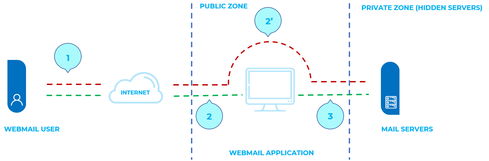

# Inyección IMAP/SMTP

|ID          |
|------------|
|WSTG-INJT-10|

## Resumen

Esta amenaza afecta a todas las aplicaciones que se comunican con servidores de correo (IMAP/SMTP), generalmente aplicaciones de webmail. El objetivo de esta prueba es verificar la capacidad de inyectar comandos IMAP/SMTP arbitrarios en los servidores de correo debido a que los datos de entrada no se sanitizan correctamente.

La técnica de inyección IMAP/SMTP es más efectiva si el servidor de correo no es directamente accesible desde Internet. Cuando es posible la comunicación completa con el servidor de correo backend, se recomienda realizar pruebas directas.

Una inyección IMAP/SMTP permite acceder a un servidor de correo que, de otro modo, no sería directamente accesible desde Internet. En algunos casos, estos sistemas internos no tienen el mismo nivel de seguridad de infraestructura y endurecimiento que se aplica a los servidores web front-end. Por lo tanto, los servidores de correo pueden ser más vulnerables a ataques por parte de usuarios finales (véase el esquema presentado en la Figura 1).

\
*Figura 4.7.10-1: Comunicación con los servidores de correo mediante la técnica de inyección IMAP/SMTP*

La Figura 1 muestra el flujo de tráfico que generalmente se observa al usar tecnologías de webmail. En los pasos 1 y 2, el usuario interactúa con el cliente de webmail; en cambio, en el paso 2, el evaluador omite el cliente de webmail e interactúa directamente con los servidores de correo backend.

Esta técnica permite una amplia variedad de acciones y ataques. Las posibilidades dependen del tipo y alcance de la inyección y de la tecnología del servidor de correo que se está probando.

Algunos ejemplos de ataques que utilizan la técnica de inyección IMAP/SMTP son:

- Explotación de vulnerabilidades en el protocolo IMAP/SMTP
- Evasión de las restricciones de la aplicación
- Evasión de procesos anti-automatización
- Fugas de información
- Relay/SPAM

## Objetivos de la prueba

- Identificar puntos de inyección IMAP/SMTP.
- Entender el flujo de datos y la estructura de despliegue del sistema.
- Evaluar los impactos de la inyección.

## Cómo probar

### Identificación de parámetros vulnerables

Para detectar parámetros vulnerables, el evaluador debe analizar la capacidad de la aplicación para manejar entradas. Las pruebas de validación de entradas requieren que el evaluador envíe solicitudes falsas o maliciosas al servidor y analice la respuesta. En una aplicación segura, la respuesta debería ser un error acompañado de alguna acción que indique al cliente que algo salió mal. En una aplicación vulnerable, la solicitud maliciosa puede ser procesada por la aplicación backend, que responderá con un mensaje `HTTP 200 OK`.

Es importante tener en cuenta que las solicitudes enviadas deben corresponder a la tecnología que se está probando. Enviar cadenas de inyección SQL para Microsoft SQL server cuando se está usando un servidor MySQL dará lugar a respuestas positivas falsas. En este caso, enviar comandos IMAP maliciosos es el procedimiento habitual, ya que IMAP es el protocolo subyacente que se está probando.

Los parámetros especiales de IMAP que se deben usar son:

| En el servidor IMAP     | En el servidor SMTP |
|------------------------|--------------------|
| Autenticación         | Correo electrónico del remitente     |
| operaciones con buzones (listar, leer, crear, eliminar, renombrar) | Correo electrónico de destino |
| operaciones con mensajes (leer, copiar, mover, eliminar) | Asunto   |
| Desconexión          | Cuerpo del mensaje       |
|                        | Archivos adjuntos     |

En este ejemplo, se prueba el parámetro "mailbox" manipulando todas las solicitudes que lo contienen:

`https://<webmail>/src/read_body.php?mailbox=INBOX&passed_id=46106&startMessage=1`

Se pueden usar los siguientes ejemplos.

- Asignar un valor nulo al parámetro:

`https://<webmail>/src/read_body.php?mailbox=&passed_id=46106&startMessage=1`

- Sustituir el valor por un valor aleatorio:

`https://<webmail>/src/read_body.php?mailbox=NOTEXIST&passed_id=46106&startMessage=1`

- Agregar otros valores al parámetro:

`https://<webmail>/src/read_body.php?mailbox=INBOX PARAMETER2&passed_id=46106&startMessage=1`

- Agregar caracteres especiales no estándar (por ejemplo: `\`, `'`, `"`, `@`, `#`, `!`, `|`):

`https://<webmail>/src/read_body.php?mailbox=INBOX"&passed_id=46106&startMessage=1`

- Eliminar el parámetro:

`https://<webmail>/src/read_body.php?passed_id=46106&startMessage=1`

El resultado final de las pruebas anteriores ofrece al evaluador tres situaciones posibles:

1. La aplicación devuelve un código o mensaje de error
2. La aplicación no devuelve un código ni un mensaje de error, pero no realiza la operación solicitada
3. La aplicación no devuelve un código ni un mensaje de error y realiza normalmente la operación solicitada

Las situaciones S1 y S2 representan una inyección IMAP/SMTP exitosa.

El objetivo del atacante es recibir la respuesta S1, ya que indica que la aplicación es vulnerable a la inyección y a una manipulación posterior.

Supongamos que un usuario recupera los encabezados del correo electrónico mediante la siguiente solicitud HTTP:

`https://<webmail>/src/view_header.php?mailbox=INBOX&passed_id=46105&passed_ent_id=0`

Un atacante podría modificar el valor del parámetro INBOX inyectando el carácter `"` (%22 mediante codificación URL):

`https://<webmail>/src/view_header.php?mailbox=INBOX%22&passed_id=46105&passed_ent_id=0`

En este caso, la respuesta de la aplicación podría ser:

```txt
ERROR: Bad or malformed request.
Query: SELECT "INBOX""
Server responded: Unexpected extra arguments to Select
```

La situación S2 es más difícil de probar con éxito. El evaluador necesita usar inyección ciega de comandos para determinar si el servidor es vulnerable.

Por otro lado, la última situación (S3) no es relevante en este apartado.

> Lista de parámetros vulnerables
>
> - Funcionalidad afectada
> - Tipo de inyección posible (IMAP/SMTP)

### Comprensión del flujo de datos y la estructura de despliegue del cliente

Después de identificar todos los parámetros vulnerables (por ejemplo, `passed_id`), el evaluador debe determinar qué nivel de inyección es posible y, luego, diseñar un plan de pruebas para explotar aún más la aplicación.

En este caso de prueba, hemos detectado que el parámetro `passed_id` de la aplicación es vulnerable y se usa en la siguiente solicitud:

`https://<webmail>/src/read_body.php?mailbox=INBOX&passed_id=46225&startMessage=1`

Al usar el siguiente caso de prueba (proporcionar un valor alfabético cuando se requiere uno numérico):

`https://<webmail>/src/read_body.php?mailbox=INBOX&passed_id=test&startMessage=1`

se generará el siguiente mensaje de error:

```txt
ERROR : Bad or malformed request.
Query: FETCH test:test BODY[HEADER]
Server responded: Error in IMAP command received by server.
```

En este ejemplo, el mensaje de error devolvió el nombre del comando ejecutado y los parámetros correspondientes.

En otras situaciones, el mensaje de error (no controlado por la aplicación) contiene el nombre del comando ejecutado, pero la lectura del [RFC](#references) adecuado permite al evaluador entender qué otros comandos podrían ejecutarse.

Si la aplicación no devuelve mensajes de error descriptivos, el evaluador debe analizar la funcionalidad afectada para deducir todos los comandos posibles (y sus parámetros) asociados con la funcionalidad mencionada anteriormente. Por ejemplo, si se ha detectado un parámetro vulnerable en la funcionalidad de creación de buzones, es lógico suponer que el comando IMAP afectado es `CREATE`. Según el RFC, el comando `CREATE` acepta un parámetro que especifica el nombre del buzón que se va a crear.

> Lista de comandos IMAP/SMTP afectados
>
> - Tipo, valor y número de parámetros esperados por los comandos IMAP/SMTP afectados

### Inyección de comandos IMAP/SMTP

Una vez que el evaluador ha identificado los parámetros vulnerables y ha analizado el contexto en el que se ejecutan, la siguiente etapa consiste en explotar la funcionalidad.

Esta etapa tiene dos resultados posibles:

1. La inyección es posible sin autenticación: la funcionalidad afectada no requiere que el usuario esté autenticado. Los comandos IMAP inyectados disponibles se limitan a: `CAPABILITY`, `NOOP`, `AUTHENTICATE`, `LOGIN` y `LOGOUT`.
2. La inyección solo es posible con autenticación: para que la explotación tenga éxito, el usuario debe estar completamente autenticado antes de que puedan continuar las pruebas.

En cualquier caso, la estructura típica de una inyección IMAP/SMTP es la siguiente:

- Encabezado: final del comando esperado;
- Cuerpo: inyección del nuevo comando;
- Pie: inicio del comando esperado.

Es importante recordar que, para ejecutar un comando IMAP/SMTP, el comando anterior debe terminarse con la secuencia CRLF (`%0d%0a`).

Supongamos que, en la etapa de [identificación de parámetros vulnerables](#identifying-vulnerable-parameters), el atacante detecta que el parámetro `message_id` de la siguiente solicitud es vulnerable:

`https://<webmail>/read_email.php?message_id=4791`

Supongamos también que el análisis realizado en la etapa 2 («Comprensión del flujo de datos y la estructura de despliegue del cliente») identificó el comando y los argumentos asociados con este parámetro como:

`FETCH 4791 BODY[HEADER]`

En este escenario, la estructura de la inyección IMAP sería:

`https://<webmail>/read_email.php?message_id=4791 BODY[HEADER]%0d%0aV100 CAPABILITY%0d%0aV101 FETCH 4791`

Esto generaría los siguientes comandos:

```sql
???? FETCH 4791 BODY[HEADER]
V100 CAPABILITY
V101 FETCH 4791 BODY[HEADER]
```

donde:

```sql
Header = 4791 BODY[HEADER]
Body   = %0d%0aV100 CAPABILITY%0d%0a
Footer = V101 FETCH 4791
```

> Lista de comandos IMAP/SMTP afectados
>
> - Inyección arbitraria de comandos IMAP/SMTP

## Referencias

### Documentos técnicos

- [RFC 0821 "Simple Mail Transfer Protocol"](https://tools.ietf.org/html/rfc821)
- [RFC 3501 "Internet Message Access Protocol - Version 4rev1"](https://tools.ietf.org/html/rfc3501)