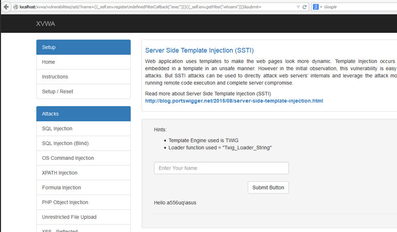

# Inyección de plantillas del lado del servidor

|ID          |
|------------|
|WSTG-INJT-18|

## Resumen

Las aplicaciones web suelen utilizar tecnologías de plantillas del lado del servidor (Jinja2, Twig, FreeMaker, etc.) para generar respuestas HTML dinámicas. Las vulnerabilidades de inyección de plantillas del lado del servidor (SSTI) se producen cuando la entrada del usuario se inserta en una plantilla de forma insegura y da lugar a la ejecución remota de código en el servidor. Cualquier funcionalidad que permita utilizar marcado avanzado proporcionado por el usuario puede ser vulnerable a SSTI, incluidas las páginas wiki, las reseñas, las aplicaciones de marketing, los sistemas CMS, etc. Algunos motores de plantillas emplean distintos mecanismos (por ejemplo, sandbox, listas de permitidos, etc.) para protegerse contra SSTI.

### Ejemplo - Twig

El siguiente ejemplo es un extracto del proyecto [Extreme Vulnerable Web Application](https://github.com/s4n7h0/xvwa).

```php
public function getFilter($name)
{
        [snip]
        foreach ($this->filterCallbacks as $callback) {
        if (false !== $filter = call_user_func($callback, $name)) {
            return $filter;
        }
    }
    return false;
}
```

En la función `getFilter`, la llamada `call_user_func($callback, $name)` es vulnerable a SSTI: el parámetro `name` se obtiene de la solicitud HTTP GET y el servidor lo ejecuta:

\
*Figura 4.7.18-1: Ejemplo de SSTI en XVWA*

### Ejemplo - Flask/Jinja2

El siguiente ejemplo utiliza Flask y el motor de plantillas Jinja2. La función `page` acepta un parámetro 'name' de una solicitud HTTP GET y renderiza una respuesta HTML con el contenido de la variable `name`:

```python
@app.route("/page")
def page():
    name = request.values.get('name')
    output = Jinja2.from_string('Hello ' + name + '!').render()
    return output
```

Este fragmento de código es vulnerable a XSS, pero también a SSTI. Si se utiliza lo siguiente como payload en el parámetro `name`:

```bash
$ curl -g 'https://www.target.com/page?name={{7*7}}'
Hello 49!
```

## Objetivos de la prueba

- Detectar puntos vulnerables a la inyección de plantillas.
- Identificar el motor de plantillas.
- Crear el exploit.

## Cómo probar

Las vulnerabilidades SSTI se producen en contextos de texto o de código. En un contexto de texto sin formato, los usuarios pueden utilizar texto libre con código HTML directo. En un contexto de código, la entrada del usuario también puede colocarse dentro de una instrucción de plantilla (por ejemplo, en un nombre de variable).

### Identificar vulnerabilidades de inyección de plantillas

El primer paso para probar SSTI en un contexto de texto sin formato consiste en crear payloads con expresiones de plantilla comunes utilizadas por distintos motores y supervisar las respuestas del servidor para identificar qué expresión de plantilla ejecutó.

Ejemplos de expresiones de plantilla comunes:

```text
a{{bar}}b
a{{7*7}}
{var} ${var} {{var}} <%var%> [% var %]
```

La sintaxis de las expresiones no es la única superficie de ataque posible. Apache Velocity y FreeMarker también evalúan la sintaxis de *directivas*, que ninguna de las pruebas anteriores activará. Una directiva de asignación almacena su resultado en lugar de imprimirlo, por lo que debe combinarse con una interpolación para que el valor sea observable:

```text
#set($x=7*7)$x
<#assign x=7*7>${x}
```

Ambas muestran `49` cuando se evalúa la directiva. Si se envían sin la interpolación final, no muestran nada, algo importante al crear el exploit: una asignación como `<#assign result=runner("id")>`, donde `runner` es un objeto instanciado por una directiva anterior y no algo que proporcione el motor, invoca el método y no devuelve ninguna salida. Por lo tanto, una respuesta sin cambios no demuestra que el payload no se haya ejecutado. Si la salida está suprimida, confirme la evaluación con un efecto secundario observable, como una consulta DNS fuera de banda o un retraso medible.

En este paso se recomienda consultar una extensa [lista de cadenas/payloads de prueba de expresiones de plantilla](https://github.com/swisskyrepo/PayloadsAllTheThings/tree/master/Server%20Side%20Template%20Injection).

Las pruebas de SSTI en un contexto de código son ligeramente diferentes. Primero, el probador construye una solicitud que produce una respuesta del servidor en blanco o con un error. En el siguiente ejemplo, el parámetro HTTP GET se inserta en la variable `personal_greeting` dentro de una instrucción de plantilla:

```text
personal_greeting=username
Hello user01
```

Al utilizar el siguiente payload, la respuesta del servidor solo muestra "Hello":

```text
personal_greeting=username<tag>
Hello
```

El siguiente paso consiste en salir de la instrucción de plantilla e inyectar una etiqueta HTML después de ella mediante el siguiente payload:

```text
personal_greeting=username}}<tag>
Hello user01 <tag>
```

### Identificar el motor de plantillas

A partir de la información del paso anterior, el probador debe identificar qué motor de plantillas se utiliza, proporcionando distintas expresiones de plantilla. A partir de las respuestas del servidor, el probador deduce qué motor de plantillas se está utilizando. Este enfoque manual se analiza con más detalle en [este artículo](https://portswigger.net/blog/server-side-template-injection?#Identify) de PortSwigger. Para automatizar la identificación de la vulnerabilidad SSTI y del motor de plantillas, existen varias herramientas, como [SSTImap](https://github.com/vladko312/SSTImap) o la [extensión Backslash Powered Scanner para Burp Suite](https://github.com/PortSwigger/backslash-powered-scanner).

### Crear el exploit de RCE

El objetivo principal de este paso es identificar cómo obtener un mayor control del servidor mediante un exploit de RCE, estudiando la documentación de la plantilla e investigando. Las áreas clave de interés son:

- Secciones **Para autores de plantillas** que cubren la sintaxis básica.
- Secciones de **Consideraciones de seguridad**.
- Listas de métodos, funciones, filtros y variables integrados.
- Listas de extensiones/plugins.

El probador también puede identificar qué otros objetos, métodos y propiedades pueden exponerse centrándose en el objeto `self`. Si el objeto `self` no está disponible y la documentación no revela los detalles técnicos, se recomienda realizar una búsqueda por fuerza bruta del nombre de la variable. Una vez identificado el objeto, el siguiente paso consiste en recorrerlo para identificar todos los métodos, propiedades y atributos a los que se puede acceder a través del motor de plantillas. Esto podría dar lugar a otros tipos de hallazgos de seguridad, como escaladas de privilegios y divulgación de información sobre contraseñas de la aplicación, claves API, configuraciones y variables de entorno, etc.

## Herramientas

- [SSTImap](https://github.com/vladko312/SSTImap)
- [Tplmap](https://github.com/epinna/tplmap) - ya no se mantiene; SSTImap es una bifurcación que se desarrolla activamente
- [Extensión Backslash Powered Scanner para Burp Suite](https://github.com/PortSwigger/backslash-powered-scanner)
- [Lista de cadenas/payloads de prueba de expresiones de plantilla](https://github.com/swisskyrepo/PayloadsAllTheThings/tree/master/Server%20Side%20Template%20Injection)

## Referencias

- [James Kettle: Inyección de plantillas del lado del servidor: RCE para las aplicaciones web modernas (documento técnico)](https://portswigger.net/kb/papers/serversidetemplateinjection.pdf)
- [Inyección de plantillas del lado del servidor](https://portswigger.net/blog/server-side-template-injection)
- [Exploración de SSTI en Flask/Jinja2](https://www.lanmaster53.com/blog/2016/03/09/exploring-ssti-flask-jinja2/)
- [Inyección de plantillas del lado del servidor: de la detección a la shell remota](https://www.okiok.com/server-side-template-injection-from-detection-to-remote-shell/)
- [Extreme Vulnerable Web Application](https://github.com/s4n7h0/xvwa)
- [Explotación de SSTI en Thymeleaf](https://www.acunetix.com/blog/web-security-zone/exploiting-ssti-in-thymeleaf/)