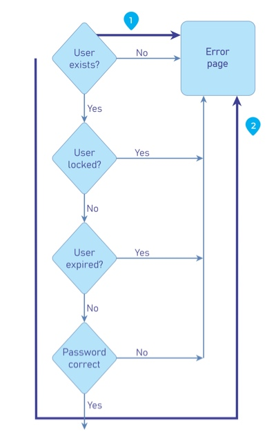

# Temporización de procesos

|ID          |
|------------|
|WSTG-BUSL-04|

## Resumen

Es posible que los atacantes recopilen información sobre una aplicación al supervisar el tiempo que tarda en completar una tarea o dar una respuesta. Además, los atacantes podrían manipular e interrumpir los flujos de procesos de negocio diseñados simplemente manteniendo abiertas las sesiones activas y sin enviar sus transacciones dentro del plazo «esperado».

Las vulnerabilidades de la lógica de temporización de procesos son particulares porque estos casos de uso indebido manuales deben crearse teniendo en cuenta los tiempos de ejecución y de transacción específicos de la aplicación o el sistema.

El tiempo de procesamiento puede proporcionar o filtrar información sobre lo que se está haciendo en los procesos en segundo plano de la aplicación o el sistema. Si una aplicación permite a los usuarios adivinar cuál será el siguiente resultado concreto a partir de las variaciones en el tiempo de procesamiento, podrán ajustarse en consecuencia y cambiar su comportamiento según sus expectativas para «manipular el sistema».

### Ejemplo 1

Las máquinas tragamonedas de video pueden tardar más en procesar una transacción justo antes de un gran premio. Esto permitiría a los jugadores astutos apostar cantidades mínimas hasta que observen un tiempo de procesamiento prolongado, lo que los llevaría a apostar la cantidad máxima.

### Ejemplo 2

Muchos procesos de inicio de sesión en sistemas solicitan el nombre de usuario y la contraseña. Si se observa con atención, es posible que ingresar un nombre de usuario no válido y una contraseña no válida tarde más en devolver un error que ingresar un nombre de usuario válido y una contraseña no válida. Esto podría permitir al atacante saber si tiene un nombre de usuario válido sin tener que depender del mensaje de la interfaz gráfica.

Puede presentarse un problema similar en la funcionalidad de restablecimiento de contraseña, que enviaría al usuario un correo electrónico con un enlace o código para recuperar la contraseña, ya que enviar correos electrónicos puede ser significativamente más lento que simplemente devolver la respuesta HTTP.

\
*Figura 4.10.4-1: Ejemplo de flujo de control de un formulario de inicio de sesión*

### Ejemplo 3

La mayoría de los estadios o las agencias de viajes tienen aplicaciones de venta de entradas que permiten a los usuarios comprar entradas y reservar asientos. Cuando el usuario solicita las entradas, los asientos que elige se bloquean o se reservan hasta que se realice el pago. ¿Qué sucede si un atacante sigue reservando asientos, pero no finaliza la compra? ¿Se liberarán los asientos o no se venderán entradas? Algunos vendedores de entradas ahora solo permiten a los usuarios 5 minutos para completar una transacción; de lo contrario, la transacción se invalida.

### Ejemplo 4

Supongamos que un sitio de comercio electrónico de metales preciosos permite a los usuarios realizar compras con una cotización basada en el precio de mercado en el momento de iniciar sesión. ¿Qué sucede si un atacante inicia sesión y realiza un pedido, pero no completa la transacción hasta más tarde ese mismo día, y solo lo hace si el precio de los metales sube? ¿Obtendrá el atacante el precio inicial más bajo?

## Objetivos de prueba

- Revisar la documentación del proyecto para identificar funcionalidades del sistema que podrían verse afectadas por el tiempo.
- Desarrollar y ejecutar casos de uso indebido.

## Cómo probar

El evaluador debe identificar qué procesos dependen del tiempo, ya sea porque hay un plazo para completar una tarea o porque el tiempo de ejecución entre dos procesos podría permitir eludir ciertos controles.

A continuación, es recomendable automatizar las solicitudes que abusarán de los procesos identificados, ya que las herramientas son más adecuadas para analizar la temporización y son más precisas que las pruebas manuales. Si esto no es posible, también se pueden realizar pruebas manuales.

El evaluador debe dibujar un diagrama del flujo del proceso y de los puntos de inyección, y preparar las solicitudes con antelación para dirigirlas a los procesos vulnerables. Una vez hecho esto, debe realizarse un análisis minucioso para identificar diferencias en la ejecución del proceso y determinar si este se comporta de forma contraria a la lógica de negocio acordada.

## Casos de prueba relacionados

- [Atributos de las cookies](../06-Session_Management/02-Cookies_Attributes.md)
- [Probar el tiempo de espera de la sesión](../06-Session_Management/07-Session_Timeout.md)

## Remediación

Desarrollar aplicaciones teniendo en cuenta el tiempo de procesamiento. Si los atacantes pudieran obtener algún tipo de ventaja al conocer las diferencias en los tiempos de procesamiento y los resultados, se deben añadir pasos o procesamiento adicionales para que, independientemente de los resultados, estos se proporcionen en el mismo plazo.

Además, la aplicación o el sistema debe contar con mecanismos para impedir que los atacantes prolonguen las transacciones más allá de un periodo «aceptable». Esto puede hacerse cancelando o restableciendo las transacciones una vez transcurrido un plazo determinado, como hacen actualmente algunos vendedores de entradas.