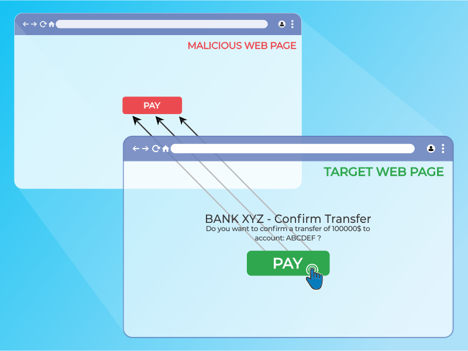
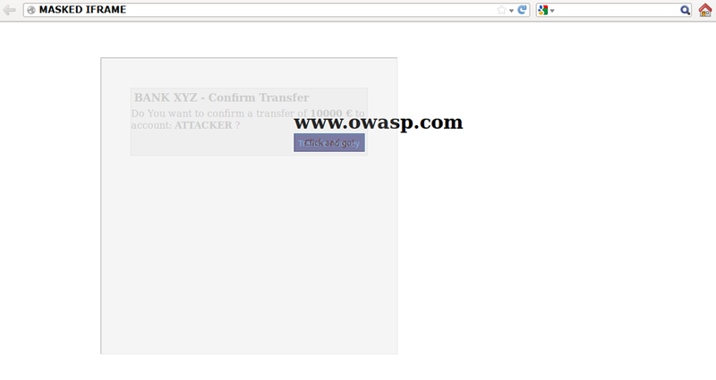

# Pruebas de clickjacking

|ID          |
|------------|
|WSTG-CLNT-09|

## Resumen

El clickjacking, un subconjunto de la manipulación de la interfaz de usuario (UI redressing), es una técnica maliciosa mediante la cual se engaña a un usuario web para que interactúe (en la mayoría de los casos, haciendo clic) con algo distinto de aquello con lo que cree estar interactuando. Este tipo de ataque, ya sea por sí solo o en combinación con otros ataques, podría enviar comandos no autorizados o revelar información confidencial mientras la víctima interactúa con páginas web aparentemente inofensivas. El término clickjacking fue acuñado por Jeremiah Grossman y Robert Hansen en 2008.

Un ataque de clickjacking usa características aparentemente inofensivas de HTML y JavaScript para obligar a la víctima a realizar acciones no deseadas, como hacer clic en un botón invisible que ejecuta una operación no prevista. Este es un problema de seguridad del lado del cliente que afecta a diversos navegadores y plataformas.

Para llevar a cabo este ataque, un atacante crea una página web aparentemente inofensiva que carga la aplicación objetivo mediante un marco en línea (oculto con código CSS). Una vez hecho esto, el atacante puede inducir a la víctima a interactuar con la página web por otros medios (por ejemplo, mediante ingeniería social). Como en otros ataques, un requisito común es que la víctima esté autenticada en la aplicación objetivo del atacante.

\
*Figura 4.11.9-1: Ilustración de marco en línea de clickjacking*

La víctima navega por la página web del atacante con la intención de interactuar con la interfaz de usuario visible, pero, sin darse cuenta, realiza acciones en la página web oculta. Mediante la página oculta, un atacante puede engañar a los usuarios para que realicen acciones que nunca tuvieron intención de realizar, colocando elementos ocultos en la página web.

\
*Figura 4.11.9-2: Ilustración de marco en línea enmascarado*

La eficacia de este método radica en que las acciones realizadas por la víctima se originan en la página web objetivo, oculta pero auténtica. En consecuencia, podrían eludirse algunas de las protecciones anti-CSRF implementadas por los desarrolladores para proteger la página web frente a ataques CSRF.

## Objetivos de la prueba

- Evaluar la vulnerabilidad de la aplicación a los ataques de clickjacking.

## Cómo probar

Como se mencionó anteriormente, este tipo de ataque suele diseñarse para que un atacante pueda inducir a los usuarios a realizar acciones en el sitio objetivo, incluso si se utilizan tokens anti-CSRF.

### Cargar la página web objetivo en un intérprete HTML mediante la etiqueta iframe de HTML

Los sitios que no están protegidos contra el escape de marcos (frame busting) son vulnerables a los ataques de clickjacking. Si la página web `https://www.target.site` se carga correctamente en un marco, el sitio es vulnerable al clickjacking. En el siguiente fragmento se muestra un ejemplo de código HTML para crear esta página web de prueba:

```htmls
    <html>
        <head>
            <title>Clickjack test web page</title>
        </head>
        <body>
            <iframe src="https://www.target.site" width="400" height="400"></iframe>
        </body>
    </html>
```

### Probar la aplicación con JavaScript deshabilitado

Dado que este tipo de protecciones del lado del cliente depende del código JavaScript para escapar de los marcos (frame busting), si la víctima tiene JavaScript deshabilitado o si un atacante puede deshabilitar el código JavaScript, la página web no tendrá ningún mecanismo de protección contra el clickjacking.

Hay pocas técnicas de desactivación que puedan usarse con marcos. En la [Hoja de referencia de defensa contra clickjacking](https://cheatsheetseries.owasp.org/cheatsheets/Clickjacking_Defense_Cheat_Sheet.html) se describen técnicas más detalladas.

### Atributo sandbox

Con HTML5 está disponible un nuevo atributo llamado "sandbox". Este permite aplicar un conjunto de restricciones al contenido cargado en el iframe.

Ejemplo:

```html
<iframe src="https://example.org" sandbox></iframe>
```

### Probar la aplicación en modos de compatibilidad y accesibilidad

Las versiones móviles de la página web suelen ser más pequeñas y rápidas que las de escritorio, y deben ser menos complejas que la aplicación principal. Las variantes móviles suelen tener menos protección. Sin embargo, un atacante puede falsificar el origen real que indica un navegador web, y una víctima que no use un dispositivo móvil podría visitar una aplicación diseñada para usuarios móviles. Este escenario podría permitir al atacante explotar una versión móvil de la página web.

También se deben probar contra el clickjacking las aplicaciones que se ejecutan en modo de accesibilidad, ya que el enmarcado del sitio podría verse afectado.

### Protección del lado del servidor: usar la directiva frame-ancestors de Content Security Policy

El encabezado de respuesta HTTP Content-Security-Policy (CSP) permite a los administradores de páginas web controlar los recursos que el agente de usuario puede cargar para una página web determinada. La directiva `frame-ancestors` de la CSP HTTP especifica los orígenes permitidos que pueden incrustar una página web mediante las etiquetas `<frame>`, `<iframe>`, `<object>`, `<embed>` o `<applet>`.

#### Encabezado de respuesta Content Security Policy

- Con un navegador, abrir las herramientas de desarrollo y acceder a la página web objetivo. Ir a la pestaña Network.
- Buscar la solicitud que carga la página web. Debe tener el mismo dominio que la página web; por lo general, es el primer elemento de la pestaña Network.
- Al hacer clic en el archivo, aparecerá más información. Buscar un código de respuesta 200 OK.
- Desplazarse hacia abajo hasta la sección Response Header. La sección Content-Security-Policy indica el nivel de protección implementado.

Como alternativa, consultar el código fuente de la página web para encontrar Content-Security-Policy en una etiqueta meta. WSTG contiene información detallada sobre [Content Security Policy](../02-Configuration_and_Deployment_Management/12-Content_Security_Policy.md).

##### Proxies

Se sabe que los proxies web añaden y eliminan encabezados. Si un proxy web elimina el encabezado `X-FRAME-OPTIONS`, el sitio pierde su protección contra el enmarcado.

##### Versión móvil de la aplicación

En este caso, dado que el encabezado HTTP `X-FRAME-OPTIONS` debe implementarse en cada página de la aplicación, es posible que los desarrolladores no hayan protegido todas las páginas de la versión móvil.

### Remediación

- Para conocer medidas de prevención del clickjacking, consulta la [Hoja de referencia de defensa contra clickjacking](https://cheatsheetseries.owasp.org/cheatsheets/Clickjacking_Defense_Cheat_Sheet.html).
- Para acceder a laboratorios interactivos sobre clickjacking, visita [la página web de PortSwigger](https://portswigger.net/web-security/clickjacking)
- Para consultar recursos adicionales sobre clickjacking, visita la [comunidad de OWASP](https://owasp.org/www-community/attacks/Clickjacking)

## Referencias

- [Clickjacking de OWASP](https://owasp.org/www-community/attacks/Clickjacking)
- [Clickjacking en Wikipedia](https://en.wikipedia.org/wiki/Clickjacking)
- [Gustav Rydstedt, Elie Bursztein, Dan Boneh y Collin Jackson: "Busting Frame Busting: a Study of Clickjacking Vulnerabilities on Popular Sites"](https://seclab.stanford.edu/websec/framebusting/framebust.pdf)