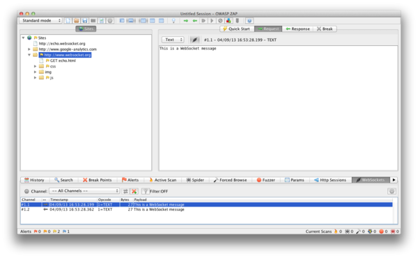
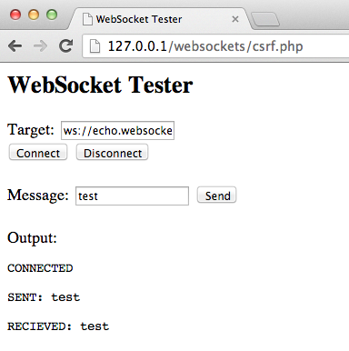

# WebSockets

|ID          |
|------------|
|WSTG-CLNT-10|

## Resumen

Tradicionalmente, el protocolo HTTP solo permite una solicitud/respuesta por conexión TCP. Asynchronous JavaScript and XML (AJAX) permite a los clientes enviar y recibir datos de forma asíncrona (en segundo plano, sin actualizar la página) al servidor; sin embargo, AJAX requiere que el cliente inicie las solicitudes y espere las respuestas del servidor (semidúplex).

[WebSockets](https://html.spec.whatwg.org/multipage/web-sockets.html#network) permiten al cliente o al servidor crear un canal de comunicación «full-duplex» (bidireccional), lo que permite que el cliente y el servidor se comuniquen de forma verdaderamente asíncrona. WebSockets realizan el *handshake* inicial de *upgrade* sobre HTTP y, a partir de entonces, toda la comunicación se lleva a cabo mediante tramas a través de canales TCP. Para obtener más información, consulta el [Protocolo WebSocket](https://tools.ietf.org/html/rfc6455).

### Origen

Es responsabilidad del servidor verificar el [encabezado `Origin`](https://developer.mozilla.org/en-US/docs/Web/HTTP/Reference/Headers/Origin) en el *handshake* HTTP inicial de WebSocket. Si el servidor no valida el encabezado de origen en el *handshake* inicial de WebSocket, el servidor WebSocket podría aceptar conexiones de cualquier origen. Esto podría permitir que los atacantes se comuniquen con el servidor WebSocket entre dominios, lo que podría dar lugar a problemas similares a CSRF. Consulta también [A01:2025 Control de acceso roto](https://owasp.org/Top10/2025/A01_2025-Broken_Access_Control/). La explotación de esta debilidad se denomina Cross-Site WebSocket Hijacking (CSWH o CSWSH).

### Confidencialidad e integridad

WebSockets se pueden usar sobre TCP sin cifrar o sobre TLS cifrado. Para usar WebSockets sin cifrar, se utiliza el esquema de URI `ws://` (puerto predeterminado 80); para usar WebSockets cifrados (TLS), se utiliza el esquema de URI `wss://` (puerto predeterminado 443). Consulta también [A04:2025 Fallos criptográficos](https://owasp.org/Top10/2025/A04_2025-Cryptographic_Failures/).

### Saneamiento de entradas

Como ocurre con cualquier dato que se origina en fuentes no confiables, los datos deben sanearse y codificarse correctamente. Consulta también [A05:2025 Inyección](https://owasp.org/Top10/2025/A05_2025-Injection/) (incluye XSS).

## Objetivos de las pruebas

- Identificar el uso de WebSockets.
- Evaluar su implementación mediante las mismas pruebas que se aplican a los canales HTTP normales.

## Cómo realizar las pruebas

### Pruebas de caja negra

1. Identificar si la aplicación utiliza WebSockets.
   - Inspeccionar el código fuente del lado del cliente para buscar el esquema de URI `ws://` o `wss://`.
   - Usar las herramientas para desarrolladores de Google Chrome para ver la comunicación WebSocket en la pestaña Network.
   - Usar la pestaña WebSocket de [ZAP](https://www.zaproxy.org).
2. Origen.
   - Usar un cliente WebSocket (se puede encontrar uno en la sección Herramientas más adelante) e intentar conectarse al servidor WebSocket remoto. Si se establece una conexión, es posible que el servidor no compruebe el encabezado de origen del *handshake* de WebSocket.
3. Confidencialidad e integridad.
   - Comprobar que la conexión WebSocket usa TLS para transportar información confidencial `wss://`.
   - Comprobar la implementación de HTTPS para detectar problemas de seguridad (certificado válido, BEAST, CRIME, RC4, etc.). Consulta la sección [Seguridad débil de la capa de transporte](../09-Weak_Cryptography/01-Weak_Transport_Layer_Security.md) de esta guía.
4. Autenticación.
   - WebSockets no gestionan la autenticación; se deben realizar las pruebas habituales de autenticación de caja negra. Consulta las secciones [Pruebas de autenticación](../04-Authentication/README.md) de esta guía.
5. Autorización.
   - WebSockets no gestionan la autorización; se deben realizar las pruebas habituales de autorización de caja negra. Consulta las secciones [Pruebas de autorización](../05-Authorization/README.md) de esta guía.
6. Saneamiento de entradas.
   - Usar la pestaña WebSocket de [ZAP](https://www.zaproxy.org) para reproducir y aplicar fuzzing a las solicitudes y respuestas de WebSocket. Consulta la sección [Pruebas de inyección](../07-Injection/README.md) de esta guía.

#### Ejemplo 1

Una vez que hayamos identificado que la aplicación utiliza WebSockets (como se describe anteriormente), podemos usar [Zed Attack Proxy (ZAP)](https://www.zaproxy.org) para interceptar las solicitudes y respuestas de WebSocket. Después, se puede usar ZAP para reproducir las solicitudes y respuestas de WebSocket y aplicarles fuzzing.

\
*Figura 4.11.10-1: ZAP WebSockets*

#### Ejemplo 2

Usar un cliente WebSocket (se puede encontrar uno en la sección Herramientas más adelante) e intentar conectarse al servidor WebSocket remoto. Si se permite la conexión, es posible que el servidor WebSocket no compruebe el encabezado de origen del *handshake* de WebSocket. Intentar reproducir solicitudes interceptadas previamente para verificar que es posible la comunicación WebSocket entre dominios.

\
*Figura 4.11.10-2: Cliente WebSocket*

### Pruebas de caja gris

Las pruebas de caja gris son similares a las pruebas de caja negra. En las pruebas de caja gris, el pentester tiene conocimiento parcial de la aplicación. La única diferencia en este caso es que podrías tener documentación de la API de la aplicación que se está probando, la cual incluye las solicitudes y respuestas de WebSocket esperadas.

## Herramientas

- [Zed Attack Proxy (ZAP)](https://www.zaproxy.org)
- [Cliente WebSocket](https://github.com/ethicalhack3r/scripts/blob/master/WebSockets.html)

## Referencias

- [HTML5 Rocks - Introducción a WebSockets: llevar los sockets a la Web](https://web.dev/articles/websockets-basics)
- [W3C - La API de WebSocket](https://html.spec.whatwg.org/multipage/web-sockets.html#network)
- [IETF - El protocolo WebSocket](https://tools.ietf.org/html/rfc6455)
- [CWE-1385: Falta de validación del origen en WebSockets](https://cwe.mitre.org/data/definitions/1385.html)
- [Christian Schneider - Secuestro de WebSocket entre sitios (CSWSH)](https://www.christian-schneider.net/blog/cross-site-websocket-hijacking/)
- [Robert Koch- Sobre WebSockets en las pruebas de penetración](https://repositum.tuwien.at/retrieve/21955)
- [DigiNinja - ZAP y WebSockets](https://digi.ninja/blog/zap_web_sockets.php)