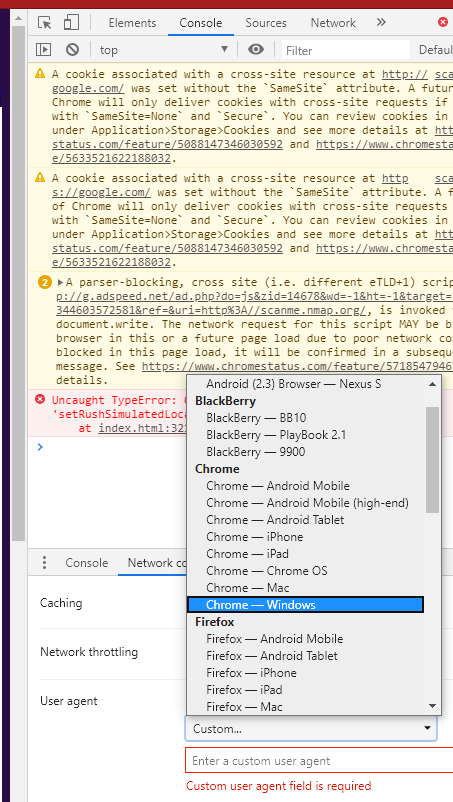
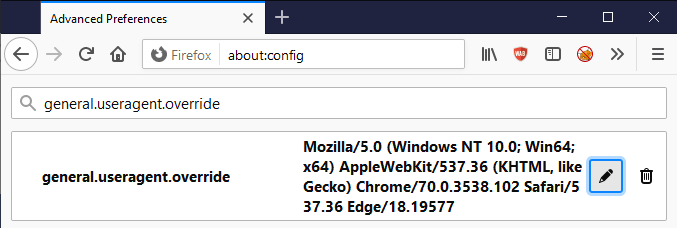
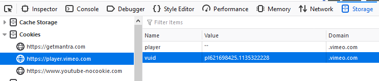
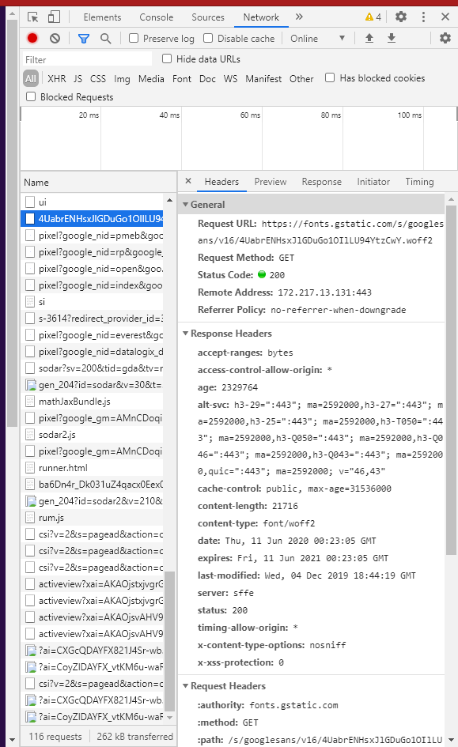
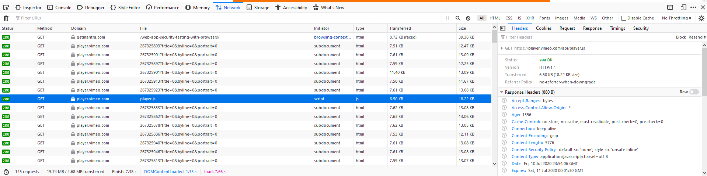
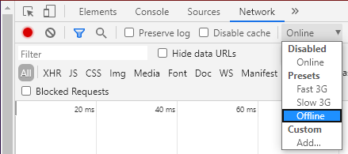
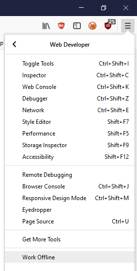
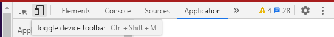
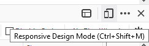

# F. Aprovechar las herramientas de desarrollo {#leveraging-dev-tools}

Este apéndice describe varios aspectos del uso de las funciones de las herramientas de desarrollo integradas en el navegador para ayudar en las actividades de pruebas de seguridad.

Obviamente, las funciones integradas en el navegador no sustituyen a las herramientas DAST (pruebas dinámicas de seguridad de aplicaciones), las herramientas SAST (pruebas estáticas de seguridad de aplicaciones) ni a la experiencia de quien realiza las pruebas. Sin embargo, pueden aprovecharse para algunas actividades de pruebas y tareas relacionadas con la elaboración de informes.

## Acceder a las herramientas de desarrollo

Las herramientas de desarrollo se pueden abrir de varias maneras.

1. Mediante el atajo de teclado `F12`.
2. Mediante el atajo de teclado `ctrl` + `shift` + `i` en Windows.
3. Mediante el atajo de teclado `cmd` + `option` + `i` en Mac.
4. Mediante el menú contextual que aparece al hacer clic con el botón derecho en la página web y seleccionar `Inspeccionar` en Google Chrome.
5. Mediante el menú contextual que aparece al hacer clic con el botón derecho en la página web y seleccionar `Inspeccionar elemento` en Mozilla Firefox.
6. Mediante el menú de tres puntos ('kabob') de Google Chrome; luego, seleccionando `Más herramientas` y, después, `Herramientas para desarrolladores`.
7. Mediante el menú de tres líneas ('hamburguesa' o 'panqueque') de Mozilla Firefox; luego, seleccionando `Desarrollador web` y, después, `Alternar herramientas`.

> NOTA: La mayoría de las instrucciones siguientes presuponen que las herramientas de desarrollo ya están abiertas o activas.

## Capacidades

| Funcionalidad         | Chrome* | Firefox | Safari |
|-----------------------|:-------:|:-------:|:------:|
| Cambiar User-Agent    | Y       | Y       | Y      |
| Editar/Reenviar solicitudes | Y       | Y       | N      |
| Editar cookies        | Y       | Y       | N      |
| Editar almacenamiento local | Y       | Y       | N      |
| Deshabilitar CSS      | Y       | Y       | Y      |
| Deshabilitar JavaScript | Y       | Y       | Y      |
| Ver encabezados HTTP  | Y       | Y       | Y      |
| Capturas de pantalla  | Y       | Y       | N      |
| Modo sin conexión     | Y       | Y       | N      |
| Codificación y decodificación | Y       | Y       | Y      |
| Modo de diseño adaptable | Y       | Y       | Y      |

`*` Todo lo que se aplique a Google Chrome debería aplicarse a todas las aplicaciones basadas en Chromium. (Esto incluye el cambio de marca de Microsoft Edge alrededor de 2019/2020).

## Cambiar el User-Agent

### Pruebas relacionadas

- [Debilidades de la caché del navegador](../4-Web_Application_Security_Testing/04-Authentication/06-Browser_Cache_Weaknesses.md)

### Google Chrome

1. Haz clic en el menú de tres puntos ('kabob') del lado derecho del panel de herramientas de desarrollo, selecciona `Más herramientas` y, luego, `Condiciones de red`.
2. Desmarca la casilla «Seleccionar automáticamente».
3. Selecciona el user agent en el menú desplegable o introduce un user agent personalizado.

\
*Figura 6.F-1: Función para cambiar el User-Agent en las herramientas de desarrollo de Google Chrome*

### Mozilla Firefox

1. Ve a la página `about:config` de Firefox y haz clic en `¡Acepto el riesgo!`.
2. Introduce `general.useragent.override` en el campo de búsqueda.
3. Busca `general.useragent.override`. Si no encuentras esta preferencia, busca una que muestre un conjunto de botones de opción `Boolean, Number, String`; selecciona `String` y, luego, haz clic en el botón con el signo más `Add` de la página `about:config`.
4. Establece el valor de `general.useragent.override` en el [User-Agent](https://developers.whatismybrowser.com/useragents/explore/) que necesites.

\
*Figura 6.F-2: Función para cambiar el User-Agent en Mozilla Firefox*

Después, haz clic en el botón de la papelera `Delete`, a la derecha de la preferencia `general.useragent.override`, para eliminar la sobrescritura y volver al user agent predeterminado.

## Editar/Reenviar solicitudes

### Pruebas relacionadas

- [Pruebas de autenticación](../4-Web_Application_Security_Testing/04-Authentication/README.md)
- [Pruebas de autorización](../4-Web_Application_Security_Testing/05-Authorization/README.md)
- [Pruebas de gestión de sesiones](../4-Web_Application_Security_Testing/06-Session_Management/README.md)
- [Pruebas de inyección](../4-Web_Application_Security_Testing/07-Injection/README.md)
- [Pruebas de lógica de negocio](../4-Web_Application_Security_Testing/10-Business_Logic/README.md)

### Mozilla Firefox

1. Selecciona la pestaña `Red`.
2. Realiza cualquier acción en la aplicación web.
3. Haz clic con el botón derecho en la solicitud HTTP de la lista y selecciona `Editar y reenviar`.
4. Realiza las modificaciones deseadas y haz clic en el botón `Enviar`.
5. Haz clic con el botón derecho en la solicitud modificada y selecciona `Abrir en una pestaña nueva`.

### Google Chrome

1. Selecciona la pestaña `Red`.
2. Realiza cualquier acción en la aplicación web.
3. Haz clic con el botón derecho en la solicitud HTTP de la lista y selecciona `Copiar > Copiar como fetch`.
4. Pega el código JavaScript proporcionado en la pestaña `Consola`.
5. Realiza las modificaciones necesarias y, luego, presiona Intro para enviar la solicitud.

## Editar cookies

### Pruebas relacionadas

- [Pruebas de autenticación](../4-Web_Application_Security_Testing/04-Authentication/README.md)
- [Pruebas de autorización](../4-Web_Application_Security_Testing/05-Authorization/README.md)
- [Pruebas de gestión de sesiones](../4-Web_Application_Security_Testing/06-Session_Management/README.md)
- [Atributos de las cookies](../4-Web_Application_Security_Testing/06-Session_Management/02-Cookies_Attributes.md)

### Google Chrome

1. Haz clic en la pestaña `Aplicación`.
2. Despliega `Cookies` bajo el encabezado `Almacenamiento`.
3. Selecciona el nombre de dominio correspondiente.
4. Haz doble clic en la columna `Valor` para editar el valor de cualquier cookie.

> Nota: Puedes eliminar las cookies seleccionadas presionando la tecla `delete` o mediante el menú contextual que aparece al hacer clic con el botón derecho.

### Mozilla Firefox

1. Haz clic en la pestaña `Almacenamiento`.
2. Despliega la sección `Cookies`.
3. Selecciona el nombre de dominio correspondiente.
4. Haz doble clic en la columna `Valor` para editar el valor de cualquier cookie.

> Nota: Puedes eliminar las cookies seleccionadas presionando la tecla `delete` o mediante las distintas opciones del menú contextual que aparece al hacer clic con el botón derecho.

\
*Figura 6.F-3: Función para editar cookies en Mozilla Firefox*

## Editar el almacenamiento local

### Pruebas relacionadas

- [Pruebas del almacenamiento del navegador](../4-Web_Application_Security_Testing/11-Client-side/12-Browser_Storage.md)

### Google Chrome

1. Haz clic en la pestaña `Aplicación`.
2. Despliega `Almacenamiento local` bajo el encabezado `Almacenamiento`.
3. Selecciona el nombre de dominio correspondiente.
4. Haz doble clic en la columna `Valor` para editar el valor de cualquier cookie.
5. Haz doble clic en la celda correspondiente para editar la `Clave` o el `Valor`.

> Nota: Para editar `Almacenamiento de sesión` o `Index DB`, se siguen esencialmente los mismos pasos.
>
> Nota: Se pueden agregar o eliminar elementos mediante el menú contextual que aparece al hacer clic con el botón derecho.

### Mozilla Firefox

1. Haz clic en la pestaña `Almacenamiento`.
2. Despliega la sección `Almacenamiento local`.
3. Selecciona el nombre de dominio correspondiente.
4. Haz doble clic en la celda correspondiente para editar la `Clave` o el `Valor`.

> Nota: Para editar `Almacenamiento de sesión` o `Index DB`, se siguen esencialmente los mismos pasos.
>
> Nota: Se pueden agregar o eliminar elementos mediante el menú contextual que aparece al hacer clic con el botón derecho.

## Deshabilitar CSS

### Pruebas relacionadas

- [Manipulación de recursos del lado del cliente](../4-Web_Application_Security_Testing/11-Client-side/06-Client-side_Resource_Manipulation.md)

### General

Todos los navegadores principales permiten manipular CSS mediante la consola de las herramientas de desarrollo y la funcionalidad de JavaScript:

- Para eliminar todas las hojas de estilo externas: `$('style,link[rel="stylesheet"]').remove();`
- Para eliminar todas las hojas de estilo internas: `$('style').remove();`
- Para eliminar todos los estilos en línea: `Array.prototype.forEach.call(document.querySelectorAll('*'),function(el){el.removeAttribute('style');});`
- Para eliminar todo el contenido de la etiqueta head: `$('head').remove();`

## Deshabilitar JavaScript

### Google Chrome

1. Haz clic en el menú de tres puntos ('kabob') del lado derecho de la barra de herramientas para desarrolladores web y haz clic en `Configuración`.
2. En la pestaña `Preferencias`, bajo la sección `Depurador`, marca la casilla `Deshabilitar JavaScript`.

### Mozilla Firefox

1. En la pestaña `Depurador` de las herramientas de desarrollo, haz clic en el botón de configuración con el engranaje, en la esquina superior derecha de la barra de herramientas para desarrolladores.
2. Selecciona `Deshabilitar JavaScript` en el menú desplegable (se trata de una opción que habilita o deshabilita JavaScript; cuando JavaScript está deshabilitado, la opción aparece marcada).

## Ver encabezados HTTP

### Pruebas relacionadas

- [Recopilación de información](../4-Web_Application_Security_Testing/01-Information_Gathering/README.md)

### Google Chrome

1. En la pestaña `Red` de las herramientas de desarrollo, selecciona cualquier URL o solicitud.
2. En el panel inferior derecho, selecciona la pestaña `Encabezados`.

\
*Figura 6.F-4: Vista de encabezados en Google Chrome*

### Mozilla Firefox

1. En la pestaña `Red` de las herramientas de desarrollo, selecciona cualquier URL o solicitud.
2. En el panel inferior derecho, selecciona la pestaña `Encabezados`.

\
*Figura 6.F-5: Vista de encabezados en Mozilla Firefox*

## Capturas de pantalla

### Pruebas relacionadas

- [Informes](../5-Reporting/README.md)

### Google Chrome

1. Presiona el botón `Alternar barra de herramientas de dispositivo` o presiona `ctrl` + `shift` + `m`.
2. Haz clic en el menú de tres puntos ('kabob') de la barra de herramientas de dispositivo.
3. Selecciona `Capturar captura de pantalla` o `Capturar captura de pantalla a tamaño completo`.

### Mozilla Firefox

1. Presiona el botón de tres puntos `ellipsis` de la barra de direcciones.
2. Selecciona `Tomar una captura de pantalla`.
3. Selecciona la opción `Guardar página completa` o `Guardar visible`.

## Modo sin conexión

### Google Chrome

1. Ve a la pestaña `Red`.
2. En el menú desplegable `Throttle`, selecciona `Offline`.

\
*Figura 6.F-6: Opción sin conexión en Google Chrome*

### Mozilla Firefox

1. En el menú de tres líneas ('hamburguesa' o 'panqueque'), selecciona `Desarrollador web` y, luego, `Trabajar sin conexión`.

\
*Figura 6.F-7: Opción sin conexión en Mozilla Firefox*

## Codificación y decodificación

### Pruebas relacionadas

- Muchos tipos de [pruebas de seguridad de aplicaciones web](../4-Web_Application_Security_Testing/README.md) (quizá incluso la mayoría) pueden beneficiarse de distintos tipos de codificación.

### General

Todos los navegadores principales permiten codificar y decodificar cadenas de distintas maneras mediante la consola de las herramientas de desarrollo y la funcionalidad de JavaScript:

- Codificación en base64: `btoa("string-to-encode")` y decodificación en base64: `atob("string-to-decode")`: funciones integradas de JavaScript que se utilizan para codificar una cadena en base64 y decodificar una cadena desde base64.
- Codificación de URL: `encodeURIComponent("string-to-encode")` y decodificación de URL: `decodeURIComponent("string-to-decode")`: codifica y decodifica entradas proporcionadas por el usuario que se utilizarán como parte de una URL; codifica todos los caracteres con significado especial en una URL, incluidos los caracteres reservados.
- Codificación de URI: `encodeURI()` y decodificación de URI: `decodeURI()` son funciones que se utilizan para codificar y decodificar una URI completa, como parámetros de consulta, segmentos de ruta o fragmentos. Incluyen los caracteres especiales, pero excluyen los caracteres reservados, como `:/?#[]@!$'()*+,;=`, que tienen significados especiales en una URL.

## Modo de diseño adaptable

### Pruebas relacionadas

- [Debilidades de la caché del navegador](../4-Web_Application_Security_Testing/04-Authentication/06-Browser_Cache_Weaknesses.md)
- [Autenticación más débil en un canal alternativo](../4-Web_Application_Security_Testing/04-Authentication/10-Weaker_Authentication_in_Alternative_Channel.md)
- [Clickjacking](../4-Web_Application_Security_Testing/11-Client-side/09-Clickjacking.md)

### Google Chrome

1. Haz clic en el botón `Alternar barra de herramientas de dispositivo` o presiona `ctrl` + `shift` + `m`.

\
*Figura 6.F-8: Modo de diseño adaptable en Google Chrome*

### Mozilla Firefox

1. Haz clic en el botón `Modo de diseño adaptable` o presiona `ctrl` + `shift` + `m`.

\
*Figura 6.F-9: Modo de diseño adaptable en Mozilla Firefox*

## Referencias

- [Pruebas de seguridad de aplicaciones web con navegadores](https://getmantra.com/web-app-security-testing-with-browsers/)
- [Black Hills Information Security - Webcast: ¡Herramientas gratuitas! Cómo usar las herramientas de desarrollo y JavaScript en pruebas de penetración de aplicaciones web](https://www.blackhillsinfosec.com/webcast-free-tools-how-to-use-developer-tools-and-javascript-in-webapp-pentests/)
- [Greg Malcolm - Chrome Developer Tools: Saqueando el arsenal](https://github.com/gregmalcolm/wacky-wandas-wicked-weapons-frontend/blob/fix-it/README.md)
- [Lista de cadenas de User-Agent](https://techblog.willshouse.com/2012/01/03/most-common-user-agents/)